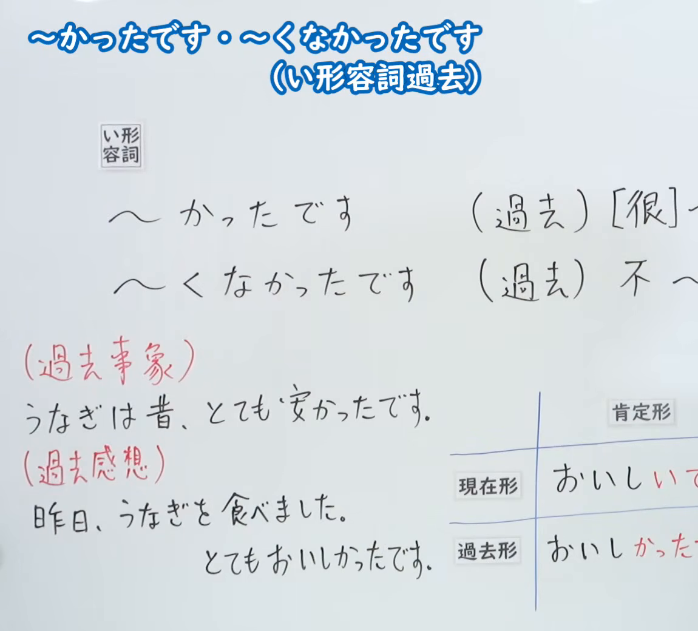
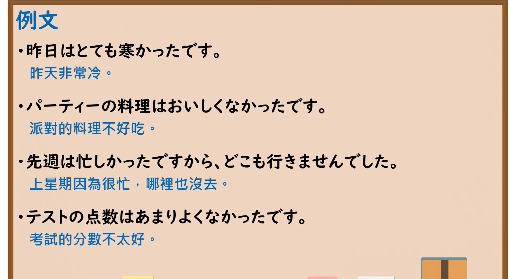

---
{
  "id": "N5-G-0012",
  "kind": "grammar",
  "level": "N5",
  "title": "～かったです・～くなかったです（い形容词过去）",
  "card_revision": 2,
  "schema_version": 1,
  "source": {
    "lesson": "N5 第12个语法",
    "material": "出口日語原视频板书（学习者截取的接续图与例句图）与东京外国语大学「Aかったです／Aくありませんでした／Aくなかったです：解説」正文",
    "video": "https://www.youtube.com/watch?v=NvlZJoSt5mg",
    "screenshot": "assets/grammar/n5/N5-G-0012-connection.png",
    "screenshot_crop": {
      "x": 0,
      "y": 0,
      "width": 1150,
      "height": 1040
    }
  },
  "tags": [
    "かったです",
    "くなかったです",
    "い形容词",
    "过去",
    "N5"
  ],
  "confusions": [
    "かったです",
    "くなかったです",
    "いい／よい",
    "な形容词"
  ]
}
---

# N5 第12个语法：～かったです・～くなかったです

# 视频学习资料整理

- 课程：[出口日語「～かったです・～くなかったです（い形容詞過去）」](https://www.youtube.com/watch?v=NvlZJoSt5mg)
- 视频 ID：`NvlZJoSt5mg`
- 视频时长：6分22秒

## 接续图

- 实际时间：未记录（图片由学习者从原视频截取并提供）
- 成品图尺寸：1150×1040，固定左上角 `(0, 0)`，右下角 `(1150, 1040)`
- 板书内容：标题「～かったです・～くなかったです（い形容詞過去）」（两行）；「い形容詞」标签后接「～かったです」对应“（過去）[很]～”，「～くなかったです」对应“（過去）不～”（右端被画面边缘截断）；左下红字「（過去事象）」配「うなぎは昔、とても安かったです。」，「（過去感想）」配「昨日、うなぎを食べました。とてもおいしかったです。」；右下「現在形／過去形」表格（おいしいです／おいしかったです）右半部被画面右缘截断，未补写。

## 例句图

- 实际时间：未记录（图片由学习者从原视频截取并提供）
- 成品图尺寸：1900×1040，固定左上角 `(0, 0)`，右下角 `(1900, 1040)`
- 板书内容：课程「例文」页，含四条例句及中文翻译（昨日はとても寒かったです／パーティーの料理はおいしくなかったです／先週は忙しかったですから、どこも行きませんでした／テストの点数はあまりよくなかったです）。四条例句均完整可见。

# 核心

## 功能一：（过去）[很]～／（过去）不～

**くわしい意味記述：**

- **Aかったです／Aくありませんでした／Aくなかったです：** 過去の時点でのNの様子や状態について述べるときは、「Aかったです」などの形を使います。（叙述过去某一时点事物的样子或状态时，使用「Aかったです」等形式。）
- **作り方：** 過去形は「Aい」の「い」を「かったです」に変えて作ります。過去の否定の形は、「い」を「くありませんでした」または「くなかったです」に変えて作ります。（过去形是把「Aい」的「い」改为「かったです」；过去否定形是把「い」改为「くありませんでした」或「くなかったです」。）
- **否定形の違い：** 否定形が2つありますが、「くなかったです」は「くありませんでした」に比べてややくだけた言い方です。（否定形有两种，「くなかったです」比「くありませんでした」稍显随意。）
- **「いい」の活用：** イ形容詞「いい」は活用が例外で、過去は「よかったです」、過去否定は「よくありませんでした」「よくなかったです」です。（い形容词「いい」的活用是例外：过去为「よかったです」，过去否定为「よくありませんでした」「よくなかったです」。）

### 例句

1. このかばんは高かったです。

   （这个包很贵。）

2. パーティーの料理はおいしくありませんでした。

   （派对的菜不好吃。）

3. きのうは寒くなかったです。

   （昨天不冷。）

4. A：北海道はどうでしたか。　B：寒かったです。

   （A：北海道怎么样？　B：很冷。）

5. A：きのうの映画はどうでしたか。　B：おもしろくありませんでした。

   （A：昨天的电影怎么样？　B：不有趣。）

# 来源

- [出口日語原视频](https://www.youtube.com/watch?v=NvlZJoSt5mg)
- [东京外国语大学「日本語 文法 Aかったです／Aくありませんでした／Aくなかったです：解説」](https://www.coelang.tufs.ac.jp/mt/ja/gmod/contents/explanation/032.html)（查询日期：2026-10-16；Hagoromo、毎日のんびり日本語教師、日本語NET 均未找到直接对应条目，按流程采用互联网检索所得的该页）
