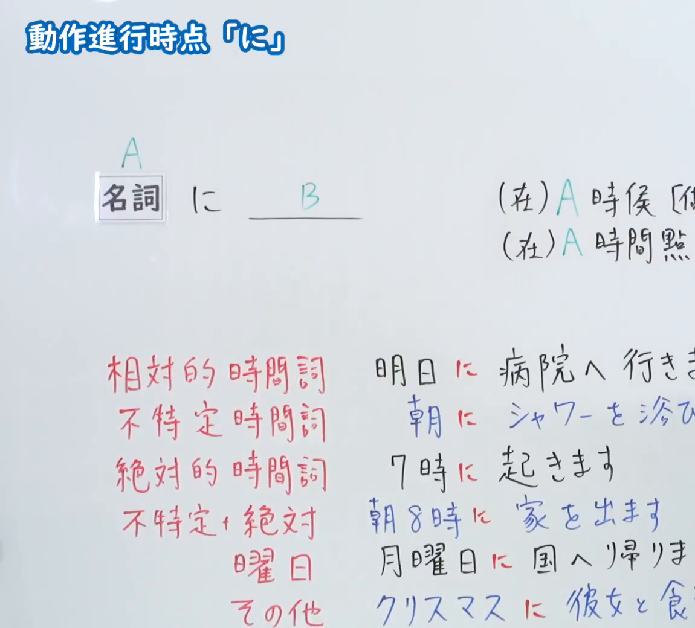
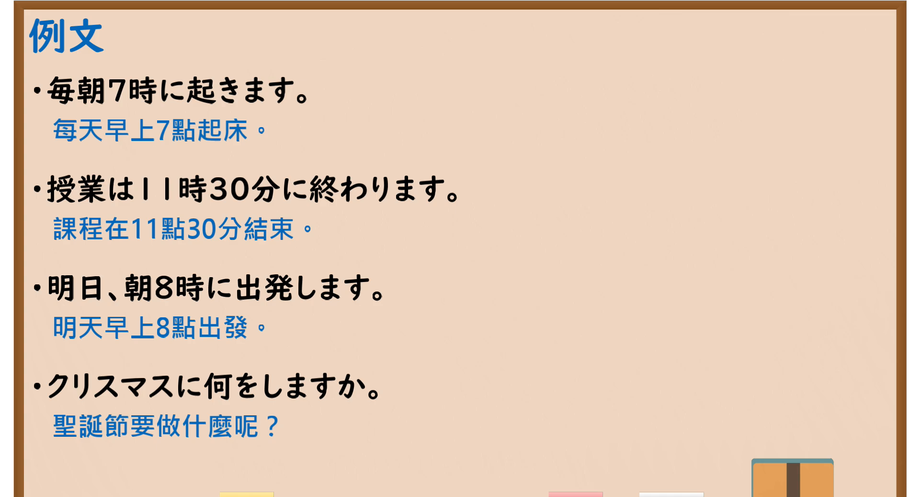

---
{
  "id": "N5-G-0013",
  "kind": "grammar",
  "level": "N5",
  "title": "助词：动作进行时点「に」",
  "card_revision": 2,
  "schema_version": 1,
  "source": {
    "lesson": "N5 第13个语法",
    "material": "出口日語原视频板书（学习者截取的接续图与例句图）与毎日のんびり日本語教師「格助詞「に」の用法一覧」正文",
    "video": "https://www.youtube.com/watch?v=f3LYA54uyVQ",
    "screenshot": "assets/grammar/n5/N5-G-0013-connection.png",
    "screenshot_crop": {
      "x": 0,
      "y": 0,
      "width": 1150,
      "height": 1040
    }
  },
  "tags": [
    "に",
    "助词",
    "时间",
    "N5"
  ],
  "confusions": [
    "时间词＋に",
    "に／で",
    "に／へ",
    "相对时间词",
    "曜日"
  ]
}
---

# N5 第13个语法：助词「に」（动作进行时点）

# 视频学习资料整理

- 课程：[出口日語「助詞：動作進行時点「に」」](https://www.youtube.com/watch?v=f3LYA54uyVQ)
- 视频 ID：`f3LYA54uyVQ`
- 视频时长：9分18秒

## 接续图

- 实际时间：未记录（图片由学习者从原视频截取并提供）
- 成品图尺寸：1150×1040，固定左上角 `(0, 0)`，右下角 `(1150, 1040)`
- 板书内容：标题「動作進行時点「に」」；「名詞A に ＿＿B」，右侧标注“(在)A時候[做…”“(在)A時間點…”（右端被画面边缘截断）；下方按时间词分类的例句：相対的時間詞「明日に病院へ行きま(す)」、不特定時間詞「朝にシャワーを浴び(ます)」、絶対的時間詞「7時に起きます」、不特定＋絶対「朝8時に家を出ます」、曜日「月曜日に国へ帰りま(す)」、その他「クリスマスに彼女と食(事)…」。右侧多处句末被画面右缘截断，未补写。

## 例句图

- 实际时间：未记录（图片由学习者从原视频截取并提供）
- 成品图尺寸：1900×1040，固定左上角 `(0, 0)`，右下角 `(1900, 1040)`
- 板书内容：课程「例文」页，含四条例句及中文翻译（毎朝7時に起きます／授業は11時30分に終わります／明日、朝8時に出発します／クリスマスに何をしますか）。四条例句均完整可见。

# 核心

## 功能一：（在）A时候[做～]；（在）A时间点[做～]

**くわしい意味記述：**

- **時間：** 述語の事態が成立する時間は「に」で表されます。（谓语所表示的事态成立的时间用「に」表示。）

### 例句

1. 明日朝８時に出発する。

   （明天早上八点出发。）

2. １０月に初めて中国に来ました。

   （我十月份第一次来中国。）

3. ６時半に起きる。

   （我会在六点半起床。）

4. 午後に打ち合わせの予定があります。

   （下午有一个会议安排。）

5. 夜には戻ってくるはずだ。

   （预计晚上会回来。）

# 来源

- [出口日語原视频](https://www.youtube.com/watch?v=f3LYA54uyVQ)
- [毎日のんびり日本語教師「格助詞「に」の用法一覧」「時間」](https://mainichi-nonbiri.com/jltct/ni-case-particle/)（查询日期：2026-10-16；Hagoromo 未收录，按流程采用优先级最高的备选网站该页中对应的「時間」小节，中文译文取自该页）
