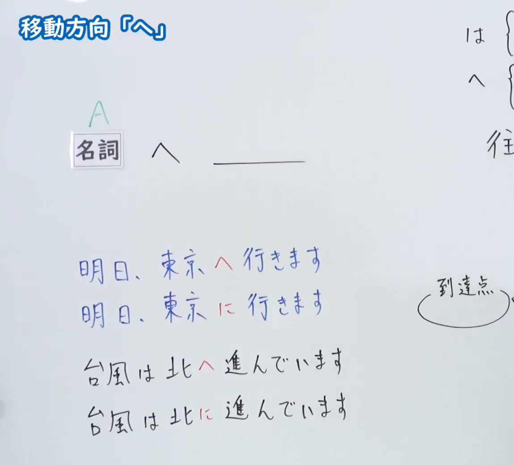
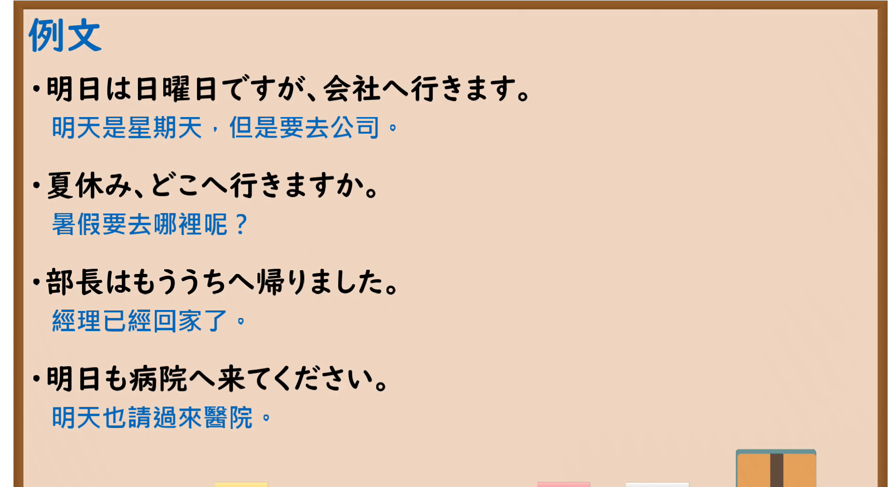

---
{
  "id": "N5-G-0014",
  "kind": "grammar",
  "level": "N5",
  "title": "助词：移动方向「へ」",
  "card_revision": 2,
  "schema_version": 1,
  "source": {
    "lesson": "N5 第14个语法",
    "material": "出口日語原视频板书（学习者截取的接续图与例句图）与毎日のんびり日本語教師「格助詞「へ」の用法一覧」正文",
    "video": "https://www.youtube.com/watch?v=7mccMpVl10E",
    "screenshot": "assets/grammar/n5/N5-G-0014-connection.png",
    "screenshot_crop": {
      "x": 0,
      "y": 0,
      "width": 1150,
      "height": 1040
    }
  },
  "tags": [
    "へ",
    "助词",
    "移动方向",
    "N5"
  ],
  "confusions": [
    "へ的读音",
    "に／へ",
    "到达点",
    "书信收件对象",
    "へも／へは"
  ]
}
---

# N5 第14个语法：助词「へ」

# 视频学习资料整理

- 课程：[出口日語「助詞：移動方向「へ」」](https://www.youtube.com/watch?v=7mccMpVl10E)
- 视频 ID：`7mccMpVl10E`
- 视频时长：5分11秒

## 接续图

- 实际时间：未记录（图片由学习者从原视频截取并提供）
- 成品图尺寸：1150×1040，固定左上角 `(0, 0)`，右下角 `(1150, 1040)`
- 板书内容：标题「移動方向「へ」」；「名詞A へ ＿＿」；例句「明日、東京へ行きます」「明日、東京に行きます」「台風は北へ進んでいます」「台風は北に進んでいます」（へ／に用红字标出以作对比）。右上角「は{」「へ{」及“往…”“到達点”的说明被画面右缘截断，未补写，功能标题中的“往 A”据可见的“往”字推定。

## 例句图

- 实际时间：未记录（图片由学习者从原视频截取并提供）
- 成品图尺寸：1900×1040，固定左上角 `(0, 0)`，右下角 `(1900, 1040)`
- 板书内容：课程「例文」页，含四条例句及中文翻译（明日は日曜日ですが、会社へ行きます／夏休み、どこへ行きますか／部長はもううちへ帰りました／明日も病院へ来てください）。四条例句均完整可见。

# 核心

## 功能一：往 A（表示移动的方向）

**くわしい意味記述：**

- **移動の方向：** 移動を表す動詞が述語にくるとき、その移動の方向を表します。（谓语是表示移动的动词时，表示该移动的方向。）
- **「へ」と「に」：** 「へ」は移動の過程に注目し、「に」は移動の着点に注目します。移動の着点に極端に注目した「に」は「へ」に置き換えられないことがあります。（「へ」关注移动的过程，「に」关注移动的终点。过于强调终点的「に」有时不能换成「へ」。）

### 例句

1. 国慶節に上海へ行く。

   （国庆节时去上海旅行。）

2. 機会があればぜひうちへいらっしゃってください。

   （有机会一定要来我家做客。）

3. 船が港へ向かう。

   （船驶向港口。）

4. 教室へ急ぐ。

   （匆忙赶往教室。）

# 来源

- [出口日語原视频](https://www.youtube.com/watch?v=7mccMpVl10E)
- [毎日のんびり日本語教師「格助詞「へ」の用法一覧」「移動の方向」](https://mainichi-nonbiri.com/jltct/he-case-particle/)（查询日期：2026-10-16；Hagoromo 未收录，按流程采用优先级最高的备选网站该页中对应的「移動の方向」小节，中文译文取自该页）
