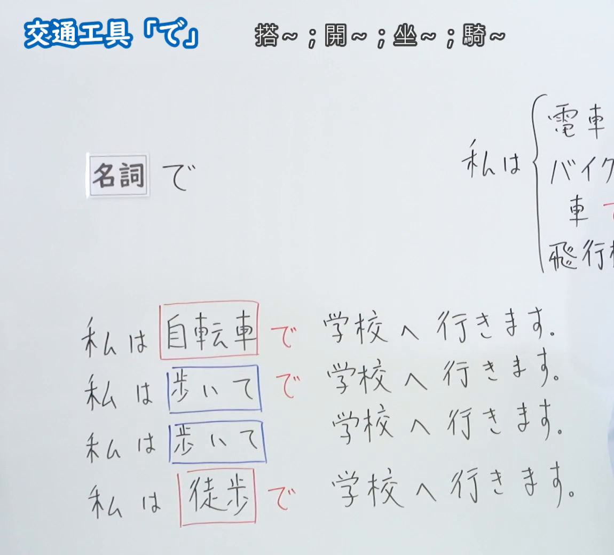
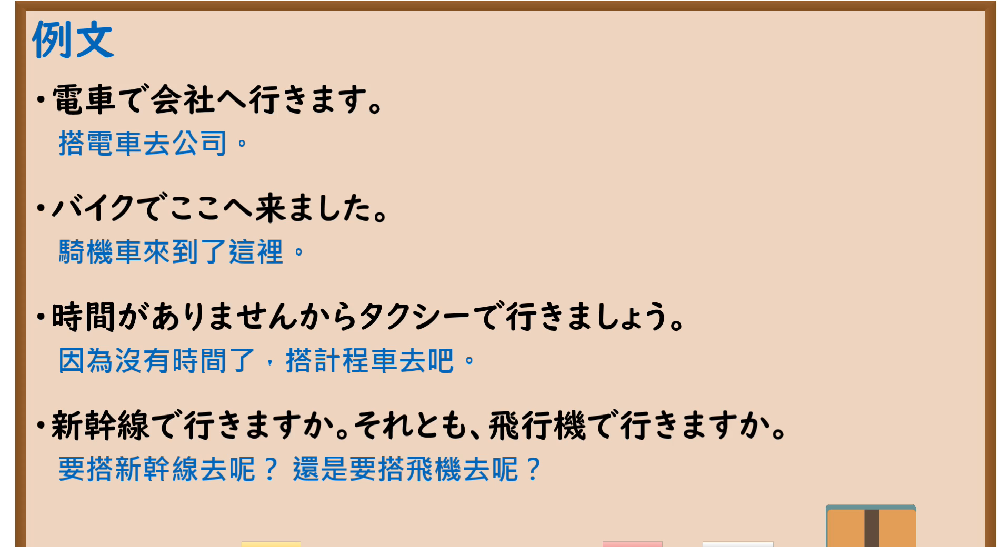

---
{
  "id": "N5-G-0015",
  "kind": "grammar",
  "level": "N5",
  "title": "助词：交通工具「で」",
  "card_revision": 2,
  "schema_version": 1,
  "source": {
    "lesson": "N5 第15个语法",
    "material": "出口日語原视频板书（学习者截取的接续图与例句图）与日本語NET「【JLPT N５】文法・例文：〜で（手段・方法）」正文",
    "video": "https://www.youtube.com/watch?v=Av0xw2N3x0Q",
    "screenshot": "assets/grammar/n5/N5-G-0015-connection.png",
    "screenshot_crop": {
      "x": 0,
      "y": 0,
      "width": 1150,
      "height": 1040
    }
  },
  "tags": [
    "で",
    "助词",
    "交通工具",
    "手段",
    "N5"
  ],
  "confusions": [
    "歩いて／徒歩で",
    "に／で",
    "で的手段与地点",
    "格助词で／连接形で"
  ]
}
---

# N5 第15个语法：助词「で」（交通工具）

# 视频学习资料整理

- 课程：[出口日語「助詞：交通工具「で」」](https://www.youtube.com/watch?v=Av0xw2N3x0Q)
- 视频 ID：`Av0xw2N3x0Q`
- 视频时长：5分53秒

## 接续图

- 实际时间：未记录（图片由学习者从原视频截取并提供）
- 成品图尺寸：1150×1040，固定左上角 `(0, 0)`，右下角 `(1150, 1040)`
- 板书内容：标题「交通工具「で」」，右侧标注“搭～；開～；坐～；騎～”；「名詞 で」；右上括号中列出「電車」「バイク」「車」「飛行機」等（右半部被画面右缘截断）；下方四行：「私は自転車で学校へ行きます」「私は歩いてで学校へ行きます」「私は歩いて学校へ行きます」「私は徒歩で学校へ行きます」，用方框和红字标出名词与「で」。老师在画面右缘露出一部分身影。

## 例句图

- 实际时间：未记录（图片由学习者从原视频截取并提供）
- 成品图尺寸：1900×1040，固定左上角 `(0, 0)`，右下角 `(1900, 1040)`
- 板书内容：课程「例文」页，含四条例句及中文翻译（電車で会社へ行きます／バイクでここへ来ました／時間がありませんからタクシーで行きましょう／新幹線で行きますか。それとも、飛行機で行きますか）。四条例句均完整可见。

# 核心

## 功能一：搭～；开～；坐～；骑～

**くわしい意味記述：**

- **〜で（手段・方法）：** 手段・方法を表す。（表示手段、方法。）本页的「手段・方法」范围比课程的“交通工具”更宽，例句中含非交通类手段（箸、スマホ等）。

### 例句

1. 自転車で学校に行きます。

   （骑自行车去学校。）

2. タクシーでレストランに行きます。

   （坐出租车去餐厅。）

3. YouTubeで日本語を勉強します。

   （用YouTube学习日语。）

4. 箸でご飯を食べます。

   （用筷子吃饭。）

5. スマホで写真を撮ります。

   （用手机拍照。）

# 来源

- [出口日語原视频](https://www.youtube.com/watch?v=Av0xw2N3x0Q)
- [日本語NET「【JLPT N５】文法・例文：〜で（手段・方法）」](https://nihongokyoshi-net.com/2019/08/13/jlptn5-grammar-de/)（查询日期：2026-10-16；Hagoromo 未收录，毎日のんびり日本語教師的「で」页例句均为工具或方法而无交通工具例句，按优先级采用日本語NET 该条目）
