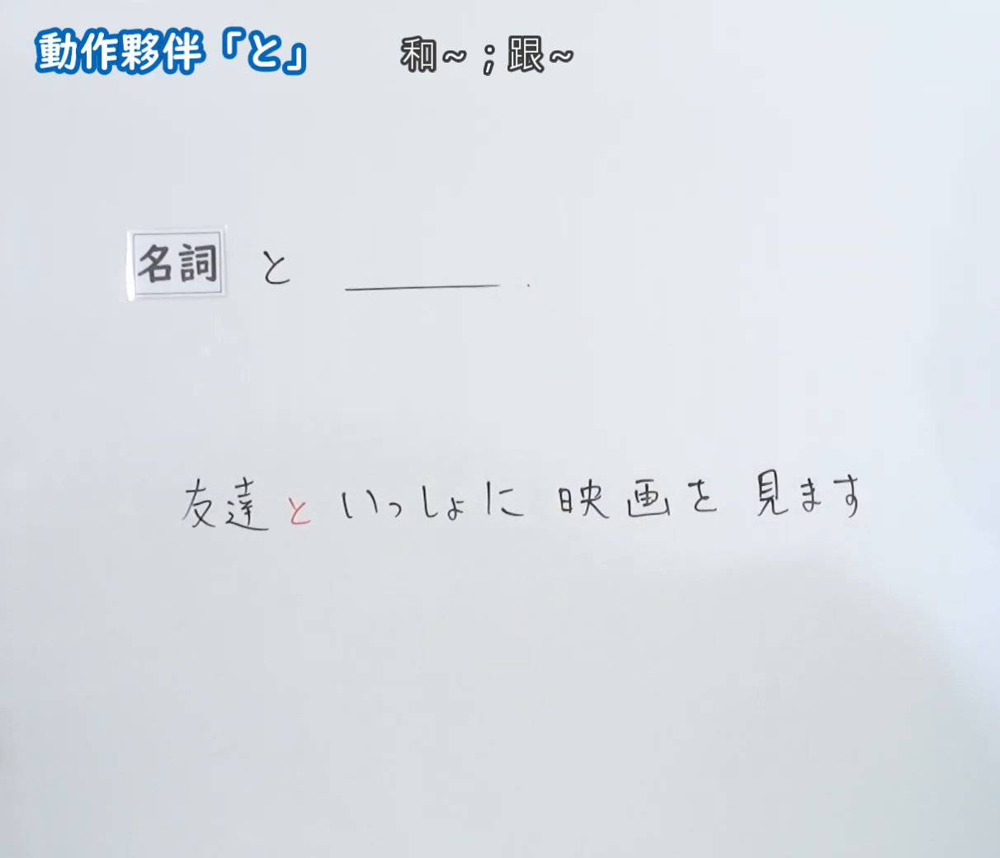
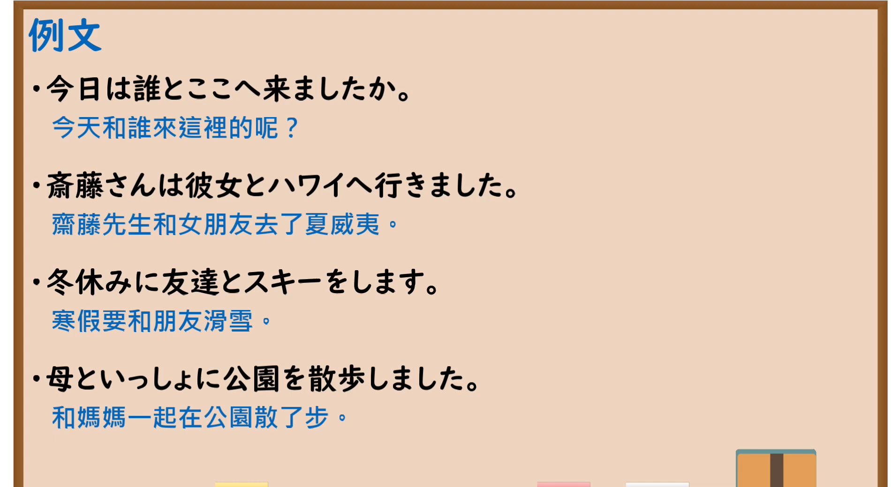

---
{
  "id": "N5-G-0016",
  "kind": "grammar",
  "level": "N5",
  "title": "助词：动作伙伴「と」",
  "card_revision": 2,
  "schema_version": 1,
  "source": {
    "lesson": "N5 第16个语法",
    "material": "出口日語原视频板书（学习者截取的接续图与例句图）与毎日のんびり日本語教師「格助詞「と」の用法一覧」正文",
    "video": "https://www.youtube.com/watch?v=ItL1z0UFV9o",
    "screenshot": "assets/grammar/n5/N5-G-0016-connection.png",
    "screenshot_crop": {
      "x": 0,
      "y": 0,
      "width": 1212,
      "height": 1040
    }
  },
  "tags": [
    "と",
    "助词",
    "动作伙伴",
    "N5"
  ],
  "confusions": [
    "と／といっしょに",
    "共同动作人／关系对象",
    "と／や",
    "并列のと／条件のと",
    "と／に"
  ]
}
---

# N5 第16个语法：助词「と」（动作伙伴）

# 视频学习资料整理

- 课程：[出口日語「助詞：動作夥伴「と」」](https://www.youtube.com/watch?v=ItL1z0UFV9o)（播放列表中该课显示为英文标题“[N5 Grammar] Particle: The Companion Marker "to"”，板书标题为日文）
- 视频 ID：`ItL1z0UFV9o`
- 视频时长：3分11秒

## 接续图

- 实际时间：未记录（图片由学习者从原视频截取并提供）
- 成品图尺寸：1212×1040，固定左上角 `(0, 0)`，右下角 `(1212, 1040)`
- 板书内容：标题「動作夥伴「と」」，右侧标注“和～；跟～”；「名詞 と ＿＿」；例句「友達といっしょに映画を見ます」（「と」用红字标出）。板书完整，无遮挡。

## 例句图

- 实际时间：未记录（图片由学习者从原视频截取并提供）
- 成品图尺寸：1900×1040，固定左上角 `(0, 0)`，右下角 `(1900, 1040)`
- 板书内容：课程「例文」页，含四条例句及中文翻译（今日は誰とここへ来ましたか／斎藤さんは彼女とハワイへ行きました／冬休みに友達とスキーをします／母といっしょに公園を散歩しました）。四条例句均完整可见。

# 核心

## 功能一：和～；跟～

**くわしい意味記述：**

- **共同動作の相手：** 述語の動作を主体とともに行う相手を「と」で表します。そのような相手は「と一緒に」「とともに」でも表すことができます。（用「と」表示与主体一起进行谓语动作的对象。这样的对象也可以用「と一緒に」「とともに」表示。）
- **「と」で示された相手の位置づけ：** 共同動作の相手を表す「と」が現れる文では、述語の動作を実現するには、ガ格で示された主体のみで十分であり、「と」で示された相手は必須ではありません。（在出现表示共同动作对象的「と」的句子中，仅靠が格表示的主体就能完成谓语动作，「と」所表示的对象不是必需的。）

### 例句

1. 私とカラオケに行きましょう。

   （我们一起去唱卡拉OK吧。）

2. 猫と一緒に布団で寝る。

   （和猫一起在被子上睡觉。）

3. あなたは誰と話しているんですか？

   （你正在和谁说话？）

4. 友達とサッカーの試合を見た。

   （我和朋友一起看足球比赛。）

# 来源

- [出口日語原视频](https://www.youtube.com/watch?v=ItL1z0UFV9o)
- [毎日のんびり日本語教師「格助詞「と」の用法一覧」「共同動作の相手」](https://mainichi-nonbiri.com/jltct/to-case-particle/)（查询日期：2026-10-16；Hagoromo 未收录，毎日のんびり日本語教師的 N5 条目「～と」讲的是引用、条件等其他用法，不对应本课，故采用同站该页中对应的「共同動作の相手」小节，中文译文取自该页）
