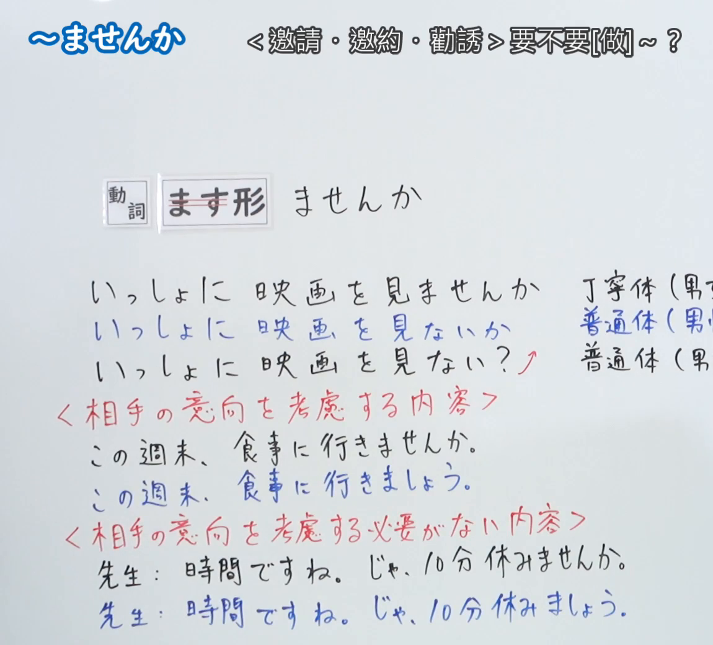
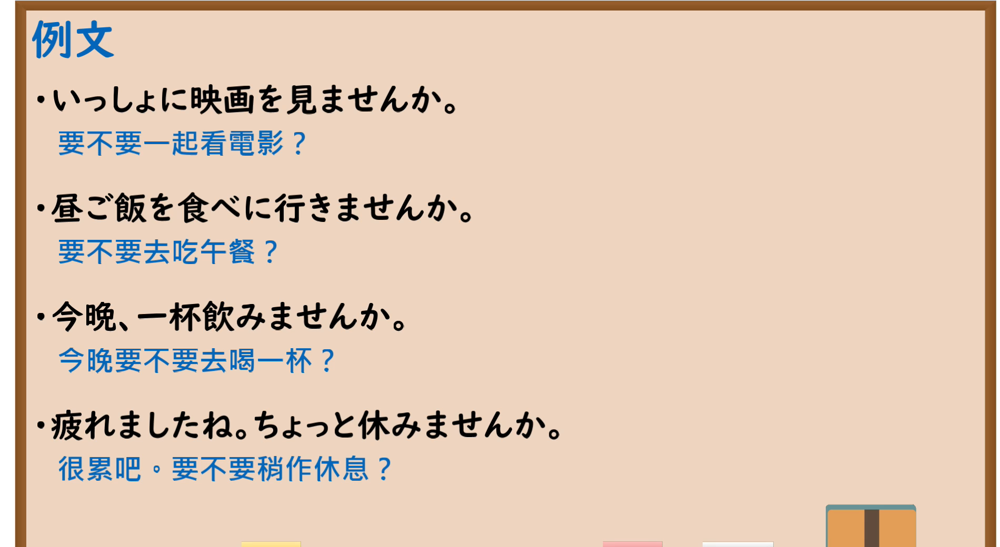

---
{
  "id": "N5-G-0017",
  "kind": "grammar",
  "level": "N5",
  "title": "～ませんか",
  "card_revision": 2,
  "schema_version": 1,
  "source": {
    "lesson": "N5 第17个语法",
    "material": "出口日語原视频板书（学习者截取的接续图与例句图）与日本語NET「【JLPT N5】文法・例文：〜ませんか」正文",
    "video": "https://www.youtube.com/watch?v=laC5NIRwMZA",
    "screenshot": "assets/grammar/n5/N5-G-0017-connection.png",
    "screenshot_crop": {
      "x": 0,
      "y": 0,
      "width": 1150,
      "height": 1040
    }
  },
  "tags": [
    "ませんか",
    "邀请",
    "劝诱",
    "N5"
  ],
  "confusions": [
    "ませんか／ましょう",
    "ましょう／ましょうか",
    "ませんか／普通体ない？",
    "邀请／安排"
  ]
}
---

# N5 第17个语法：～ませんか

# 视频学习资料整理

- 课程：[出口日語「～ませんか」](https://www.youtube.com/watch?v=laC5NIRwMZA)
- 视频 ID：`laC5NIRwMZA`
- 视频时长：8分2秒

## 接续图

- 实际时间：未记录（图片由学习者从原视频截取并提供）
- 成品图尺寸：1150×1040，固定左上角 `(0, 0)`，右下角 `(1150, 1040)`
- 板书内容：标题「～ませんか」，右侧标注“＜邀請・邀約・勸誘＞要不要[做]～？”；「動詞 ます形（「ます」划去） ませんか」；例句「いっしょに映画を見ませんか」「見ないか」「見ない？」及右侧「丁寧体」「普通体」说明（被画面右缘截断）；＜相手の意向を考慮する内容＞「この週末、食事に行きませんか／行きましょう」；＜相手の意向を考慮する必要がない内容＞「先生：時間ですね。じゃ、10分休みませんか／休みましょう」。右侧说明文字被截断，未补写。

## 例句图

- 实际时间：未记录（图片由学习者从原视频截取并提供）
- 成品图尺寸：1900×1040，固定左上角 `(0, 0)`，右下角 `(1900, 1040)`
- 板书内容：课程「例文」页，含四条例句及中文翻译（いっしょに映画を見ませんか／昼ご飯を食べに行きませんか／今晩、一杯飲みませんか／疲れましたね。ちょっと休みませんか）。四条例句均完整可见。

# 核心

## 功能一：＜邀请・邀约・劝诱＞要不要[做]～？

**くわしい意味記述：**

- **〜ませんか：** 相手を誘う表現。（邀请对方的表达。）接続はV（ます形）の「ます」を「せんか」に変えます。（接续是把动词ます形的「ます」换成「せんか」。）
- **備考：** 「一緒に」とセットで使うことが多い。（多与「一緒に」搭配使用。）

### 例句

1. 週末、一緒に映画を見ませんか。

   （周末要不要一起看电影？）

2. 今晩、一緒に食事しませんか。

   （今晚要不要一起吃饭？）

3. 一緒に帰りませんか。

   （要不要一起回去？）

4. 一緒に図書館で勉強しませんか。

   （要不要一起在图书馆学习？）

5. これから、一緒にカフェに行きませんか。

   （现在要不要一起去咖啡馆？）

# 来源

- [出口日語原视频](https://www.youtube.com/watch?v=laC5NIRwMZA)
- [日本語NET「【JLPT N5】文法・例文：〜ませんか」](https://nihongokyoshi-net.com/2019/12/14/jlptn5-grammar-masenka/)（查询日期：2026-10-16；Hagoromo 未收录。毎日のんびり日本語教師有「～ませんか」条目，但其例句多为「てくれませんか」等请求表达，与本课的邀请功能不符，故按优先级采用日本語NET 该条目；中文译文为整理者所译）
