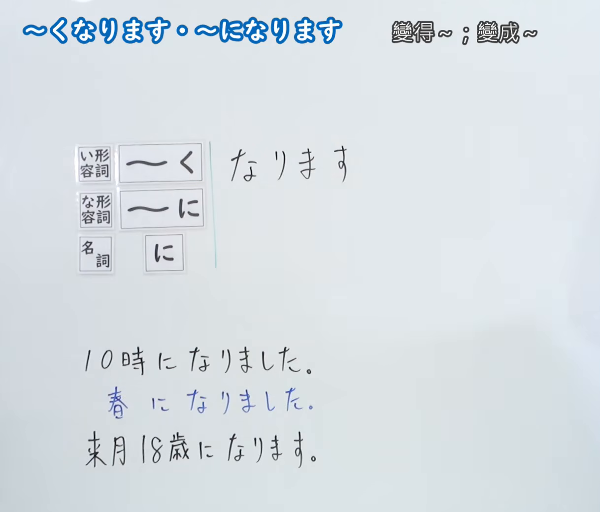
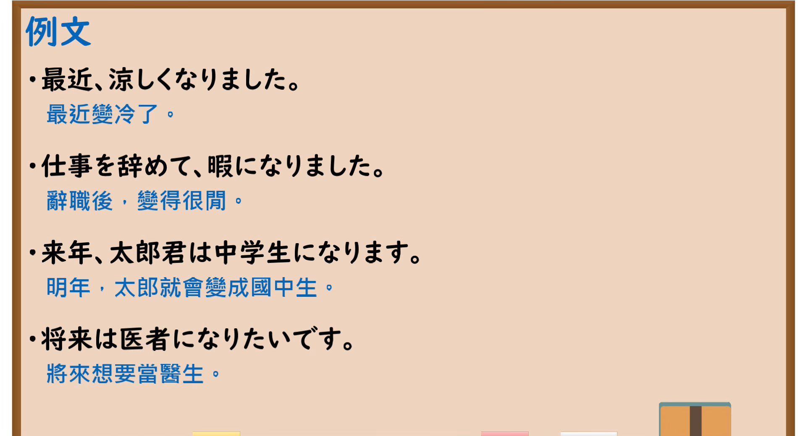

---
{
  "id": "N5-G-0018",
  "kind": "grammar",
  "level": "N5",
  "title": "～くなります・～になります",
  "card_revision": 2,
  "schema_version": 1,
  "source": {
    "lesson": "N5 第18个语法",
    "material": "出口日語原视频板书（学习者截取的接续图与例句图）与毎日のんびり日本語教師「【Ｎ５文法】～になる／くなる」正文",
    "video": "https://www.youtube.com/watch?v=w2d2YiJU9UA",
    "screenshot": "assets/grammar/n5/N5-G-0018-connection.png",
    "screenshot_crop": {
      "x": 0,
      "y": 0,
      "width": 1218,
      "height": 1040
    }
  },
  "tags": [
    "くなります",
    "になります",
    "变化",
    "N5"
  ],
  "confusions": [
    "くなります／くします",
    "になります／にします",
    "いい→よく",
    "い形容词／な形容词／名词"
  ]
}
---

# N5 第18个语法：～くなります・～になります

# 视频学习资料整理

- 课程：[出口日語「～くなります・～になります」](https://www.youtube.com/watch?v=w2d2YiJU9UA)（播放列表中该课显示为英文标题“[N5 Grammar] ~nimasu・~nimasu”，板书标题为日文）
- 视频 ID：`w2d2YiJU9UA`
- 视频时长：4分18秒

## 接续图

- 实际时间：未记录（图片由学习者从原视频截取并提供）
- 成品图尺寸：1218×1040，固定左上角 `(0, 0)`，右下角 `(1218, 1040)`
- 板书内容：标题「～くなります・～になります」，右侧标注“變得～；變成～”；左侧三个词类标签：「い形容詞」→「～く」、「な形容詞」→「～に」、「名詞」→「に」，后接「なります」；例句「10時になりました。」「春になりました。」「来月18歳になります。」。板书完整，无遮挡。

## 例句图

- 实际时间：未记录（图片由学习者从原视频截取并提供）
- 成品图尺寸：1900×1040，固定左上角 `(0, 0)`，右下角 `(1900, 1040)`
- 板书内容：课程「例文」页，含四条例句及中文翻译（最近、涼しくなりました／仕事を辞めて、暇になりました／来年、太郎君は中学生になります／将来は医者になりたいです）。四条例句均完整可见。

# 核心

## 功能一：变得～；变成～

**くわしい意味記述：**

- **～になる／くなる：** 物事や状態、性質が自然に変化したことを表します。（表示事物、状态、性质自然地发生变化。）
- **接続：** な形容詞語幹＋になる、名詞＋になる、い形容詞語幹＋くなる。（な形容词词干＋になる，名词＋になる，い形容词词干＋くなる。）
- **動詞との関係：** 動詞に接続する場合は「～ようになる／ないようになる」を用います。（接动词时，使用「～ようになる／ないようになる」。）

### 例句

1. 先生の一声で教室は静かになった。

   （老师一声，教室里安静下来了。）

2. やっと大人になった。

   （终于长大成人了。）

3. 彼女は化粧するともっと可愛くなる。

   （她化妆后会变得更可爱。）

4. 気づいたら彼を好きになっていた。

   （意识到的时候已经喜欢上他了。）

5. ２０歳になった。

   （二十岁了。）

# 来源

- [出口日語原视频](https://www.youtube.com/watch?v=w2d2YiJU9UA)
- [毎日のんびり日本語教師「【Ｎ５文法】～になる／くなる」](https://mainichi-nonbiri.com/grammar/n5-ninaru/)（查询日期：2026-10-16；Hagoromo 未收录，故按流程采用优先级最高的备选网站条目；中文译文取自该页）
