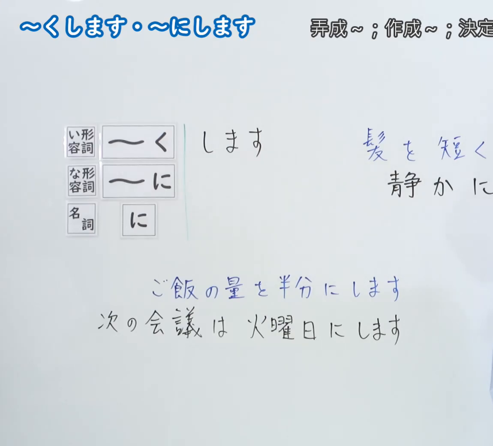
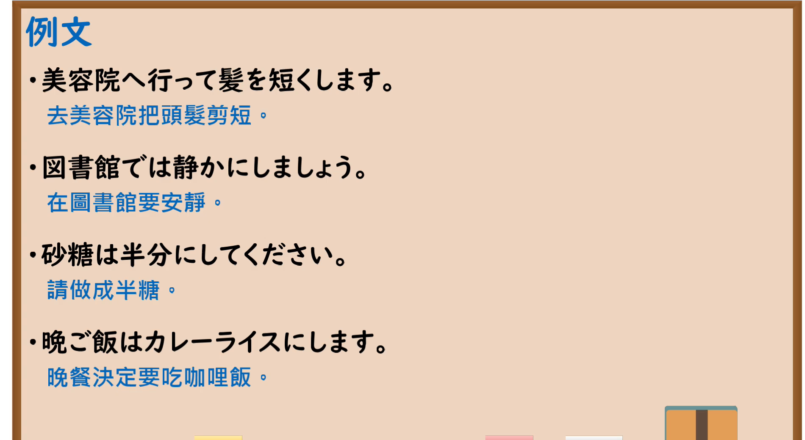

---
{
  "id": "N5-G-0019",
  "kind": "grammar",
  "level": "N5",
  "title": "～くします・～にします",
  "card_revision": 2,
  "schema_version": 1,
  "source": {
    "lesson": "N5 第19个语法",
    "material": "出口日語原视频板书（学习者截取的接续图与例句图）与毎日のんびり日本語教師「【Ｎ５文法】～にする／くする」正文",
    "video": "https://www.youtube.com/watch?v=q4JbhXZuZGY",
    "screenshot": "assets/grammar/n5/N5-G-0019-connection.png",
    "screenshot_crop": {
      "x": 0,
      "y": 0,
      "width": 1150,
      "height": 1040
    }
  },
  "tags": [
    "くします",
    "にします",
    "变化",
    "N5"
  ],
  "confusions": [
    "くなります／くします",
    "になります／にします",
    "を／が",
    "改变／选择"
  ]
}
---

# N5 第19个语法：～くします・～にします

# 视频学习资料整理

- 课程：[出口日語「～くします・～にします」](https://www.youtube.com/watch?v=q4JbhXZuZGY)（播放列表中该课显示为英文标题“[N5 Grammar] ～ku shimasu / ～ni shimasu”，板书标题为日文）
- 视频 ID：`q4JbhXZuZGY`
- 视频时长：5分47秒

## 接续图

- 实际时间：未记录（图片由学习者从原视频截取并提供）
- 成品图尺寸：1150×1040，固定左上角 `(0, 0)`，右下角 `(1150, 1040)`
- 板书内容：标题「～くします・～にします」，右上角标注“弄成～；作成～；決定…”（右端被画面边缘截断）；左侧三个词类标签：「い形容詞」→「～く」、「な形容詞」→「～に」、「名詞」→「に」，后接「します」；右侧例句「髪を短く…」「静かに…」被画面右缘截断；下方「ご飯の量を半分にします」「次の会議は火曜日にします」。老师在画面右缘露出一部分身影，右侧例句末尾未补写。

## 例句图

- 实际时间：未记录（图片由学习者从原视频截取并提供）
- 成品图尺寸：1900×1040，固定左上角 `(0, 0)`，右下角 `(1900, 1040)`
- 板书内容：课程「例文」页，含四条例句及中文翻译（美容院へ行って髪を短くします／図書館では静かにしましょう／砂糖は半分にしてください／晩ご飯はカレーライスにします）。四条例句均完整可见。

# 核心

## 功能一：弄成～；作成～；决定～

**くわしい意味記述：**

- **～にする／くする：** 物事や状態、性質を人為的に望んでいる結果へと変化させることを表します。（表示人为地使事物、状态、性质变为所期望的结果。）
- **接続：** な形容詞語幹＋にする、名詞＋にする、い形容詞語幹＋くする。（な形容词词干＋にする，名词＋にする，い形容词词干＋くする。）
- **動詞との関係：** 動詞に接続する場合は「～ようにする／ないようにする」を用います。（接动词时，使用「～ようにする／ないようにする」。）

### 例句

1. 我が子を弁護士にしたい。

   （想让自己的孩子成为律师。）

2. ちょっと静かにしてください。

   （请安静一点。）

3. 練習は不可能を可能にする。

   （练习使不可能成为可能。）

4. 壁の色を黒くしたい。

   （想把墙壁的颜色弄黑。）

5. 辛いのが苦手なので、カレー作るときはいつも甘くする。

   （因为不擅长吃辣，所以做咖喱的时候总是做成甜的。）

# 来源

- [出口日語原视频](https://www.youtube.com/watch?v=q4JbhXZuZGY)
- [毎日のんびり日本語教師「【Ｎ５文法】～にする／くする」](https://mainichi-nonbiri.com/grammar/n5-nisuru/)（查询日期：2026-10-16；Hagoromo 未收录，故按流程采用优先级最高的备选网站条目；中文译文取自该页。该页解说只覆盖“使变成”的用法，板书标注中的“决定～”用法（如「晩ご飯はカレーライスにします」）该页未单独解说）
