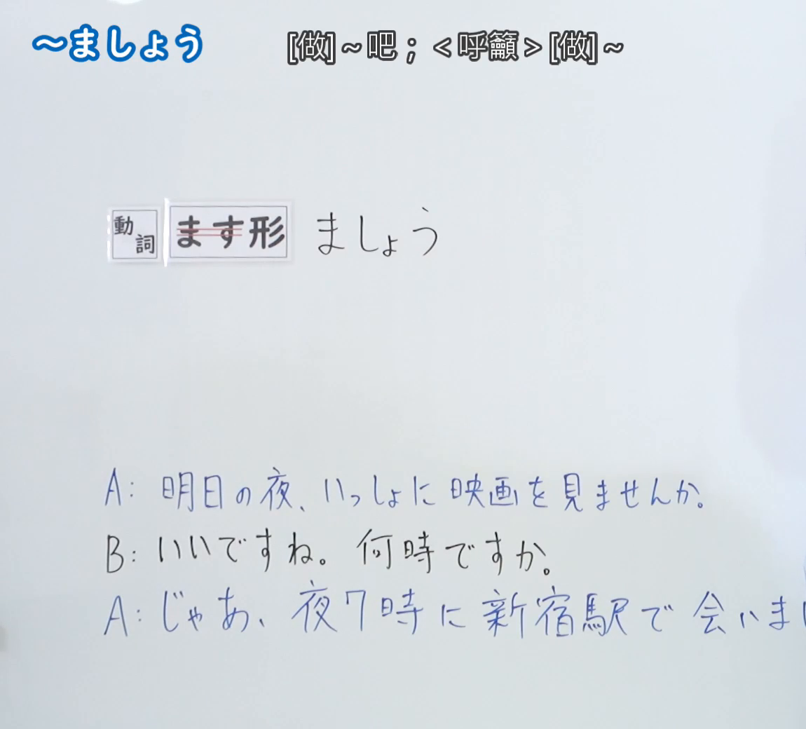
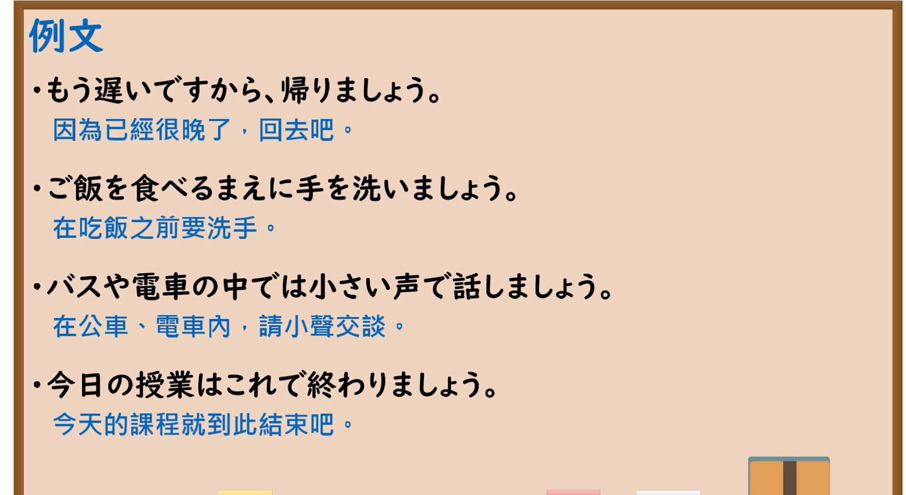

---
{
  "id": "N5-G-0020",
  "kind": "grammar",
  "level": "N5",
  "title": "～ましょう",
  "card_revision": 2,
  "schema_version": 1,
  "source": {
    "lesson": "N5 第20个语法",
    "material": "出口日語原视频板书（学习者截取的接续图与例句图）与毎日のんびり日本語教師「【Ｎ５文法】～ましょう／ましょうか」正文",
    "video": "https://www.youtube.com/watch?v=eYOl26g6ao4",
    "screenshot": "assets/grammar/n5/N5-G-0020-connection.png",
    "screenshot_crop": {
      "x": 0,
      "y": 0,
      "width": 1150,
      "height": 1040
    }
  },
  "tags": [
    "ましょう",
    "劝诱",
    "提议",
    "N5"
  ],
  "confusions": [
    "ましょう／ませんか",
    "ましょう／意向形",
    "一类／二类动词的意向形",
    "礼貌体／随意体"
  ]
}
---

# N5 第20个语法：～ましょう

# 视频学习资料整理

- 课程：[出口日語「～ましょう」](https://www.youtube.com/watch?v=eYOl26g6ao4)
- 视频 ID：`eYOl26g6ao4`
- 视频时长：5分55秒

## 接续图

- 实际时间：未记录（图片由学习者从原视频截取并提供）
- 成品图尺寸：1150×1040，固定左上角 `(0, 0)`，右下角 `(1150, 1040)`
- 板书内容：标题「～ましょう」，右侧标注“[做]～吧；＜呼籲＞[做]～”；「動詞 ます形（「ます」划去） ましょう」；下方对话「A：明日の夜、いっしょに映画を見ませんか。B：いいですね。何時ですか。A：じゃあ、夜7時に新宿駅で会いま（しょう）」，最后一行句末被画面右缘截断，未补写。

## 例句图

- 实际时间：未记录（图片由学习者从原视频截取并提供）
- 成品图尺寸：1900×1040，固定左上角 `(0, 0)`，右下角 `(1900, 1040)`
- 板书内容：课程「例文」页，含四条例句及中文翻译（もう遅いですから、帰りましょう／ご飯を食べるまえに手を洗いましょう／バスや電車の中では小さい声で話しましょう／今日の授業はこれで終わりましょう）。四条例句均完整可见。

# 核心

## 功能一：[做]～吧；＜呼吁＞[做]～

**くわしい意味記述：**

- **～ましょう／～ましょうか：** 相手に対する勧誘、提案を表します。自分に対して用いると、意志を表します。（表示对对方的劝诱、提议。用于自己时，表示意志。）
- **接続：** 動ます形＋ましょう。（动词ます形＋ましょう。）

### 例句

1. 元気出しましょう。

   （打起精神吧。）

2. レポート書き終わったので寝ましょう。

   （报告写完了，所以睡觉吧。）

3. 嫌な事は忘れましょう。

   （忘了不愉快的事吧。）

4. 一旦落ち着きましょう。

   （先冷静下来吧。）

5. また会いましょう。

   （下次再见吧。）

# 来源

- [出口日語原视频](https://www.youtube.com/watch?v=eYOl26g6ao4)
- [毎日のんびり日本語教師「【Ｎ５文法】～ましょう／ましょうか」](https://mainichi-nonbiri.com/grammar/n5-mashouka/)（查询日期：2026-10-16；Hagoromo 未收录，故按流程采用优先级最高的备选网站条目；中文译文取自该页，个别措辞作了调整）
