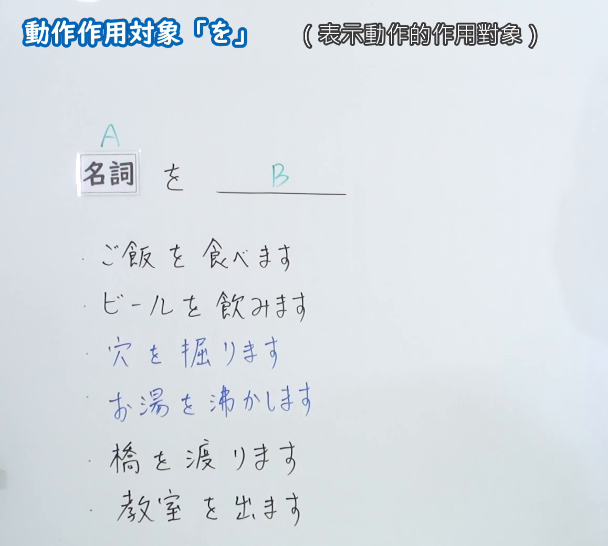
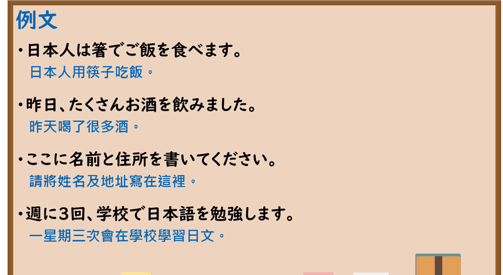

---
{
  "id": "N5-G-0021",
  "kind": "grammar",
  "level": "N5",
  "title": "助词：动作作用对象「を」",
  "card_revision": 2,
  "schema_version": 1,
  "source": {
    "lesson": "N5 第21个语法",
    "material": "出口日語原视频板书（学习者截取的接续图与例句图）与毎日のんびり日本語教師「格助詞「を」の用法一覧」正文",
    "video": "https://www.youtube.com/watch?v=WdXNSul1CyY",
    "screenshot": "assets/grammar/n5/N5-G-0021-connection.png",
    "screenshot_crop": {
      "x": 0,
      "y": 0,
      "width": 1158,
      "height": 1040
    }
  },
  "tags": [
    "を",
    "助词",
    "动作对象",
    "N5"
  ],
  "confusions": [
    "を／に",
    "を／から",
    "动作对象／经过点",
    "结果对象／目的"
  ]
}
---

# N5 第21个语法：助词「を」（动作作用对象）

# 视频学习资料整理

- 课程：[出口日語「助詞：動作作用対象「を」」](https://www.youtube.com/watch?v=WdXNSul1CyY)
- 视频 ID：`WdXNSul1CyY`
- 视频时长：8分23秒

## 接续图

- 实际时间：未记录（图片由学习者从原视频截取并提供）
- 成品图尺寸：1158×1040，固定左上角 `(0, 0)`，右下角 `(1158, 1040)`
- 板书内容：标题「動作作用対象「を」」，右侧标注“（表示動作的作用對象）”；「名詞（A） を ＿＿（B）」；下方六行例句：「ご飯を食べます」「ビールを飲みます」「穴を掘ります」「お湯を沸かします」「橋を渡ります」「教室を出ます」。板书完整，无遮挡。

## 例句图

- 实际时间：未记录（图片由学习者从原视频截取并提供）
- 成品图尺寸：1900×1040，固定左上角 `(0, 0)`，右下角 `(1900, 1040)`
- 板书内容：课程「例文」页，含四条例句及中文翻译（日本人は箸でご飯を食べます／昨日、たくさんお酒を飲みました／ここに名前と住所を書いてください／週に3回、学校で日本語を勉強します）。四条例句均完整可见。

# 核心

## 功能一：表示动作的作用对象

**くわしい意味記述：**

- **対象：** 他動詞が表す動作・作用によって働きかけられる対象を表します。（表示被他动词所表示的动作、作用所作用的对象。）
- **起点：** 主体の移動を表す移動動詞が述語に置かれているとき、移動動詞が表す移動の起点（出発点）を表します。（谓语是表示主体移动的移动动词时，表示该移动的起点（出发点）。）
- **経過域：** 移動動詞が述語に置かれているとき、移動動詞が表す移動の経過域（経路、通過点）を表します。（谓语是移动动词时，表示该移动的经过区域（路径、通过点）。）

### 例句

1. 窓を壊す。

   （打破窗户。）

2. 小説を書く。

   （写小说。）

3. 料理を作る。

   （做饭菜。）

4. もうすぐ家を出ます。

   （我们马上要离开家了。）

5. あの丁字路を左に曲がる。

   （在那个丁字路口左转。）

# 来源

- [出口日語原视频](https://www.youtube.com/watch?v=WdXNSul1CyY)
- [毎日のんびり日本語教師「格助詞「を」の用法一覧」「対象」「起点」「経過域」](https://mainichi-nonbiri.com/jltct/wo-case-particle/)（查询日期：2026-10-16；Hagoromo 未收录，按流程采用优先级最高的备选网站该页，中文译文取自该页）
