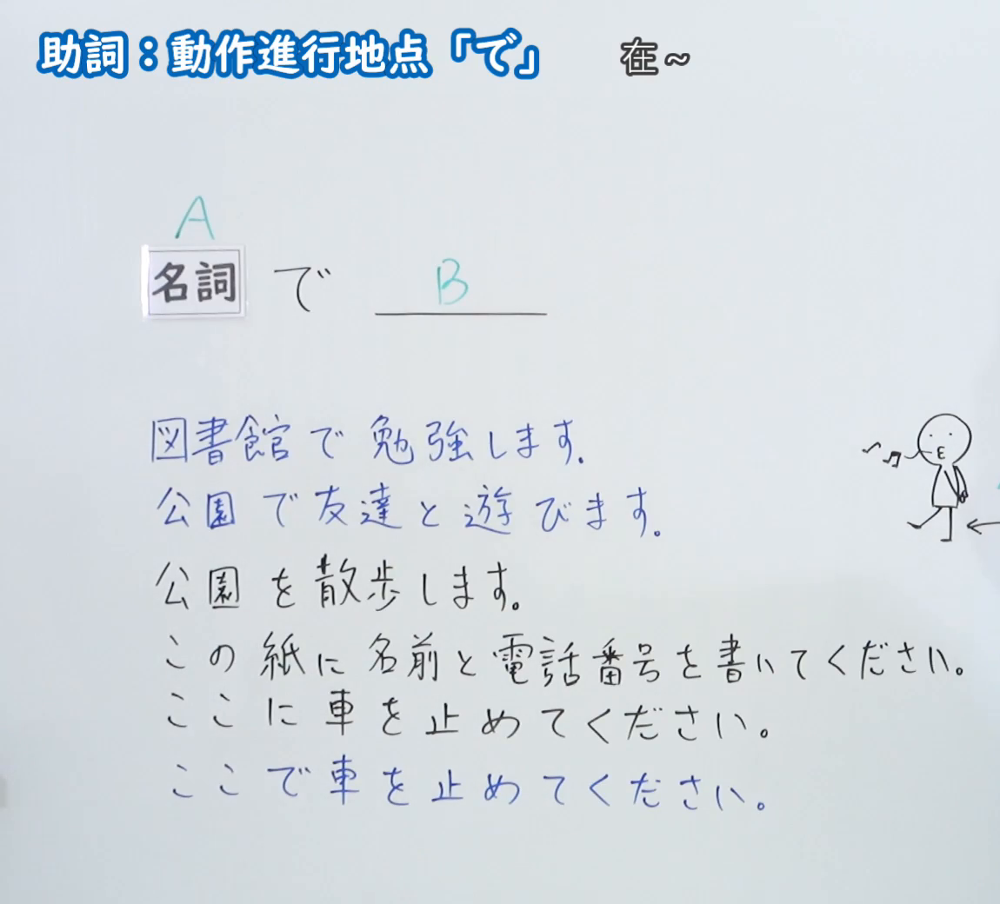
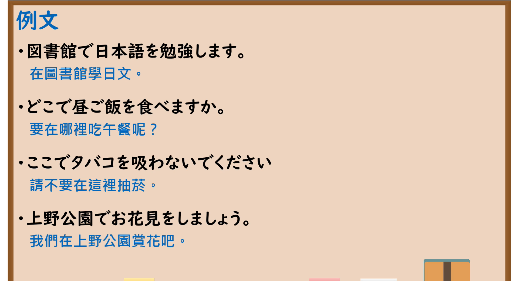

---
{
  "id": "N5-G-0022",
  "kind": "grammar",
  "level": "N5",
  "title": "助词：动作进行地点「で」",
  "card_revision": 2,
  "schema_version": 1,
  "source": {
    "lesson": "N5 第22个语法",
    "material": "出口日語原视频板书（学习者截取的接续图与例句图）与毎日のんびり日本語教師「格助詞「で」の用法一覧」正文",
    "video": "https://www.youtube.com/watch?v=GYxgc7uKfdE",
    "screenshot": "assets/grammar/n5/N5-G-0022-connection.png",
    "screenshot_crop": {
      "x": 0,
      "y": 0,
      "width": 1150,
      "height": 1040
    }
  },
  "tags": [
    "で",
    "助词",
    "地点",
    "N5"
  ],
  "confusions": [
    "で／に",
    "で／を",
    "动作地点／存在地点",
    "に的归着点／で的动作地点"
  ]
}
---

# N5 第22个语法：助词「で」（动作进行地点）

# 视频学习资料整理

- 课程：[出口日語「助詞：動作進行地点「で」」](https://www.youtube.com/watch?v=GYxgc7uKfdE)
- 视频 ID：`GYxgc7uKfdE`
- 视频时长：9分34秒

## 接续图

- 实际时间：未记录（图片由学习者从原视频截取并提供）
- 成品图尺寸：1150×1040，固定左上角 `(0, 0)`，右下角 `(1150, 1040)`
- 板书内容：标题「助詞：動作進行地点「で」」，右侧标注“在～”；「名詞（A） で ＿＿（B）」；下方例句：「図書館で勉強します」「公園で友達と遊びます」「公園を散歩します」「この紙に名前と電話番号を書いてください」「ここに車を止めてください」「ここで車を止めてください」；右侧有一幅小人手绘插图及箭头，箭头末端被画面右缘截断，未补写。

## 例句图

- 实际时间：未记录（图片由学习者从原视频截取并提供）
- 成品图尺寸：1900×1040，固定左上角 `(0, 0)`，右下角 `(1900, 1040)`
- 板书内容：课程「例文」页，含四条例句及中文翻译（図書館で日本語を勉強します／どこで昼ご飯を食べますか／ここでタバコを吸わないでください／上野公園でお花見をしましょう）。四条例句均完整可见。

# 核心

## 功能一：在～（表示动作进行的地点）

**くわしい意味記述：**

- **動作場所：** 述語が動作動詞の場合、その動作が行われる場所を表します。（谓语是动作动词时，表示该动作进行的场所。）
- **出来事の発生：** 「ある」が出来事の発生を表すとき、「起きる」「発生する」「開催する」などと同義になり、その動的事象が起こる場所も「で」で表されます。（「ある」表示事件发生时，与「起きる」「発生する」「開催する」等同义，该动态事件发生的场所也用「で」表示。）

### 例句

1. 公園で散歩する。

   （在公园里散步。）

2. レストランで食事をする。

   （在餐厅用餐。）

3. 図書館で本を読む。

   （在图书馆读书。）

4. プールで泳ぐ。

   （在游泳池游泳。）

5. あそこで事故があった。

   （那边发生了事故。）

# 来源

- [出口日語原视频](https://www.youtube.com/watch?v=GYxgc7uKfdE)
- [毎日のんびり日本語教師「格助詞「で」の用法一覧」「動作場所」](https://mainichi-nonbiri.com/jltct/de-case-particle/)（查询日期：2026-10-16；Hagoromo 未收录，按流程采用优先级最高的备选网站该页，中文译文取自该页）
