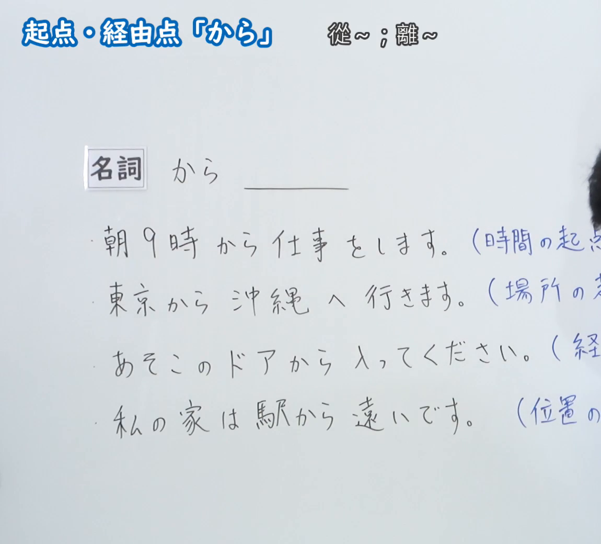
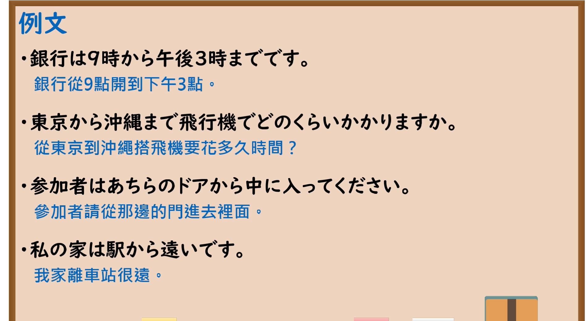

---
{
  "id": "N5-G-0023",
  "kind": "grammar",
  "level": "N5",
  "title": "助词：起点・经由点「から」",
  "card_revision": 2,
  "schema_version": 1,
  "source": {
    "lesson": "N5 第23个语法",
    "material": "出口日語原视频板书（学习者截取的接续图与例句图）与毎日のんびり日本語教師「格助詞「から」の用法一覧」正文",
    "video": "https://www.youtube.com/watch?v=HlYSIpdDtmk",
    "screenshot": "assets/grammar/n5/N5-G-0023-connection.png",
    "screenshot_crop": {
      "x": 0,
      "y": 0,
      "width": 1150,
      "height": 1040
    }
  },
  "tags": [
    "から",
    "助词",
    "起点",
    "N5"
  ],
  "confusions": [
    "から／まで",
    "から／で",
    "から／に",
    "移动起点／距离参照点"
  ]
}
---

# N5 第23个语法：助词「から」（起点・经由点）

# 视频学习资料整理

- 课程：[出口日語「助詞：起点・経由点「から」」](https://www.youtube.com/watch?v=HlYSIpdDtmk)
- 视频 ID：`HlYSIpdDtmk`
- 视频时长：5分16秒

## 接续图

- 实际时间：未记录（图片由学习者从原视频截取并提供）
- 成品图尺寸：1150×1040，固定左上角 `(0, 0)`，右下角 `(1150, 1040)`
- 板书内容：标题「起点・経由点「から」」，右侧标注“從～；離～”；「名詞 から ＿＿」；四行例句：「朝9時から仕事をします。（時間の起点）」「東京から沖縄へ行きます。（場所の起点）」「あそこのドアから入ってください。（経由点）」「私の家は駅から遠いです。（位置の起点）」，括号内说明的右半部被画面右缘截断，其中第二至四行括号内文字未能完整看到，未补写；右缘有老师头部一小部分。

## 例句图

- 实际时间：未记录（图片由学习者从原视频截取并提供）
- 成品图尺寸：1900×1040，固定左上角 `(0, 0)`，右下角 `(1900, 1040)`
- 板书内容：课程「例文」页，含四条例句及中文翻译（銀行は9時から午後3時までです／東京から沖縄まで飛行機でどのくらいかかりますか／参加者はあちらのドアから中に入ってください／私の家は駅から遠いです）。四条例句均完整可见。

# 核心

## 功能一：从～；离～（表示起点、经由点）

**くわしい意味記述：**

- **起点：** 事物がある地点（起点）からある地点（終点）へと移動することを表す動詞が述語に置かれるとき、移動の起点は「から」で表します。時間的な範囲の起点も「から」で表します。（谓语是表示从某地点（起点）向某地点（终点）移动的动词时，移动的起点用「から」表示。时间范围的起点也用「から」表示。）
- **経過域：** 移動の経過域を「から」で表すこともできます。この「から」は起点としても解釈可能です。（移动的经过区域也可以用「から」表示。这个「から」也可以解释为起点。）

### 例句

1. 家から駅まで歩いて１０分です。

   （从家里走到车站需要10分钟。）

2. 学校からバス停まで走っていった。

   （我从学校跑到公交车站。）

3. 昨日は朝から深夜まで仕事をしていました。

   （昨天我从早上一直工作到深夜。）

4. 明日から全品半額のセールが始まります！

   （明天开始所有商品将打五折！）

5. 犯人は窓から逃げていった。

   （罪犯从窗户逃走了。）

# 来源

- [出口日語原视频](https://www.youtube.com/watch?v=HlYSIpdDtmk)
- [毎日のんびり日本語教師「格助詞「から」の用法一覧」「起点」「経過域」](https://mainichi-nonbiri.com/jltct/kara-case-particle/)（查询日期：2026-10-16；Hagoromo 未收录，按流程采用优先级最高的备选网站该页，中文译文取自该页；板书中“位置的起点”（私の家は駅から遠いです）该页未单独列出例句）
