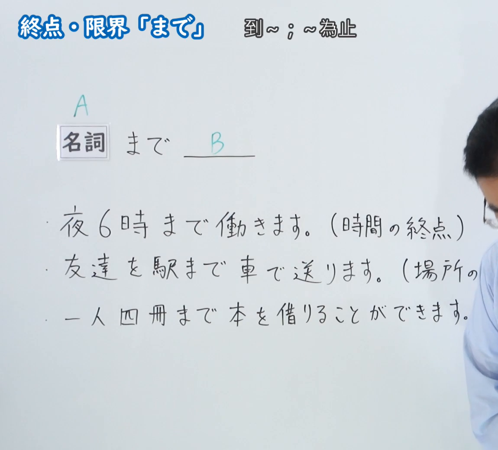
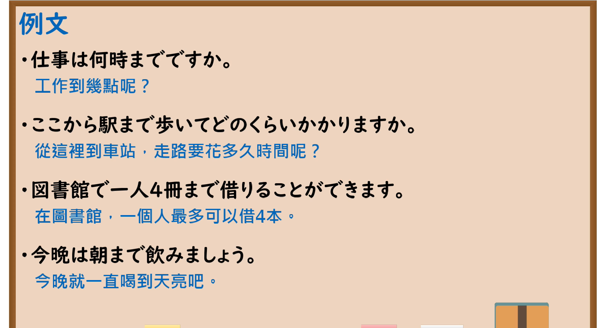

---
{
  "id": "N5-G-0024",
  "kind": "grammar",
  "level": "N5",
  "title": "助词：终点・限界「まで」",
  "card_revision": 2,
  "schema_version": 1,
  "source": {
    "lesson": "N5 第24个语法",
    "material": "出口日語原视频板书（学习者截取的接续图与例句图）与毎日のんびり日本語教師「格助詞「まで」の用法一覧」正文",
    "video": "https://www.youtube.com/watch?v=qePEc2F-9Kw",
    "screenshot": "assets/grammar/n5/N5-G-0024-connection.png",
    "screenshot_crop": {
      "x": 0,
      "y": 0,
      "width": 1150,
      "height": 1040
    }
  },
  "tags": [
    "まで",
    "助词",
    "终点",
    "N5"
  ],
  "confusions": [
    "まで／までに",
    "まで／に",
    "から～まで",
    "终点／上限"
  ]
}
---

# N5 第24个语法：助词「まで」（终点・限界）

# 视频学习资料整理

- 课程：[出口日語「助詞：終点・限界「まで」」](https://www.youtube.com/watch?v=qePEc2F-9Kw)
- 视频 ID：`qePEc2F-9Kw`
- 视频时长：4分28秒

## 接续图

- 实际时间：未记录（图片由学习者从原视频截取并提供）
- 成品图尺寸：1150×1040，固定左上角 `(0, 0)`，右下角 `(1150, 1040)`
- 板书内容：标题「終点・限界「まで」」，右侧标注“到～；～為止”；「名詞（A） まで ＿＿（B）」；三行例句：「夜6時まで働きます。（時間の終点）」「友達を駅まで車で送ります。（場所の…」「一人四冊まで本を借りることができます。」；老师身影出现在画面右侧，第二行括号内文字被截断并被人物遮挡，未补写。

## 例句图

- 实际时间：未记录（图片由学习者从原视频截取并提供）
- 成品图尺寸：1900×1040，固定左上角 `(0, 0)`，右下角 `(1900, 1040)`
- 板书内容：课程「例文」页，含四条例句及中文翻译（仕事は何時までですか／ここから駅まで歩いてどのくらいかかりますか／図書館で一人4冊まで借りることができます／今晩は朝まで飲みましょう）。四条例句均完整可见。

# 核心

## 功能一：到～；～为止（表示终点、限界）

**くわしい意味記述：**

- **終点（場所）：** 場所を表す名詞について、述語の動作が及ぶ範囲の終点を表します。（对于表示场所的名词，表示谓语动作所及范围的终点。）
- **終点（時間）：** 時間を表す名詞について、述語の事態が成立する時間的な範囲の終点を表します。（对于表示时间的名词，表示谓语事态成立的时间范围的终点。）
- **終点（数値・程度）：** 数値や何かしらの程度を表す名詞について、その範囲の終点（到達点）を表します。（对于表示数值或某种程度的名词，表示该范围的终点（到达点）。）

### 例句

1. 家から学校まで１時間かかる。

   （家到学校需要一个小时的时间。）

2. 大学まで徒歩で通っています。

   （我走路上大学。）

3. 彼は毎晩遅くまで働いています。

   （他每天都工作到很晚。）

4. 銀行は午後３時まで開いています。

   （银行营业到下午三点。）

5. 熱が４０度まであがった。

   （温度升到了四十度。）

# 来源

- [出口日語原视频](https://www.youtube.com/watch?v=qePEc2F-9Kw)
- [毎日のんびり日本語教師「格助詞「まで」の用法一覧」「終点」](https://mainichi-nonbiri.com/jltct/made-case-particle/)（查询日期：2026-10-16；Hagoromo 未收录，按流程采用优先级最高的备选网站该页，中文译文取自该页）
