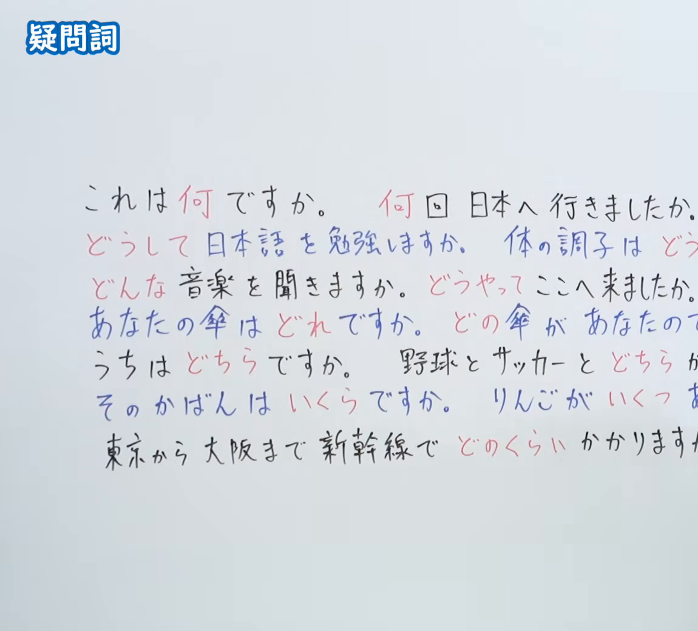
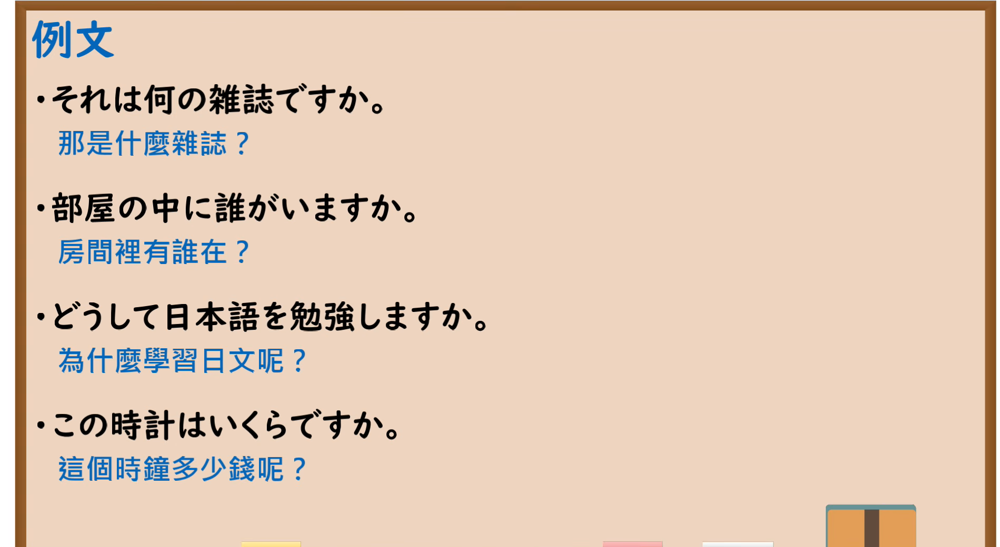

---
{
  "id": "N5-G-0025",
  "kind": "grammar",
  "level": "N5",
  "title": "疑问词",
  "card_revision": 2,
  "schema_version": 1,
  "source": {
    "lesson": "N5 第25个语法",
    "material": "出口日語原视频板书（学习者截取的接续图与例句图）与东京外国语大学「どれ／どこ／どのN：解説」正文",
    "video": "https://www.youtube.com/watch?v=Ff_Ca_WGZDA",
    "screenshot": "assets/grammar/n5/N5-G-0025-connection.png",
    "screenshot_crop": {
      "x": 0,
      "y": 0,
      "width": 1150,
      "height": 1040
    }
  },
  "tags": [
    "疑问词",
    "何",
    "どれ",
    "N5"
  ],
  "confusions": [
    "なに／なん",
    "どうして／どうやって",
    "どれ／どの",
    "いくつ／何＋助数词",
    "だれ／どなた"
  ]
}
---

# N5 第25个语法：疑问词

# 视频学习资料整理

- 课程：[出口日語「疑問詞」](https://www.youtube.com/watch?v=Ff_Ca_WGZDA)
- 视频 ID：`Ff_Ca_WGZDA`
- 视频时长：9分21秒

## 接续图

- 实际时间：未记录（图片由学习者从原视频截取并提供）
- 成品图尺寸：1150×1040，固定左上角 `(0, 0)`，右下角 `(1150, 1040)`
- 板书内容：标题「疑問詞」，无接续公式；板书为七行红蓝字例句，列出疑问词：何（これは何ですか／何回日本へ行きましたか）、どうして（どうして日本語を勉強しますか）、どう（体の調子はどう…）、どんな（どんな音楽を聞きますか）、どうやって（どうやってここへ来ましたか）、どれ／どの（あなたの傘はどれですか／どの傘があなたの…）、どちら（うちはどちらですか／野球とサッカーとどちらが…）、いくら／いくつ（そのかばんはいくらですか／りんごがいくつ あ…）、どのくらい（東京から大阪まで新幹線でどのくらいかかります…）。右半部各行句末被画面右缘截断，未补写。

## 例句图

- 实际时间：未记录（图片由学习者从原视频截取并提供）
- 成品图尺寸：1900×1040，固定左上角 `(0, 0)`，右下角 `(1900, 1040)`
- 板书内容：课程「例文」页，含四条例句及中文翻译（それは何の雑誌ですか／部屋の中に誰がいますか／どうして日本語を勉強しますか／この時計はいくらですか）。四条例句均完整可见。

# 核心

## 功能一：询问不明确的事物、场所、人、原因、价格等

**くわしい意味記述：**

- **どれ：** どれかわからないものについて聞くときは、「どれ」を使います。（询问不知是哪个的东西时，使用「どれ」。）
- **どこ：** どこかわからない場所についてたずねるときは、「どこ」を使います。（询问不知是哪里的场所时，使用「どこ」。）
- **どのN：** 特定されたNがどれか聞くときは、「どのN」を使います。（询问已确定的N是哪一个时，使用「どのN」。）

### 例句

1. A：田中さんの消しゴムはどれですか。　B：それです。

   （A：田中的橡皮是哪个？　B：是那个。）

2. A：すみません、トイレはどこですか。　B：あそこです。

   （A：不好意思，厕所在哪里？　B：在那边。）

3. A：先生の車はどこにありますか。　B：あそこです。

   （A：老师的车在哪里？　B：在那边。）

4. A：あのかばんは誰のですか。　B：どのかばんですか。　A：あの黒いかばんです。

   （A：那个包是谁的？　B：哪个包？　A：那个黑色的包。）

# 来源

- [出口日語原视频](https://www.youtube.com/watch?v=Ff_Ca_WGZDA)
- [东京外国语大学「日本語 文法 どれ／どこ／どのN：解説」](https://www.coelang.tufs.ac.jp/mt/ja/gmod/contents/explanation/014.html)（查询日期：2026-10-16；Hagoromo、毎日のんびり日本語教師、日本語NET 均未找到直接对应条目，按流程采用互联网检索所得的该页；该页只覆盖「どれ／どこ／どのN」，板书中的「何」「どうして」「どんな」「どうやって」「どちら」「いくら」「いくつ」「どのくらい」本页没有解说，卡内未写这些词的解释，需另找来源补充；例句译文为整理者所译）
