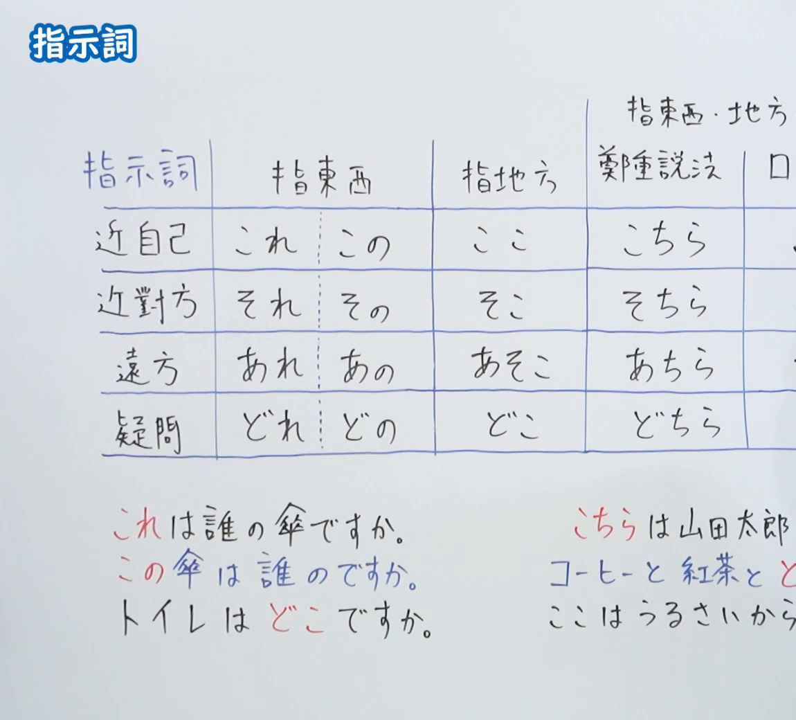
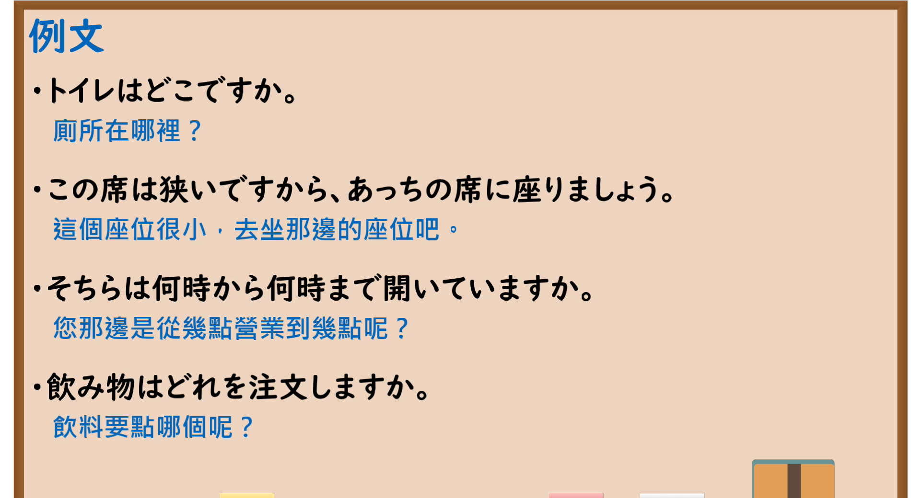

---
{
  "id": "N5-G-0026",
  "kind": "grammar",
  "level": "N5",
  "title": "指示词",
  "card_revision": 2,
  "schema_version": 1,
  "source": {
    "lesson": "N5 第26个语法",
    "material": "出口日語原视频板书（学习者截取的接续图与例句图）与东京外国语大学「これ／それ／あれ」「ここ／そこ／あそこ」「このN／そのN／あのN」解说正文",
    "video": "https://www.youtube.com/watch?v=oLFV9NVepJs",
    "screenshot": "assets/grammar/n5/N5-G-0026-connection.png",
    "screenshot_crop": {
      "x": 0,
      "y": 0,
      "width": 1150,
      "height": 1040
    }
  },
  "tags": [
    "指示词",
    "これ",
    "ここ",
    "この",
    "N5"
  ],
  "confusions": [
    "これ／この",
    "どれ／どの",
    "ここ／こちら",
    "どこ／どちら",
    "こちら／こっち"
  ]
}
---

# N5 第26个语法：指示词

# 视频学习资料整理

- 课程：[出口日語「指示詞」](https://www.youtube.com/watch?v=oLFV9NVepJs)
- 视频 ID：`oLFV9NVepJs`
- 视频时长：8分48秒

## 接续图

- 实际时间：未记录（图片由学习者从原视频截取并提供）
- 成品图尺寸：1150×1040，固定左上角 `(0, 0)`，右下角 `(1150, 1040)`
- 板书内容：标题「指示詞」，无接续公式；板书为表格：纵列「近自己／近對方／遠方／疑問」，横列「指東西（これ／この、それ／その、あれ／あの、どれ／どの）」「指地方（ここ／そこ／あそこ／どこ）」「指東西・地方 鄭重説法（こちら／そちら／あちら／どちら）」，其右「口…」列被画面右缘截断；下方例句「これは誰の傘ですか」「この傘は誰のですか」「トイレはどこですか」，右侧「こちらは山田太郎…」「コーヒーと紅茶と ど…」「ここはうるさいから…」被截断，未补写。

## 例句图

- 实际时间：未记录（图片由学习者从原视频截取并提供）
- 成品图尺寸：1900×1040，固定左上角 `(0, 0)`，右下角 `(1900, 1040)`
- 板书内容：课程「例文」页，含四条例句及中文翻译（トイレはどこですか／この席は狭いですから、あっちの席に座りましょう／そちらは何時から何時まで開いていますか／飲み物はどれを注文しますか）。四条例句均完整可见。

# 核心

## 功能一：指示事物、场所（近称、中称、远称、疑问）

**くわしい意味記述：**

- **これ／それ／あれ：** 「これ／それ／あれ」は指示詞です。特定のものをさします。近い領域のものを「これ」、遠い領域のものを「あれ」、中間の領域のものを「それ」でさします。（「これ／それ／あれ」是指示词，指称特定的东西。近处的称「これ」，远处的称「あれ」，中间的称「それ」。）
- **ここ／そこ／あそこ：** 「ここ／そこ／あそこ」は指示詞です。特定の場所をさします。（「ここ／そこ／あそこ」是指示词，指称特定的场所。）
- **このN／そのN／あのN：** 「この／その／あの」は指示詞です。特定のNをさし示します。Nを修飾することばがある場合の語順に注意しましょう。（「この／その／あの」是指示词，指示特定的N。有修饰N的词语时要注意语序。）
- **話し手と聞き手の位置：** 話し手と聞き手が異なる位置に立つ状況では、話し手の周囲の領域のものは「これ」、聞き手側の領域のものは「それ」、両方から遠い領域のものは「あれ」でさします。（说话人与听话人站在不同位置时，说话人周围的称「これ」，听话人一侧的称「それ」，离双方都远的称「あれ」。）

### 例句

1. これは日本語の教科書です。

   （这是日语教科书。）

2. あれは体育館です。

   （那是体育馆。）

3. ここは１年生の教室です。

   （这里是一年级的教室。）

4. この部屋は２年生の教室です。

   （这个房间是二年级的教室。）

5. その大きいかばんはわたしのです。

   （那个大包是我的。）

# 来源

- [出口日語原视频](https://www.youtube.com/watch?v=oLFV9NVepJs)
- 东京外国语大学「日本語 文法」解说：[「これ／それ／あれ」](https://www.coelang.tufs.ac.jp/mt/ja/gmod/contents/explanation/011.html)、[「ここ／そこ／あそこ」](https://www.coelang.tufs.ac.jp/mt/ja/gmod/contents/explanation/012.html)、[「このN／そのN／あのN」](https://www.coelang.tufs.ac.jp/mt/ja/gmod/contents/explanation/013.html)（查询日期：2026-10-16；Hagoromo、毎日のんびり日本語教師、日本語NET 均未找到直接对应条目，按流程采用互联网检索所得的三页；板书中的「こちら／そちら／あちら」「どれ／どの／どこ／どちら」三页未解说「こちら」系列，卡内未写其解释；例句译文为整理者所译）
