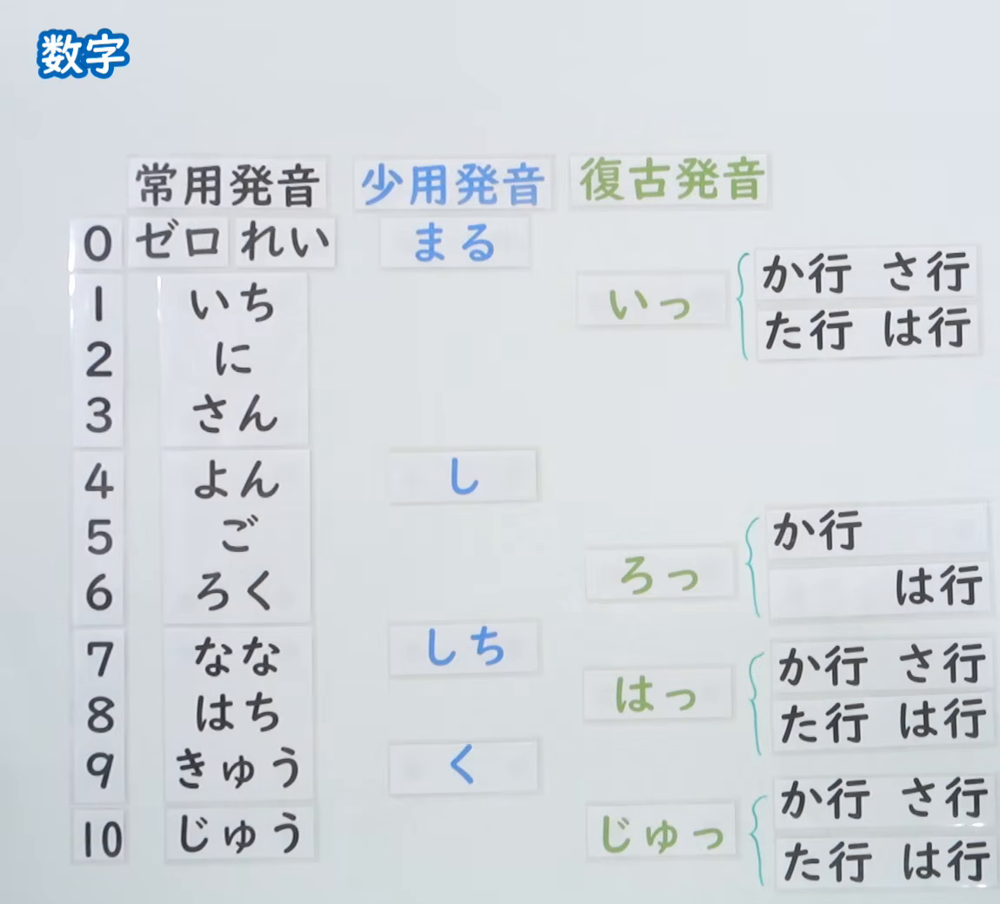
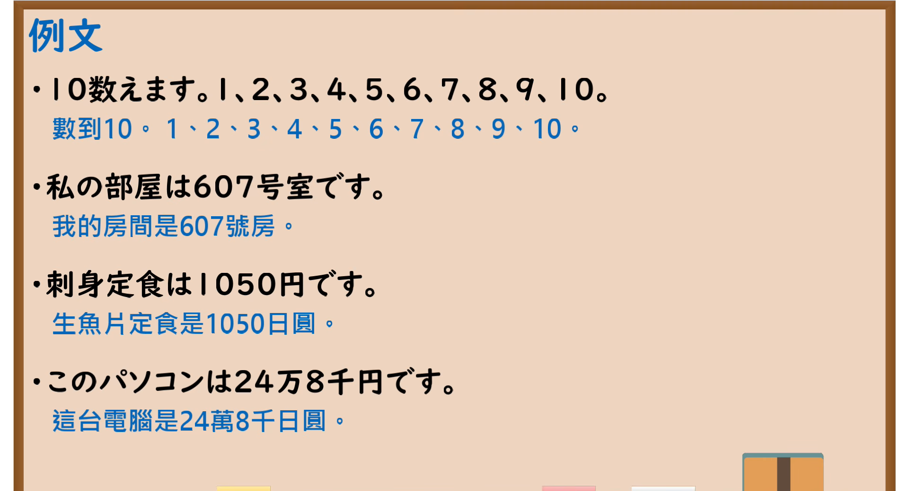

---
{
  "id": "N5-G-0027",
  "kind": "grammar",
  "level": "N5",
  "title": "数字",
  "card_revision": 2,
  "schema_version": 1,
  "source": {
    "lesson": "N5 第27个语法",
    "material": "出口日語原视频板书（学习者截取的接续图与例句图）与东京外国语大学「数詞（1）」「～時」「○○分・半」解说正文",
    "video": "https://www.youtube.com/watch?v=3fqzAjezi2k",
    "screenshot": "assets/grammar/n5/N5-G-0027-connection.png",
    "screenshot_crop": {
      "x": 0,
      "y": 0,
      "width": 1150,
      "height": 1040
    }
  },
  "tags": [
    "数字",
    "读法",
    "数词",
    "N5"
  ],
  "confusions": [
    "よん／し",
    "なな／しち",
    "きゅう／く",
    "促音化／一般读法",
    "数字／助数词"
  ]
}
---

# N5 第27个语法：数字

# 视频学习资料整理

- 课程：[出口日語「数字」](https://www.youtube.com/watch?v=3fqzAjezi2k)
- 视频 ID：`3fqzAjezi2k`
- 视频时长：14分42秒

## 接续图

- 实际时间：未记录（图片由学习者从原视频截取并提供）
- 成品图尺寸：1150×1040，固定左上角 `(0, 0)`，右下角 `(1150, 1040)`
- 板书内容：标题「数字」，无接续公式；板书为读法表：纵列0至10，横列「常用発音」「少用発音」「復古発音」。常用発音：0ゼロ・れい，1いち，2に，3さん，4よん，5ご，6ろく，7なな，8はち，9きゅう，10じゅう；少用発音：0まる，4し，7しち，9く；復古発音（促音化）：1「いっ」（か行・さ行・た行・は行），6「ろっ」（か行・は行），8「はっ」（か行・さ行・た行・は行），10「じゅっ」（か行・さ行・た行・は行）。板书完整，无遮挡。

## 例句图

- 实际时间：未记录（图片由学习者从原视频截取并提供）
- 成品图尺寸：1900×1040，固定左上角 `(0, 0)`，右下角 `(1900, 1040)`
- 板书内容：课程「例文」页，含四条例句及中文翻译（10数えます。1、2、3、4、5、6、7、8、9、10。／私の部屋は607号室です／刺身定食は1050円です／このパソコンは24万8千円です）。四条例句均完整可见。

# 核心

## 功能一：数字的读法（常用读法与少用读法）

**くわしい意味記述：**

- **「０」「４」「７」「９」の読み方：** 「０」「４」「７」「９」には２とおりの読み方があります。０：れい、ゼロ／４：よん、し／７：なな、しち／９：きゅう、く。ただし、数えるものによってどちらか一方が選ばれることが多いです。（「0」「4」「7」「9」各有两种读法。0：れい、ゼロ；4：よん、し；7：なな、しち；9：きゅう、く。但是根据所数的东西，多半会选其中一种。）
- **時刻の場合：** 「４」は「よん」や「し」と読みますが、時刻の場合は「よ（じ）」になります。「７」は時刻の場合は「しち（じ）」、「９」は時刻の場合は「く（じ）」となります。（「4」时刻读作「よ（じ）」，「7」时刻读作「しち（じ）」，「9」时刻读作「く（じ）」。）

### 例句

1. 今、５時です。

   （现在是5点。）

2. A：今、何時ですか。　B：４時です。

   （A：现在几点？　B：4点。）

3. A：今、何時何分ですか。　B：10時51分です。

   （A：现在几点几分？　B：10点51分。）

# 来源

- [出口日語原视频](https://www.youtube.com/watch?v=3fqzAjezi2k)
- 东京外国语大学「日本語 文法」解说：[「数詞（1）」](https://www.coelang.tufs.ac.jp/mt/ja/gmod/contents/explanation/015.html)、[「～時」](https://www.coelang.tufs.ac.jp/mt/ja/gmod/contents/explanation/018.html)、[「○○分・半」](https://www.coelang.tufs.ac.jp/mt/ja/gmod/contents/explanation/019.html)（查询日期：2026-10-16；Hagoromo、毎日のんびり日本語教師、日本語NET 均未找到直接对应条目，按流程采用互联网检索所得的三页；这些页面没有解说板书中的「復古発音」（促音化）规则，卡内未写，需另找来源补充；例句只有 3 条，为这三页中与数字读法相关的全部句子；例句译文为整理者所译）
