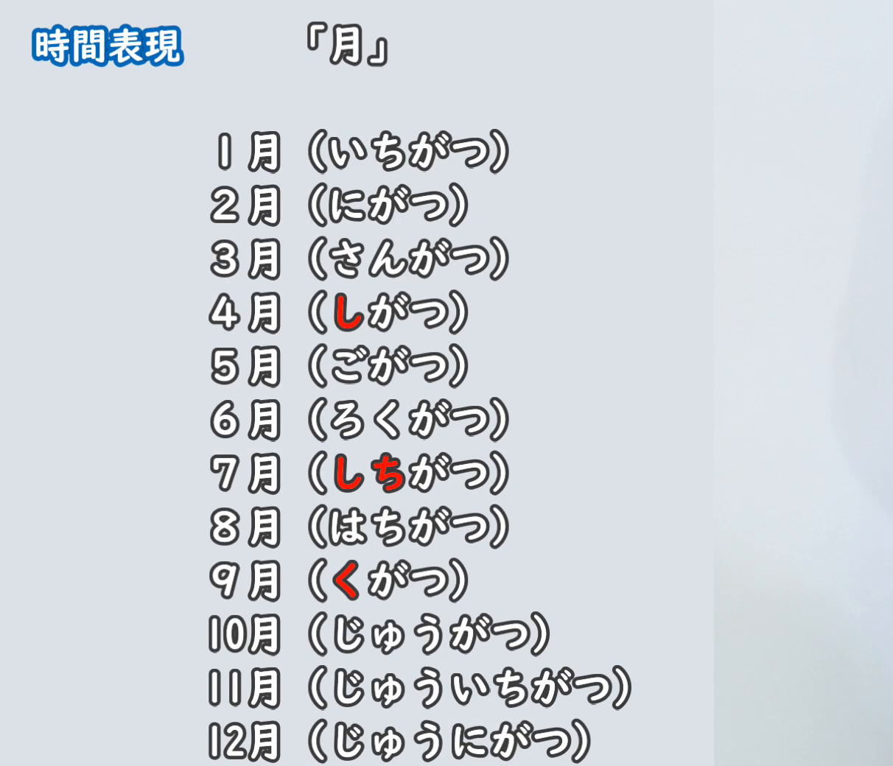
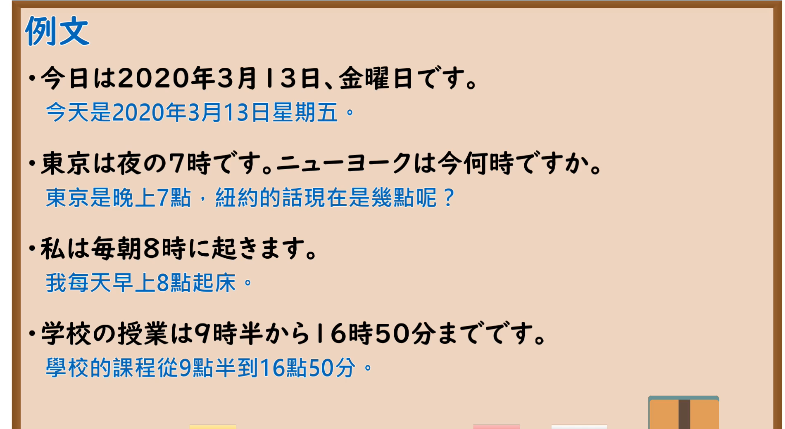

---
{
  "id": "N5-G-0028",
  "kind": "grammar",
  "level": "N5",
  "title": "时间表现",
  "card_revision": 2,
  "schema_version": 1,
  "source": {
    "lesson": "N5 第28个语法",
    "material": "出口日語原视频板书（学习者截取的接续图与例句图）与东京外国语大学「～時」「○○分・半」「昨日・今日など」「月・日付・曜日」解说正文",
    "video": "https://www.youtube.com/watch?v=QRyu_Yud0gs",
    "screenshot": "assets/grammar/n5/N5-G-0028-connection.png",
    "screenshot_crop": {
      "x": 0,
      "y": 0,
      "width": 1212,
      "height": 1040
    }
  },
  "tags": [
    "时间",
    "月",
    "日期",
    "时刻",
    "N5"
  ],
  "confusions": [
    "月的读音",
    "日的读音",
    "时／时间",
    "分的读音",
    "日期一日／时长一日"
  ]
}
---

# N5 第28个语法：时间表现

# 视频学习资料整理

- 课程：[出口日語「時間表現」](https://www.youtube.com/watch?v=QRyu_Yud0gs)
- 视频 ID：`QRyu_Yud0gs`
- 视频时长：14分37秒

## 接续图

- 实际时间：未记录（图片由学习者从原视频截取并提供）
- 成品图尺寸：1212×1040，固定左上角 `(0, 0)`，右下角 `(1212, 1040)`
- 板书内容：标题「時間表現」，右上标注「月」；板书为1月至12月的读音表：いちがつ、にがつ、さんがつ、しがつ（「し」红字）、ごがつ、ろくがつ、しちがつ（「しち」红字）、はちがつ、くがつ（「く」红字）、じゅうがつ、じゅういちがつ、じゅうにがつ。画面右侧有明显的灰色色块，是原视频画面所致。

## 例句图

- 实际时间：未记录（图片由学习者从原视频截取并提供）
- 成品图尺寸：1900×1040，固定左上角 `(0, 0)`，右下角 `(1900, 1040)`
- 板书内容：课程「例文」页，含四条例句及中文翻译（今日は2020年3月13日、金曜日です／東京は夜の7時です。ニューヨークは今何時ですか／私は毎朝8時に起きます／学校の授業は9時半から16時50分までです）。四条例句均完整可见。

# 核心

## 功能一：时间的表达（月、日、星期、时、分）

**くわしい意味記述：**

- **時刻：** 「数字＋時」で時刻を表わします。時刻をたずねるときは「何時」を使います。（用「数字＋時」表示时刻。询问时刻时使用「何時」。）
- **分：** 「〇〇分」の言い方は、「分」の前にくる数詞によって「ふん」になったり「ぷん」になったりします。分数をたずねるときは「何分」を使います。（「〇〇分」的说法，根据「分」前面的数词，「分」读作「ふん」或「ぷん」。询问分钟时使用「何分」。）
- **昨日・今日など：** 「一昨日・昨日・今日・明日・明後日」は日を、「先々週・先週・今週・来週・再来週」は週を、「先々月・先月・今月・来月・再来月」は月を、「一昨年・去年・今年・来年・再来年」は年を表わします。（「一昨日・昨日・今日・明日・明後日」表示日，「先々週…再来週」表示周，「先々月…再来月」表示月，「一昨年…再来年」表示年。）
- **月・日付・曜日：** 月・日付・曜日をたずねるときは、「何月何日」「何曜日」を使います。（询问月、日期、星期时，使用「何月何日」「何曜日」。）

### 例句

1. 今、５時です。

   （现在是5点。）

2. A：今、何時何分ですか。　B：10時51分です。

   （A：现在几点几分？　B：10点51分。）

3. A：きょうは何月何日ですか。　B：5月21日です。

   （A：今天是几月几号？　B：5月21日。）

4. A：あしたは何曜日ですか。　B：日曜日です。

   （A：明天是星期几？　B：星期日。）

# 来源

- [出口日語原视频](https://www.youtube.com/watch?v=QRyu_Yud0gs)
- 东京外国语大学「日本語 文法」解说：[「～時」](https://www.coelang.tufs.ac.jp/mt/ja/gmod/contents/explanation/018.html)、[「○○分・半」](https://www.coelang.tufs.ac.jp/mt/ja/gmod/contents/explanation/019.html)、[「昨日・今日など」](https://www.coelang.tufs.ac.jp/mt/ja/gmod/contents/explanation/020.html)、[「月・日付・曜日」](https://www.coelang.tufs.ac.jp/mt/ja/gmod/contents/explanation/022.html)（查询日期：2026-10-16；Hagoromo、毎日のんびり日本語教師、日本語NET 均未找到直接对应条目，按流程采用互联网检索所得的四页；这些页面把月、日期的具体读音放在图表中，没有文字化的读音表，卡内未转写月、日的读音，读音以接续图板书为准；例句译文为整理者所译）
