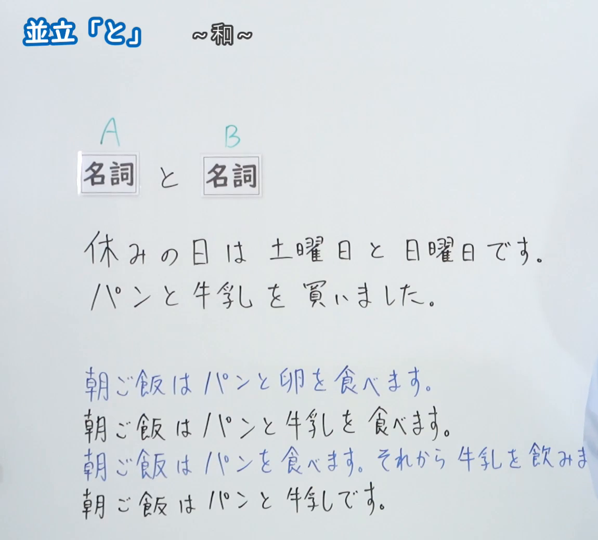
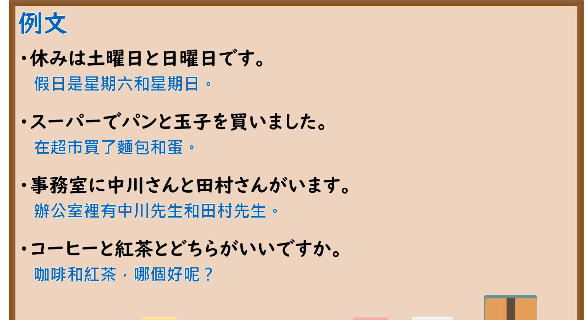

---
{
  "id": "N5-G-0029",
  "kind": "grammar",
  "level": "N5",
  "title": "助词：并立「と」",
  "card_revision": 2,
  "schema_version": 1,
  "source": {
    "lesson": "N5 第29个语法",
    "material": "出口日語原视频板书（学习者截取的接续图与例句图）与东京外国语大学「NとN：解説」正文",
    "video": "https://www.youtube.com/watch?v=Vcdwe_5WCU4",
    "screenshot": "assets/grammar/n5/N5-G-0029-connection.png",
    "screenshot_crop": {
      "x": 0,
      "y": 0,
      "width": 1150,
      "height": 1040
    }
  },
  "tags": [
    "と",
    "助词",
    "并立",
    "N5"
  ],
  "confusions": [
    "并列のと／动作伙伴のと",
    "と／や",
    "并列名词／谓语搭配"
  ]
}
---

# N5 第29个语法：助词「と」（并立）

# 视频学习资料整理

- 课程：[出口日語「助詞：並立「と」」](https://www.youtube.com/watch?v=Vcdwe_5WCU4)
- 视频 ID：`Vcdwe_5WCU4`
- 视频时长：5分9秒

## 接续图

- 实际时间：未记录（图片由学习者从原视频截取并提供）
- 成品图尺寸：1150×1040，固定左上角 `(0, 0)`，右下角 `(1150, 1040)`
- 板书内容：标题「並立「と」」，右侧标注“～和～”；「名詞（A） と 名詞（B）」；例句「休みの日は土曜日と日曜日です」「パンと牛乳を買いました」；下方四行对比句：「朝ご飯はパンと卵を食べます」「朝ご飯はパンと牛乳を食べます」「朝ご飯はパンを食べます。それから牛乳を飲みま（す）」「朝ご飯はパンと牛乳です」，第三行句末被画面右缘截断，未补写。

## 例句图

- 实际时间：未记录（图片由学习者从原视频截取并提供）
- 成品图尺寸：1900×1040，固定左上角 `(0, 0)`，右下角 `(1900, 1040)`
- 板书内容：课程「例文」页，含四条例句及中文翻译（休みは土曜日と日曜日です／スーパーでパンと玉子を買いました／事務室に中川さんと田村さんがいます／コーヒーと紅茶とどちらがいいですか）。四条例句均完整可见。

# 核心

## 功能一：～和～

**くわしい意味記述：**

- **NとN：** 「と」は助詞です。複数の名詞をつなぎます。「と」でつながれた名詞は、文の中で一つの名詞のように使えます。（「と」是助词，连接多个名词。由「と」连接的名词在句中可以当作一个名词使用。）
- **文と文：** 文と文をつなぐときに、「と」ではつなげません。文と文をつなぐときは、「そして」または動詞の「て形」などを使います。（连接句子与句子时不能用「と」，要使用「そして」或动词的「て形」等。）

### 例句

1. 田中さんと山田さんは大学２年生です。

   （田中和山田是大学二年级学生。）

2. わたしはパンとサラダを食べます。

   （我吃面包和沙拉。）

3. 机の上に本とノートがあります。

   （桌上有书和笔记本。）

4. 月曜日と水曜日と金曜日にサッカーの練習があります。

   （星期一、星期三和星期五有足球练习。）

# 来源

- [出口日語原视频](https://www.youtube.com/watch?v=Vcdwe_5WCU4)
- [东京外国语大学「日本語 文法 NとN：解説」](https://www.coelang.tufs.ac.jp/mt/ja/gmod/contents/explanation/047.html)（查询日期：2026-10-16；Hagoromo 未收录；毎日のんびり日本語教師的 N5 条目「～と」及「格助詞「と」の用法一覧」无名词并列用法的小节，日本語NET 无对应条目，按流程采用互联网检索所得的该页；例句译文为整理者所译）
