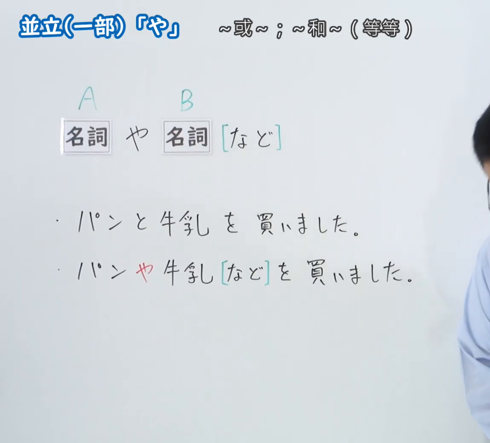
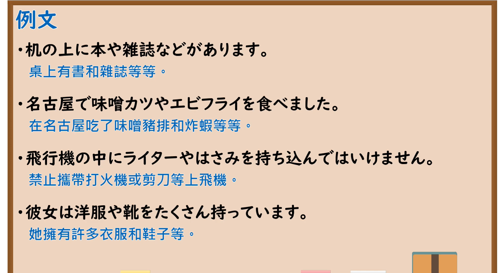

---
{
  "id": "N5-G-0030",
  "kind": "grammar",
  "level": "N5",
  "title": "助词：并立（一部）「や」",
  "card_revision": 2,
  "schema_version": 1,
  "source": {
    "lesson": "N5 第30个语法",
    "material": "出口日語原视频板书（学习者截取的接续图与例句图）与东京外国语大学「NやN：解説」正文",
    "video": "https://www.youtube.com/watch?v=Ys3Uq2JDjdw",
    "screenshot": "assets/grammar/n5/N5-G-0030-connection.png",
    "screenshot_crop": {
      "x": 0,
      "y": 0,
      "width": 1150,
      "height": 1040
    }
  },
  "tags": [
    "や",
    "助词",
    "并立",
    "N5"
  ],
  "confusions": [
    "や／と",
    "や／など",
    "不完全列举／完整列举"
  ]
}
---

# N5 第30个语法：助词「や」（部分并立）

# 视频学习资料整理

- 课程：[出口日語「助詞：並立（一部）「や」」](https://www.youtube.com/watch?v=Ys3Uq2JDjdw)
- 视频 ID：`Ys3Uq2JDjdw`
- 视频时长：4分25秒

## 接续图

- 实际时间：未记录（图片由学习者从原视频截取并提供）
- 成品图尺寸：1150×1040，固定左上角 `(0, 0)`，右下角 `(1150, 1040)`
- 板书内容：标题「並立（一部）「や」」，右侧标注“～或～；～和～（等等）”；「名詞（A） や 名詞（B）［など］」；两句对比：「パンと牛乳を買いました」「パンや牛乳［など］を買いました」（「や」红字，「など」青色方括号）。老师身影出现在画面右缘，对板书无遮挡。

## 例句图

- 实际时间：未记录（图片由学习者从原视频截取并提供）
- 成品图尺寸：1900×1040，固定左上角 `(0, 0)`，右下角 `(1900, 1040)`
- 板书内容：课程「例文」页，含四条例句及中文翻译（机の上に本や雑誌などがあります／名古屋で味噌カツやエビフライを食べました／飛行機の中にライターやはさみを持ち込んではいけません／彼女は洋服や靴をたくさん持っています）。四条例句均完整可见。

# 核心

## 功能一：～或～；～和～（等等）

**くわしい意味記述：**

- **NやN：** 「や」は助詞です。複数の名詞をつなぎます。N1、N2のように、該当する項目のいくつかを例として示すときに使います。ほかにも該当する項目があることを暗示します。（「や」是助词，连接多个名词。用于像N1、N2这样举出符合条件的若干项目作为例子，暗示还有其他符合的项目。）
- **「など」：** 「N1やN2など」の形で使うこともできます。「など」は助詞で、ほかに同類のものが存在することを暗示します。ただし、「など」は人には使いません。人のときは「たち」を使います。（也可以使用「N1やN2など」的形式。「など」是助词，暗示还存在其他同类的东西。但「など」不用于人，指人时用「たち」。）
- **「と」との違い：** 「と」との違いは、該当する項目をすべて示すか示さないかということです。（与「と」的区别在于是否列出所有符合的项目。）

### 例句

1. わたしは日曜日に［漫画や雑誌］を読みます。

   （我星期日看漫画和杂志（等）。）

2. ［デパートやスーパー］で買い物をします。

   （在百货商场、超市等地购物。）

3. ［郵便局の前や駅のそば］にポストがあります。

   （邮局前、车站旁等处有邮筒。）

4. ［パンや卵］などを食べます。

   （吃面包、鸡蛋等。）

5. わたしの部屋に［机やベッドやテレビ］などがあります。

   （我的房间里有桌子、床、电视等。）

# 来源

- [出口日語原视频](https://www.youtube.com/watch?v=Ys3Uq2JDjdw)
- [东京外国语大学「日本語 文法 NやN：解説」](https://www.coelang.tufs.ac.jp/mt/ja/gmod/contents/explanation/048.html)（查询日期：2026-10-16；Hagoromo 未收录，毎日のんびり日本語教師和日本語NET 无对应条目，按流程采用互联网检索所得的该页；例句译文为整理者所译）
