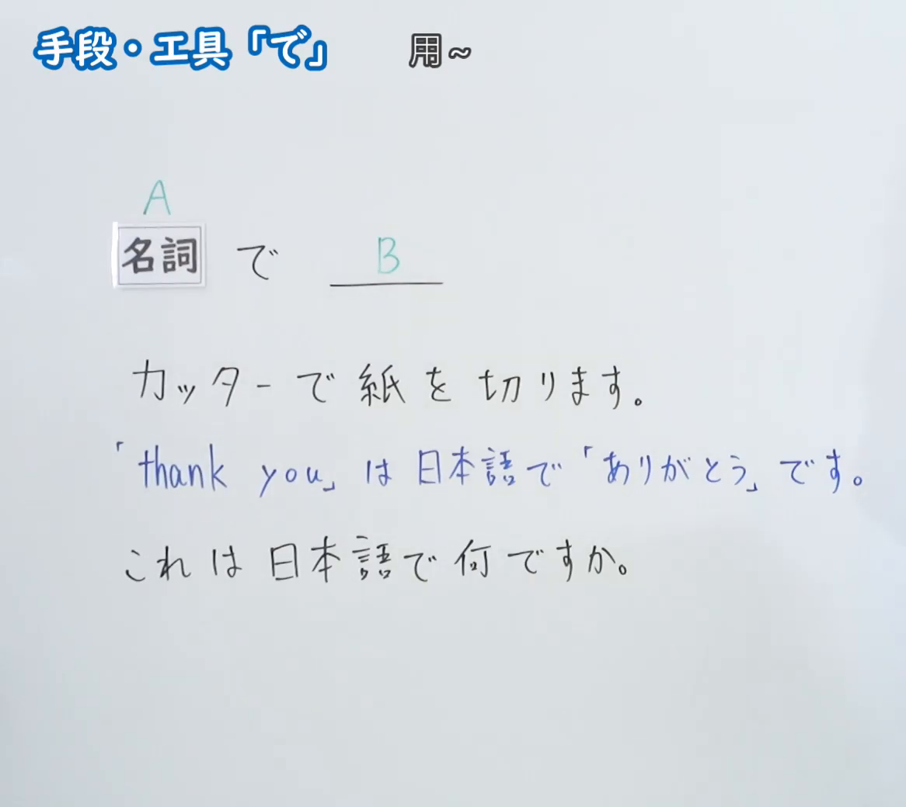
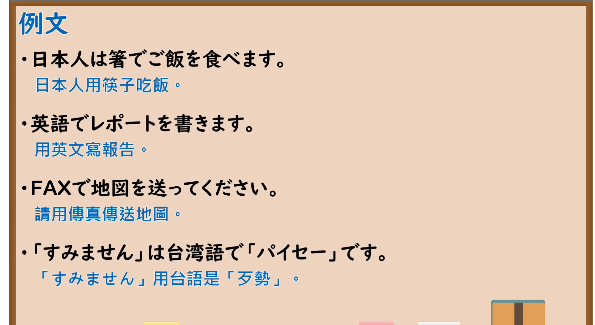

---
{
  "id": "N5-G-0031",
  "kind": "grammar",
  "level": "N5",
  "title": "助词：手段・工具「で」",
  "card_revision": 2,
  "schema_version": 1,
  "source": {
    "lesson": "N5 第31个语法",
    "material": "出口日語原视频板书（学习者截取的接续图与例句图）与毎日のんびり日本語教師「格助詞「で」の用法一覧」正文",
    "video": "https://www.youtube.com/watch?v=QmVm0TJgYpk",
    "screenshot": "assets/grammar/n5/N5-G-0031-connection.png",
    "screenshot_crop": {
      "x": 0,
      "y": 0,
      "width": 1166,
      "height": 1040
    }
  },
  "tags": [
    "で",
    "助词",
    "手段",
    "工具",
    "N5"
  ],
  "confusions": [
    "手段の で／地点の で",
    "で／に",
    "语言の で／を",
    "工具／交通工具"
  ]
}
---

# N5 第31个语法：助词「で」（手段・工具）

# 视频学习资料整理

- 课程：[出口日語「助詞：手段・工具「で」」](https://www.youtube.com/watch?v=QmVm0TJgYpk)
- 视频 ID：`QmVm0TJgYpk`
- 视频时长：4分8秒

## 接续图

- 实际时间：未记录（图片由学习者从原视频截取并提供）
- 成品图尺寸：1166×1040，固定左上角 `(0, 0)`，右下角 `(1166, 1040)`
- 板书内容：标题「手段・工具「で」」，右侧标注“用～”；「名詞（A） で ＿＿（B）」；三行例句：「カッターで紙を切ります」「「thank you」は日本語で「ありがとう」です」「これは日本語で何ですか」。板书完整，无遮挡。

## 例句图

- 实际时间：未记录（图片由学习者从原视频截取并提供）
- 成品图尺寸：1900×1040，固定左上角 `(0, 0)`，右下角 `(1900, 1040)`
- 板书内容：课程「例文」页，含四条例句及中文翻译（日本人は箸でご飯を食べます／英語でレポートを書きます／FAXで地図を送ってください／「すみません」は台湾語で「パイセー」です）。四条例句均完整可见。

# 核心

## 功能一：用～（表示手段、工具）

**くわしい意味記述：**

- **道具：** 述語の事態を成立させるために用いられる「物」としての手段は「で」で表します。この用法の「で」は「～を使って」「～を用いて」などに言い換えられます。（为使谓语事态成立而使用的作为“物”的手段用「で」表示。这个「で」可以换成「～を使って」「～を用いて」等。）
- **方法：** 述語の事態を成立させるために採用される方法は「で」で表します。方法、方式、作戦など抽象的な手段であり、「～を使って」「～を用いて」などに言い換えられるものも言い換えられないものもあります。（为使谓语事态成立而采用的方法用「で」表示。是方法、方式、策略等抽象的手段，有的能换成「～を使って」「～を用いて」，有的不能。）

### 例句

1. ハサミで紙を切る。

   （用剪刀剪纸。）

2. スマホで写真を撮る。

   （用手机拍照。）

3. スプーンでスープを飲む。

   （用汤匙喝汤。）

4. 副業でお金を稼ぐ。

   （通过兼职赚钱。）

5. １８歳になると、みんなの代表を選挙で選ぶことのできる権利が与えられます。

   （到了18岁，每个人都被授予通过选举选择代表的权利。）

# 来源

- [出口日語原视频](https://www.youtube.com/watch?v=QmVm0TJgYpk)
- [毎日のんびり日本語教師「格助詞「で」の用法一覧」「道具」「方法」](https://mainichi-nonbiri.com/jltct/de-case-particle/)（查询日期：2026-10-16；Hagoromo 未收录，按流程采用优先级最高的备选网站该页，中文译文取自该页；板书中的“语言”用法（日本語で、英語で）该页未单独列出）
