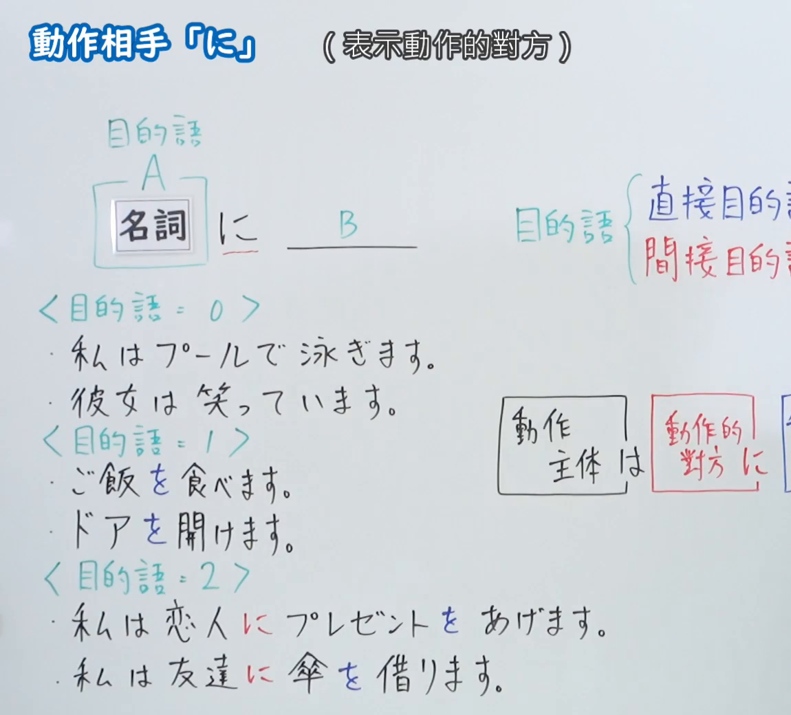
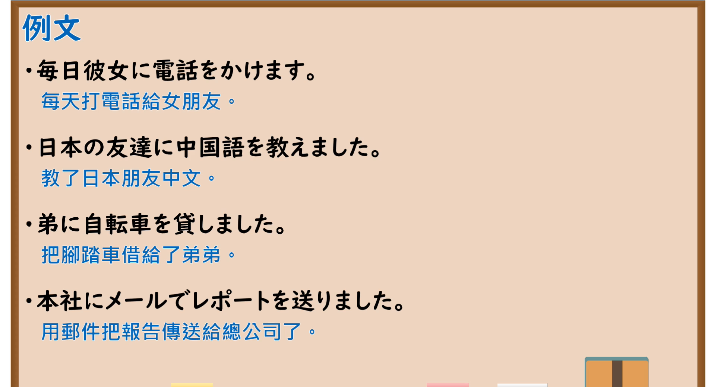

---
{
  "id": "N5-G-0032",
  "kind": "grammar",
  "level": "N5",
  "title": "助词：动作相手「に」",
  "card_revision": 2,
  "schema_version": 1,
  "source": {
    "lesson": "N5 第32个语法",
    "material": "出口日語原视频板书（学习者截取的接续图与例句图）与毎日のんびり日本語教師「格助詞「に」の用法一覧」正文",
    "video": "https://www.youtube.com/watch?v=DBvJIYAexwM",
    "screenshot": "assets/grammar/n5/N5-G-0032-connection.png",
    "screenshot_crop": {
      "x": 0,
      "y": 0,
      "width": 1150,
      "height": 1040
    }
  },
  "tags": [
    "に",
    "助词",
    "动作对方",
    "N5"
  ],
  "confusions": [
    "に／を",
    "に／から",
    "に／と",
    "动作对方／到达点"
  ]
}
---

# N5 第32个语法：助词「に」（动作的对方）

# 视频学习资料整理

- 课程：[出口日語「助詞：動作相手「に」」](https://www.youtube.com/watch?v=DBvJIYAexwM)
- 视频 ID：`DBvJIYAexwM`
- 视频时长：8分27秒

## 接续图

- 实际时间：未记录（图片由学习者从原视频截取并提供）
- 成品图尺寸：1150×1040，固定左上角 `(0, 0)`，右下角 `(1150, 1040)`
- 板书内容：标题「動作相手「に」」，右侧标注“（表示動作的對方）”；「名詞（A） に ＿＿（B）」，上标「目的語」；右侧「目的語{直接目的…／間接目的…」被画面右缘截断；按目的語数量分类的例句：＜目的語＝0＞「私はプールで泳ぎます」「彼女は笑っています」，＜目的語＝1＞「ご飯を食べます」「ドアを開けます」，＜目的語＝2＞「私は恋人にプレゼントをあげます」「私は友達に傘を借ります」（「に」红字，「を」蓝字）；右侧「動作主体は 動作的對方に…」的方框图被画面右缘截断，未补写。

## 例句图

- 实际时间：未记录（图片由学习者从原视频截取并提供）
- 成品图尺寸：1900×1040，固定左上角 `(0, 0)`，右下角 `(1900, 1040)`
- 板书内容：课程「例文」页，含四条例句及中文翻译（毎日彼女に電話をかけます／日本の友達に中国語を教えました／弟に自転車を貸しました／本社にメールでレポートを送りました）。四条例句均完整可见。

# 核心

## 功能一：表示动作的对方

**くわしい意味記述：**

- **動作の向かう相手：** 「反対する」「噛みつく」「恋する」「ぶつかる」「会う」「触れる」「憧れる」などの主体が相手に向かって何らかの動作が行われるような動詞が述語にくるとき、その相手は「に」で表されます。（谓语是「反対する」「噛みつく」「恋する」「ぶつかる」「会う」「触れる」「憧れる」等主体对对方进行某种动作的动词时，该对方用「に」表示。）
- **授受の受け手：** 「ＸがＹにＺを～する」において、Ｘが所有するものなどをＹに移すことを表す「あげる」系の授受動詞が述語にくるとき、その授受の受け手は「に」で表されます。（在「ＸがＹにＺを～する」中，谓语是表示把Ｘ所有的东西转移给Ｙ的「あげる」类授受动词时，授受的接受方用「に」表示。）
- **授受の与え手：** 「もらう」系の授受動詞が述語にくるとき、その授受の与え手は「に」で表されます。「もらう」「受ける」「教わる」「習う」「借りる」など。だいたい「から」に置き換えられます。（谓语是「もらう」类授受动词时，授受的给予方用「に」表示。大致可以换成「から」。）

### 例句

1. これから上司に会う。

   （我要见上司。）

2. 友人に電話をかける。

   （给朋友打电话。）

3. 私は友達にプレゼントをあげた。

   （我给了朋友一份礼物。）

4. 母にパソコンの使い方を教える。

   （我教母亲如何使用电脑。）

5. 友達にお金を借りた。

   （我向朋友借了钱。）

# 来源

- [出口日語原视频](https://www.youtube.com/watch?v=DBvJIYAexwM)
- [毎日のんびり日本語教師「格助詞「に」の用法一覧」「動作の向かう相手」「授受の受け手」「授受の与え手」](https://mainichi-nonbiri.com/jltct/ni-case-particle/)（查询日期：2026-10-16；Hagoromo 未收录，按流程采用优先级最高的备选网站该页，中文译文取自该页；板书的“目的语=0/1/2”分类该页没有解说）
