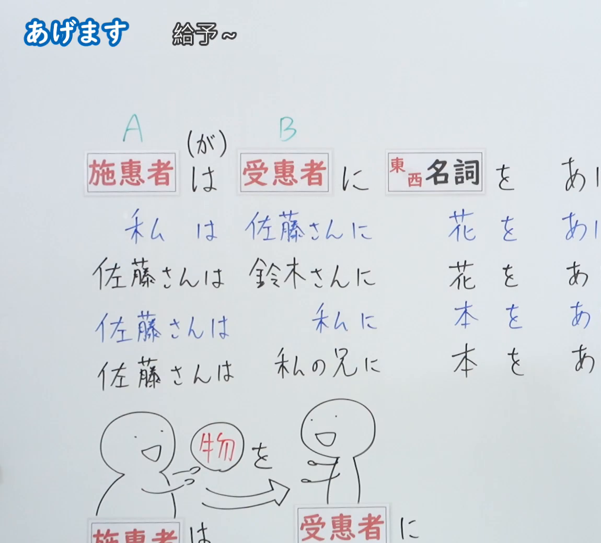
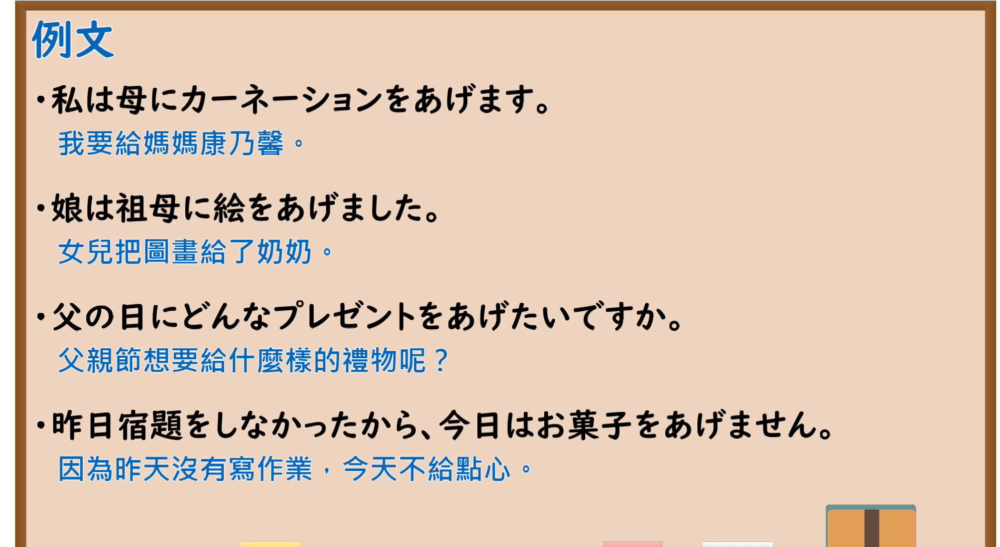

---
{
  "id": "N5-G-0033",
  "kind": "grammar",
  "level": "N5",
  "title": "授受动词「あげます」",
  "card_revision": 2,
  "schema_version": 1,
  "source": {
    "lesson": "N5 第33个语法",
    "material": "出口日語原视频板书（学习者截取的接续图与例句图）与毎日のんびり日本語教師「【Ｎ４文法】～あげる／やる／差し上げる」正文",
    "video": "https://www.youtube.com/watch?v=neL6eLJNj0A",
    "screenshot": "assets/grammar/n5/N5-G-0033-connection.png",
    "screenshot_crop": {
      "x": 0,
      "y": 0,
      "width": 1150,
      "height": 1040
    }
  },
  "tags": [
    "あげます",
    "授受动词",
    "给予",
    "N5"
  ],
  "confusions": [
    "あげる／くれる",
    "我／我方",
    "に／を",
    "あげる／差し上げる"
  ]
}
---

# N5 第33个语法：あげます

# 视频学习资料整理

- 课程：[出口日語「あげます」](https://www.youtube.com/watch?v=neL6eLJNj0A)
- 视频 ID：`neL6eLJNj0A`
- 视频时长：7分24秒

## 接续图

- 实际时间：未记录（图片由学习者从原视频截取并提供）
- 成品图尺寸：1150×1040，固定左上角 `(0, 0)`，右下角 `(1150, 1040)`
- 板书内容：标题「あげます」，右侧标注“給予～”；「施恵者（A）(が)は 受恵者（B）に 東西名詞 を あげ(ます)」（句末被画面右缘截断）；四行例句：「私は佐藤さんに花をあげ(ます)」「佐藤さんは鈴木さんに花をあ(げます)」「佐藤さんは私に本をあ(げます)」「佐藤さんは私の兄に本をあ(げます)」，各句末被截断；下方手绘：施惠者递出“物を”给受惠者，下方「施惠者は／受惠者に」被画面下缘截断，未补写。

## 例句图

- 实际时间：未记录（图片由学习者从原视频截取并提供）
- 成品图尺寸：1900×1040，固定左上角 `(0, 0)`，右下角 `(1900, 1040)`
- 板书内容：课程「例文」页，含四条例句及中文翻译（私は母にカーネーションをあげます／娘は祖母に絵をあげました／父の日にどんなプレゼントをあげたいですか／昨日宿題をしなかったから、今日はお菓子をあげません）。四条例句均完整可见。

# 核心

## 功能一：给予～

**くわしい意味記述：**

- **～あげる：** 「～あげる／やる／差し上げる」は、内から外への物の移動を表します。自分以外の人物間（外から外）の物の移動を表すこともできます。（「～あげる／やる／差し上げる」表示物品由内向外转移。也可以表示自己以外的人之间（由外到外）的物品转移。）
- **視点：** 「あげる」の視点は主語（与え手）です。受け手視点で述べる場合は「もらう」を使います。（「あげる」的视点是主语（给予方）。从接受方视点叙述时使用「もらう」。）
- **接続：** [主語（与え手）]は[受け手]に[物]をあげる。（[主语（给予方）]は[接受方]に[物品]を あげる。）

### 例句

1. 母に病気平癒のお守りをあげました。

   （给了母亲能治愈疾病的护身符。）

2. 友達にお菓子をあげました。

   （我给了朋友点心。）

3. 姪っ子にお年玉をあげた。

   （我给了侄女压岁钱。）

4. いつもお世話になっている彼にお土産をあげました。

   （我把特产给了一直照顾我的他。）

5. 野良猫に食べ物をあげた。

   （我给了野猫食物。）

# 来源

- [出口日語原视频](https://www.youtube.com/watch?v=neL6eLJNj0A)
- [毎日のんびり日本語教師「【Ｎ４文法】～あげる／やる／差し上げる（さしあげる）」](https://mainichi-nonbiri.com/grammar/n4-ageru/)（查询日期：2026-10-16；Hagoromo 未收录，故按流程采用优先级最高的备选网站条目，该站将本语法归入 N4；中文译文取自该页）
