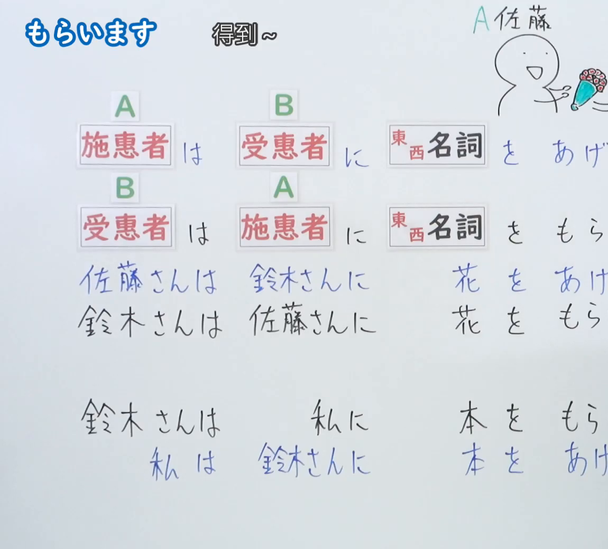
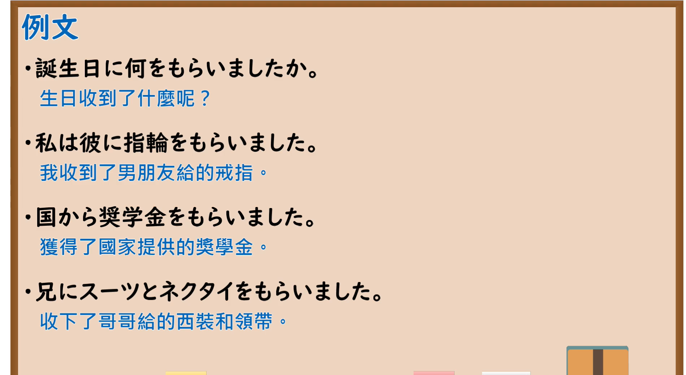

---
{
  "id": "N5-G-0034",
  "kind": "grammar",
  "level": "N5",
  "title": "授受动词「もらいます」",
  "card_revision": 2,
  "schema_version": 1,
  "source": {
    "lesson": "N5 第34个语法",
    "material": "出口日語原视频板书（学习者截取的接续图与例句图）与毎日のんびり日本語教師「【Ｎ４文法】～もらう／頂く（いただく）」正文",
    "video": "https://www.youtube.com/watch?v=3qSNQQKTWmQ",
    "screenshot": "assets/grammar/n5/N5-G-0034-connection.png",
    "screenshot_crop": {
      "x": 0,
      "y": 0,
      "width": 1150,
      "height": 1040
    }
  },
  "tags": [
    "もらいます",
    "授受动词",
    "接受",
    "N5"
  ],
  "confusions": [
    "もらいます／あげます",
    "施惠者／受惠者",
    "に／から",
    "图片中的说话人视角"
  ]
}
---

# N5 第34个语法：もらいます

# 视频学习资料整理

- 课程：[出口日語「もらいます」](https://www.youtube.com/watch?v=3qSNQQKTWmQ)
- 视频 ID：`3qSNQQKTWmQ`
- 视频时长：4分43秒

## 接续图

- 实际时间：未记录（图片由学习者从原视频截取并提供）
- 成品图尺寸：1150×1040，固定左上角 `(0, 0)`，右下角 `(1150, 1040)`
- 板书内容：标题「もらいます」，右侧标注“得到～”；两行对比公式：「施恵者（A）は 受恵者（B）に 東西名詞 を あげ(ます)」「受恵者（B）は 施恵者（A）に 東西名詞 を もら(います)」（句末被画面右缘截断）；例句：「佐藤さんは鈴木さんに花をあげ(ます)」「鈴木さんは佐藤さんに花をもら(います)」「鈴木さんは私に本をもら(います)」「私は鈴木さんに本をあげ(ます)」，句末均被截断；右上角有手绘的“A 佐藤”人物与花束。

## 例句图

- 实际时间：未记录（图片由学习者从原视频截取并提供）
- 成品图尺寸：1900×1040，固定左上角 `(0, 0)`，右下角 `(1900, 1040)`
- 板书内容：课程「例文」页，含四条例句及中文翻译（誕生日に何をもらいましたか／私は彼に指輪をもらいました／国から奨学金をもらいました／兄にスーツとネクタイをもらいました）。四条例句均完整可见。

# 核心

## 功能一：得到～

**くわしい意味記述：**

- **～もらう：** 「～もらう／頂く」は、外から内への物の移動を表します。自分以外の人物間（外から外）の物の移動を表すこともできます。（「～もらう／頂く」表示物品由外向内转移。也可以表示自己以外的人之间（由外到外）的物品转移。）
- **視点：** 「もらう」の視点は主語（受け手）です。与え手視点で述べる場合は「あげる／くれる」を使います。（「もらう」的视点是主语（接受方）。从给予方视点叙述时使用「あげる／くれる」。）
- **接続：** [主語（受け手）]は[与え手]に[物]をもらう。[主語（受け手）]は[与え手]から[物]をもらう。（[主语（接受方）]は[给予方]に／から[物品]を もらう。）

### 例句

1. 彼から勇気をもらった。

   （他给了我勇气。）

2. 先輩からアドバイスをもらった。

   （从前辈那里得到了建议。）

3. 病院から薬をもらってきた。

   （从医院拿了药。）

4. 誕生日プレゼントをもらった。

   （我收到了生日礼物。）

5. 研究室への立ち入りの許可をもらった。

   （我得到了进入研究室的许可。）

# 来源

- [出口日語原视频](https://www.youtube.com/watch?v=3qSNQQKTWmQ)
- [毎日のんびり日本語教師「【Ｎ４文法】～もらう／頂く（いただく）」](https://mainichi-nonbiri.com/grammar/n4-morau/)（查询日期：2026-10-16；Hagoromo 未收录，故按流程采用优先级最高的备选网站条目，该站将本语法归入 N4；中文译文取自该页）
