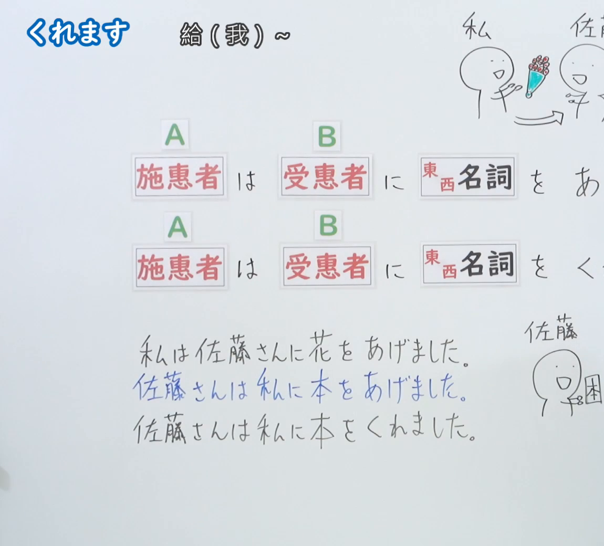
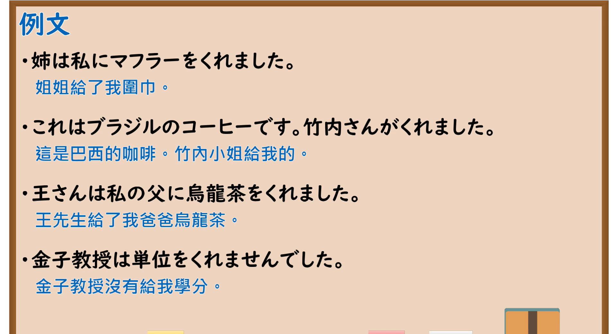

---
{
  "id": "N5-G-0035",
  "kind": "grammar",
  "level": "N5",
  "title": "授受动词「くれます」",
  "card_revision": 2,
  "schema_version": 1,
  "source": {
    "lesson": "N5 第35个语法",
    "material": "出口日語原视频板书（学习者截取的接续图与例句图）与毎日のんびり日本語教師「【Ｎ４文法】～くれる／くださる」正文",
    "video": "https://www.youtube.com/watch?v=Rz7R8YA3FPA",
    "screenshot": "assets/grammar/n5/N5-G-0035-connection.png",
    "screenshot_crop": {
      "x": 0,
      "y": 0,
      "width": 1150,
      "height": 1040
    }
  },
  "tags": [
    "くれます",
    "授受动词",
    "给予",
    "N5"
  ],
  "confusions": [
    "くれます／あげます",
    "くれます／もらいます",
    "我／我方",
    "施惠者／受惠者"
  ]
}
---

# N5 第35个语法：くれます

# 视频学习资料整理

- 课程：[出口日語「くれます」](https://www.youtube.com/watch?v=Rz7R8YA3FPA)
- 视频 ID：`Rz7R8YA3FPA`
- 视频时长：5分21秒

## 接续图

- 实际时间：未记录（图片由学习者从原视频截取并提供）
- 成品图尺寸：1150×1040，固定左上角 `(0, 0)`，右下角 `(1150, 1040)`
- 板书内容：标题「くれます」，右侧标注“給（我）～”；两行对比公式：「施恵者（A）は 受恵者（B）に 東西名詞 を あげ(ます)」「施恵者（A）は 受恵者（B）に 東西名詞 を くれ(ます)」（句末被画面右缘截断）；三行例句：「私は佐藤さんに花をあげました」「佐藤さんは私に本をあげました」（蓝字）「佐藤さんは私に本をくれました」；右上角手绘“私”“佐…”，右下角手绘“佐藤”，二者均被画面右缘截断。

## 例句图

- 实际时间：未记录（图片由学习者从原视频截取并提供）
- 成品图尺寸：1900×1040，固定左上角 `(0, 0)`，右下角 `(1900, 1040)`
- 板书内容：课程「例文」页，含四条例句及中文翻译（姉は私にマフラーをくれました／これはブラジルのコーヒーです。竹内さんがくれました／王さんは私の父に烏龍茶をくれました／金子教授は単位をくれませんでした）。四条例句均完整可见。

# 核心

## 功能一：给（我）～

**くわしい意味記述：**

- **～くれる：** 「～くれる／くださる」は、外から内への物の移動を表します。受け手は必ず内（私ないし私に近しい存在）でなければいけません。（「～くれる／くださる」表示物品由外向内转移。接受方必须是内（我或与我亲近的人）。）
- **視点：** 「くれる」の視点は主語（与え手）です。受け手視点で述べる場合は「もらう」を使います。（「くれる」的视点是主语（给予方）。从接受方视点叙述时使用「もらう」。）
- **接続：** [主語（与え手）]は[私]に[物]をくれる。（[主语（给予方）]は[我]に[物品]を くれる。）

### 例句

1. 娘が手紙をくれた。

   （女儿给我写信了。）

2. 彼がプレゼントで口紅をくれた。

   （他送了我口红作为礼物。）

3. 妻は私にこれまでたくさん宝物をくれた。

   （妻子迄今为止给了我很多宝物。）

4. さっき知らないおじさんがお菓子をくれた。

   （刚才不认识的叔叔给了我点心。）

5. 彼が素敵な花束をくれた。

   （他送了我一束漂亮的花束。）

# 来源

- [出口日語原视频](https://www.youtube.com/watch?v=Rz7R8YA3FPA)
- [毎日のんびり日本語教師「【Ｎ４文法】～くれる／くださる（下さる）」](https://mainichi-nonbiri.com/grammar/n4-kureru/)（查询日期：2026-10-16；Hagoromo 未收录，故按流程采用优先级最高的备选网站条目，该站将本语法归入 N4；中文译文取自该页）
