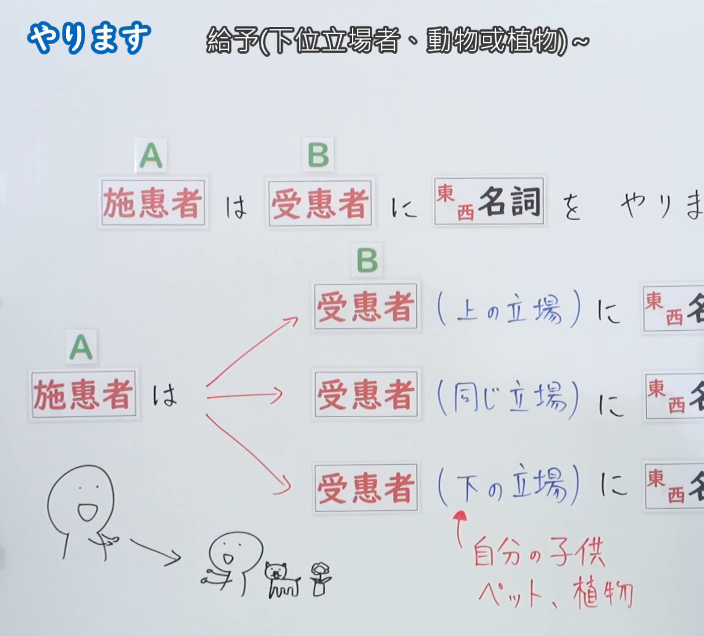
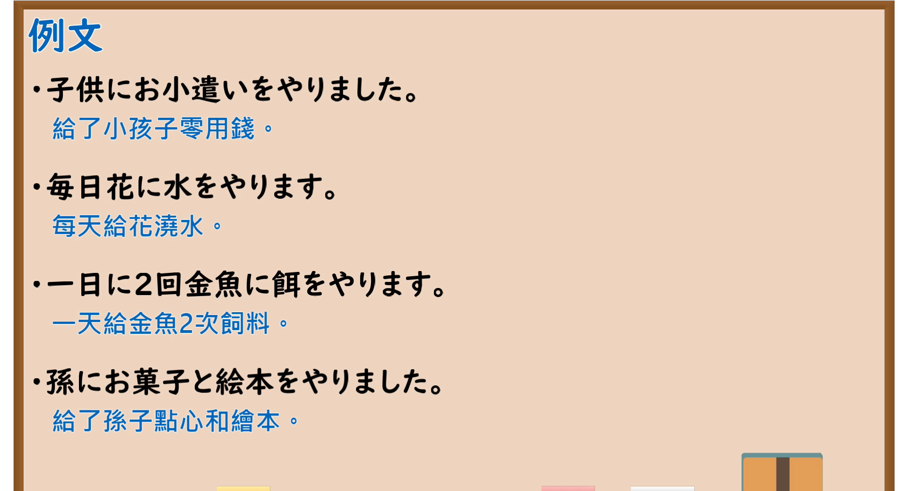

---
{
  "id": "N5-G-0036",
  "kind": "grammar",
  "level": "N5",
  "title": "授受动词「やります」",
  "card_revision": 2,
  "schema_version": 1,
  "source": {
    "lesson": "N5 第36个语法",
    "material": "出口日語原视频板书（学习者截取的接续图与例句图）与毎日のんびり日本語教師「【Ｎ４文法】～あげる／やる／差し上げる」及日本語教師の広場「授受「やる/あげる/さしあげる」②」正文",
    "video": "https://www.youtube.com/watch?v=K94H0QG26Ao",
    "screenshot": "assets/grammar/n5/N5-G-0036-connection.png",
    "screenshot_crop": {
      "x": 0,
      "y": 0,
      "width": 1150,
      "height": 1040
    }
  },
  "tags": [
    "やります",
    "授受动词",
    "给予",
    "N5"
  ],
  "confusions": [
    "やります／あげます",
    "授受动词／做",
    "上位／同辈／下位",
    "动物／植物"
  ]
}
---

# N5 第36个语法：やります

# 视频学习资料整理

- 课程：[出口日語「やります」](https://www.youtube.com/watch?v=K94H0QG26Ao)
- 视频 ID：`K94H0QG26Ao`
- 视频时长：6分16秒

## 接续图

- 实际时间：未记录（图片由学习者从原视频截取并提供）
- 成品图尺寸：1150×1040，固定左上角 `(0, 0)`，右下角 `(1150, 1040)`
- 板书内容：标题「やります」，右侧标注“給予(下位立場者、動物或植物)～”；「施恵者（A）は 受恵者（B）に 東西名詞 を やりま(す)」（句末被画面右缘截断）；下方分三支：「施恵者は→受恵者（上の立場）に 東西名…」「受恵者（同じ立場）に 東西名…」「受恵者（下の立場）に 東西名…」，各行右端被画面右缘截断；右下红字标注“自分の子供、ペット、植物”指向「下の立場」；左下手绘人物与小人、小猫、花。

## 例句图

- 实际时间：未记录（图片由学习者从原视频截取并提供）
- 成品图尺寸：1900×1040，固定左上角 `(0, 0)`，右下角 `(1900, 1040)`
- 板书内容：课程「例文」页，含四条例句及中文翻译（子供にお小遣いをやりました／毎日花に水をやります／一日に2回金魚に餌をやります／孫にお菓子と絵本をやりました）。四条例句均完整可见。

# 核心

## 功能一：给予（下位者、动物或植物）～

**くわしい意味記述：**

- **「やる」：** 「やる」は目上から目下への物の移動を表すぞんざいな表現で、動物や植物等に使われます。（「やる」表示物品从上位者向下位者转移，是较随便的表达，用于动物、植物等。）
- **使い分け：** 「やる」を使うのは、受け手が動物や植物のとき、受け手が与え手より目下のときです。しかし、最近は使用範囲が広がり、「あげる」を使う人が多くなっています。（使用「やる」的情况是接受方为动物或植物时、接受方比给予方地位低时。不过最近使用范围扩大，用「あげる」的人变多了。）

### 例句

1. 小鳥にエサをやる。

   （给小鸟喂食。）

2. 花に水をやる。

   （给花浇水。）

3. お正月には子供たちにお年玉をやります。

   （新年时给孩子们压岁钱。）

4. 毎日犬にエサをやるのが私の仕事です。

   （每天给狗喂食是我的工作。）

5. 花に水をやりに行く。

   （去浇花。）

# 来源

- [出口日語原视频](https://www.youtube.com/watch?v=K94H0QG26Ao)
- [日本語教師の広場「授受「やる/あげる/さしあげる」②」](https://www.tomojuku.com/blog/jujumono/2-2/)（查询日期：2026-10-16；例句1–4取自该页）
- [毎日のんびり日本語教師「【Ｎ４文法】～あげる／やる／差し上げる（さしあげる）」](https://mainichi-nonbiri.com/grammar/n4-ageru/)（查询日期：2026-10-16；「くわしい意味記述」第1项与例句5取自该页，该站将本语法归入 N4；该页只有 1 条「やる」例句，不足3条，故按流程补用互联网检索所得的上一页；两页的中文译文：毎日のんびり日本語教師页取自该页，日本語教師の広場页为整理者所译）
