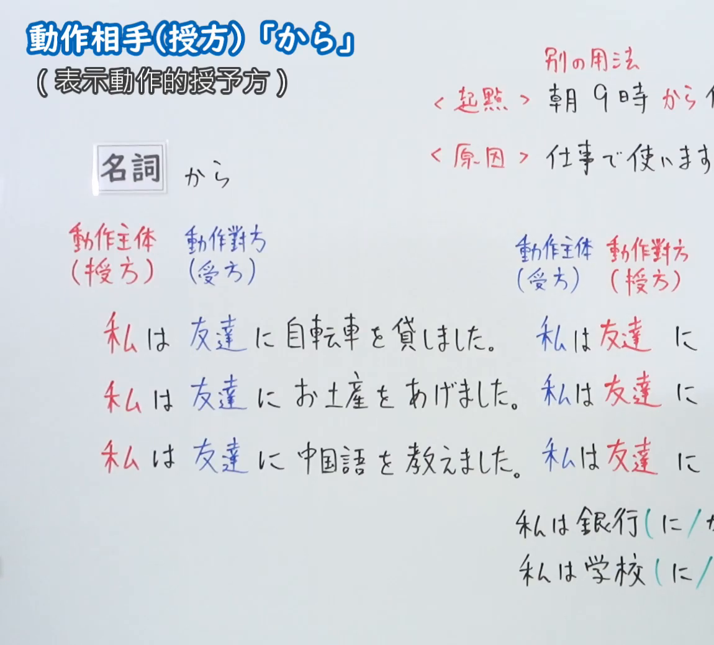
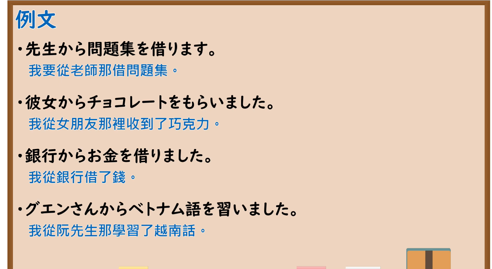

---
{
  "id": "N5-G-0037",
  "kind": "grammar",
  "level": "N5",
  "title": "助词：动作相手（授方）「から」",
  "card_revision": 2,
  "schema_version": 1,
  "source": {
    "lesson": "N5 第37个语法",
    "material": "出口日語原视频板书（学习者截取的接续图与例句图）与毎日のんびり日本語教師「格助詞「から」の用法一覧」正文",
    "video": "https://www.youtube.com/watch?v=ZBMfv9Gc3uU",
    "screenshot": "assets/grammar/n5/N5-G-0037-connection.png",
    "screenshot_crop": {
      "x": 0,
      "y": 0,
      "width": 1150,
      "height": 1040
    }
  },
  "tags": [
    "から",
    "助词",
    "授方",
    "N5"
  ],
  "confusions": [
    "に／から",
    "接受／给予",
    "动作授方",
    "起点／原因的から"
  ]
}
---

# N5 第37个语法：助词「から」（动作对方・授方）

# 视频学习资料整理

- 课程：[出口日語「助詞：動作相手（授方）「から」」](https://www.youtube.com/watch?v=ZBMfv9Gc3uU)
- 视频 ID：`ZBMfv9Gc3uU`
- 视频时长：8分43秒

## 接续图

- 实际时间：未记录（图片由学习者从原视频截取并提供）
- 成品图尺寸：1150×1040，固定左上角 `(0, 0)`，右下角 `(1150, 1040)`
- 板书内容：标题「動作相手（授方）「から」」，副标“（表示動作的授予方）”；「名詞 から」；右上红字“別の用法”：＜起點＞「朝9時から（仕事…）」＜原因＞「仕事で使います（から…）」，句末被画面右缘截断；左侧标注“動作主体（授方）／動作對方（受方）”，对比三行「私は友達に自転車を貸しました。私は友達に…」「私は友達にお土産をあげました。私は友達に…」「私は友達に中国語を教えました。私は友達に…」，右半“動作主体（受方）／動作對方（授方）”的句子被画面右缘截断；右下「私は銀行（に／か…）」「私は学校（に／…」被截断，未补写。

## 例句图

- 实际时间：未记录（图片由学习者从原视频截取并提供）
- 成品图尺寸：1900×1040，固定左上角 `(0, 0)`，右下角 `(1900, 1040)`
- 板书内容：课程「例文」页，含四条例句及中文翻译（先生から問題集を借ります／彼女からチョコレートをもらいました／銀行からお金を借りました／グエンさんからベトナム語を習いました）。四条例句均完整可见。

# 核心

## 功能一：表示动作的授予方（从～得到）

**くわしい意味記述：**

- **授受の与え手：** 「ＸがＹからＺを～する」において、Ｙが所有するものなどをＸに移すことを表す「もらう」系の授受動詞が述語に置かれるとき、その授受の与え手は「から」で表されます。「もらう」「受ける」「教わる」「習う」「学ぶ」「買う」「借りる」「預かる」など。だいたい「に」に置き換えられます。（在「ＸがＹからＺを～する」中，谓语是表示把Ｙ所有的东西转移给Ｘ的「もらう」类授受动词时，授受的给予方用「から」表示。大致可以换成「に」。）

### 例句

1. 彼から本を貸してもらった。

   （我向他借了一本书。）

2. 伊藤先生から英語を学びました。

   （我从伊藤先生那里学习了英语。）

3. 友達からお金を借りた。

   （我向朋友借了钱。）

# 来源

- [出口日語原视频](https://www.youtube.com/watch?v=ZBMfv9Gc3uU)
- [毎日のんびり日本語教師「格助詞「から」の用法一覧」「授受の与え手」](https://mainichi-nonbiri.com/jltct/kara-case-particle/)（查询日期：2026-10-16；Hagoromo 未收录，按流程采用优先级最高的备选网站该页，中文译文取自该页；该小节只有 3 条例句，刚好满足下限）
