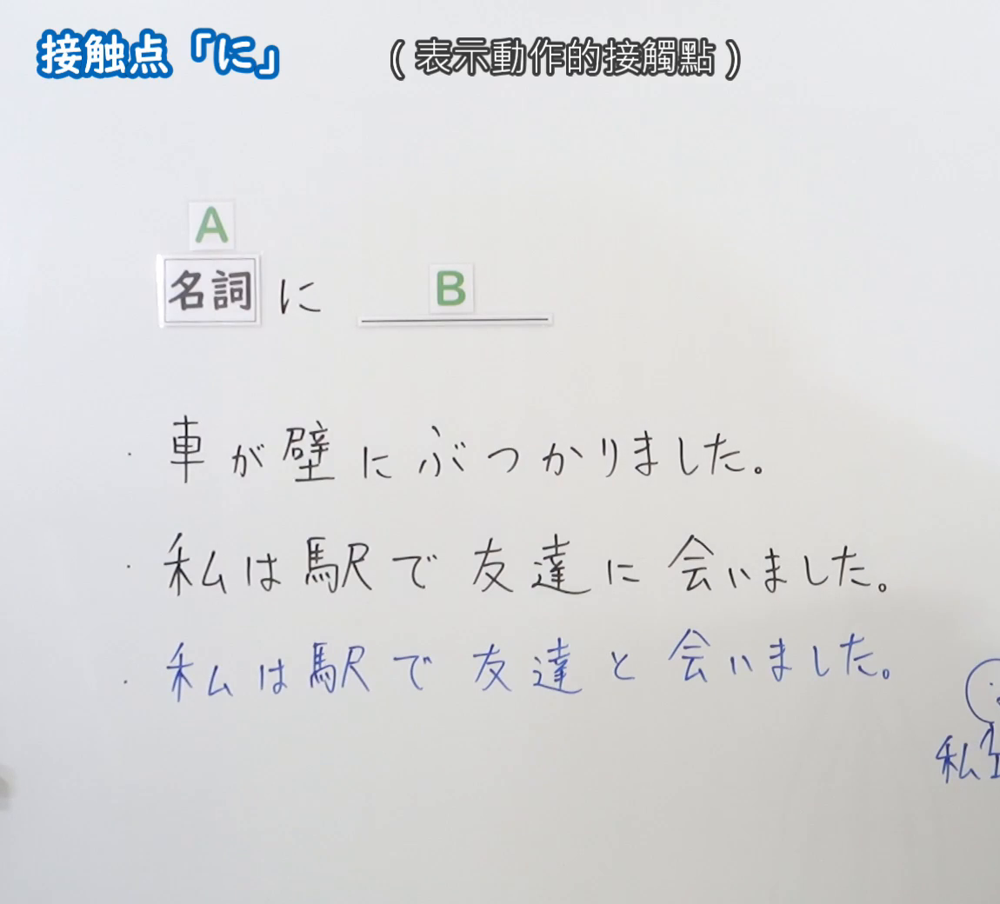
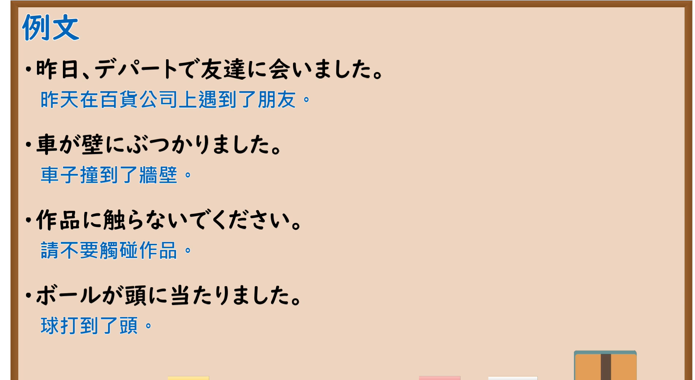

---
{
  "id": "N5-G-0038",
  "kind": "grammar",
  "level": "N5",
  "title": "助词：接触点「に」",
  "card_revision": 2,
  "schema_version": 1,
  "source": {
    "lesson": "N5 第38个语法",
    "material": "出口日語原视频板书（学习者截取的接续图与例句图）与毎日のんびり日本語教師「格助詞「に」の用法一覧」正文",
    "video": "https://www.youtube.com/watch?v=rmCrcK7mqHU",
    "screenshot": "assets/grammar/n5/N5-G-0038-connection.png",
    "screenshot_crop": {
      "x": 0,
      "y": 0,
      "width": 1150,
      "height": 1040
    }
  },
  "tags": [
    "に",
    "助词",
    "接触点",
    "N5"
  ],
  "confusions": [
    "に／を",
    "に会う／と会う",
    "物理接触／抽象接触",
    "で／に"
  ]
}
---

# N5 第38个语法：助词「に」（接触点）

# 视频学习资料整理

- 课程：[出口日語「助詞：接触点「に」」](https://www.youtube.com/watch?v=rmCrcK7mqHU)
- 视频 ID：`rmCrcK7mqHU`
- 视频时长：5分12秒

## 接续图

- 实际时间：未记录（图片由学习者从原视频截取并提供）
- 成品图尺寸：1150×1040，固定左上角 `(0, 0)`，右下角 `(1150, 1040)`
- 板书内容：标题「接触点「に」」，右侧标注“（表示動作的接觸點）”；「名詞（A） に ＿＿（B）」；三行例句：「車が壁にぶつかりました」「私は駅で友達に会いました」「私は駅で友達と会いました」（第三行为蓝字）；右下角手绘“私”及图形被画面右缘截断，未补写。

## 例句图

- 实际时间：未记录（图片由学习者从原视频截取并提供）
- 成品图尺寸：1900×1040，固定左上角 `(0, 0)`，右下角 `(1900, 1040)`
- 板书内容：课程「例文」页，含四条例句及中文翻译（昨日、デパートで友達に会いました／車が壁にぶつかりました／作品に触らないでください／ボールが頭に当たりました）。四条例句均完整可见。

# 核心

## 功能一：表示动作的接触点

**くわしい意味記述：**

- **動作の向かう相手：** 「反対する」「噛みつく」「恋する」「ぶつかる」「会う」「触れる」「憧れる」などの主体が相手に向かって何らかの動作が行われるような動詞が述語にくるとき、その相手は「に」で表されます。（谓语是「ぶつかる」「会う」「触れる」等主体对对方进行某种动作的动词时，该对方用「に」表示。）

### 例句

1. これから上司に会う。

   （我要见上司。）

2. 友達に殴りかかる。

   （冲朋友出手。）

3. 子供に話しかけるときはかがんで目線を合わせよう

   （和孩子说话时要弯下腰并与他们对视。）

4. 猫が私に噛みつく。

   （猫咬了我。）

5. 友人に電話をかける。

   （给朋友打电话。）

# 来源

- [出口日語原视频](https://www.youtube.com/watch?v=rmCrcK7mqHU)
- [毎日のんびり日本語教師「格助詞「に」の用法一覧」「動作の向かう相手」](https://mainichi-nonbiri.com/jltct/ni-case-particle/)（查询日期：2026-10-16；Hagoromo 未收录，按流程采用优先级最高的备选网站该页，中文译文取自该页；该页的例句以「会う」「噛みつく」等动词为主，没有「壁にぶつかる」「頭に当たる」等物理接触例句，板书中的这类用法本卡未另找来源补充）
