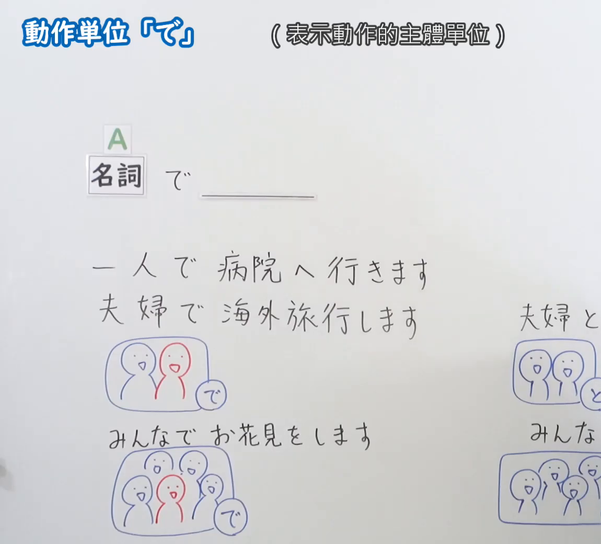
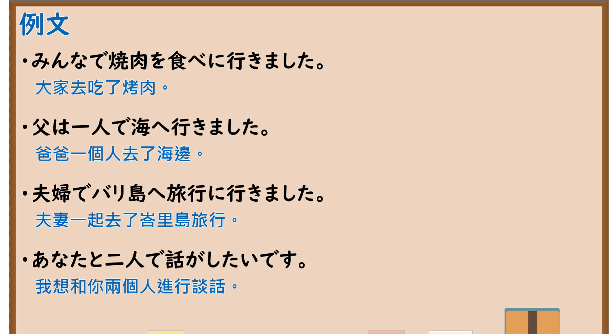

---
{
  "id": "N5-G-0039",
  "kind": "grammar",
  "level": "N5",
  "title": "助词：动作单位「で」",
  "card_revision": 2,
  "schema_version": 1,
  "source": {
    "lesson": "N5 第39个语法",
    "material": "出口日語原视频板书（学习者截取的接续图与例句图）与毎日のんびり日本語教師「格助詞「で」の用法一覧」正文",
    "video": "https://www.youtube.com/watch?v=iIt_tieV_10",
    "screenshot": "assets/grammar/n5/N5-G-0039-connection.png",
    "screenshot_crop": {
      "x": 0,
      "y": 0,
      "width": 1150,
      "height": 1040
    }
  },
  "tags": [
    "で",
    "助词",
    "动作单位",
    "N5"
  ],
  "confusions": [
    "で／と",
    "动作单位／同伴",
    "包含说话人",
    "一人で"
  ]
}
---

# N5 第39个语法：助词「で」（动作单位）

# 视频学习资料整理

- 课程：[出口日語「助詞：動作単位「で」」](https://www.youtube.com/watch?v=iIt_tieV_10)
- 视频 ID：`iIt_tieV_10`
- 视频时长：6分12秒

## 接续图

- 实际时间：未记录（图片由学习者从原视频截取并提供）
- 成品图尺寸：1150×1040，固定左上角 `(0, 0)`，右下角 `(1150, 1040)`
- 板书内容：标题「動作単位「で」」，右侧标注“（表示動作的主體單位）”；「名詞（A） で ＿＿」；例句「一人で病院へ行きます」「夫婦で海外旅行します」，配手绘“で”标记的小人图；右侧对比句「夫婦と…」「みんな…」及其手绘图被画面右缘截断；下方「みんなでお花見をします」配手绘多人图，其中红色小人为说话人。

## 例句图

- 实际时间：未记录（图片由学习者从原视频截取并提供）
- 成品图尺寸：1900×1040，固定左上角 `(0, 0)`，右下角 `(1900, 1040)`
- 板书内容：课程「例文」页，含四条例句及中文翻译（みんなで焼肉を食べに行きました／父は一人で海へ行きました／夫婦でバリ島へ旅行に行きました／あなたと二人で話がしたいです）。四条例句均完整可见。

# 核心

## 功能一：表示动作的主体单位

**くわしい意味記述：**

- **主体：** 述語が表す動作に対処したり、取り組んだりする主体を「で」で表します。（用「で」表示应对或处理谓语所表示动作的主体。）

### 例句

1. 荷物は自分で持ってください。

   （请自己携带行李。）

2. 自分のことは自分でやる。

   （我会自己处理自己的事情。）

3. 私たちだけで完成させよう。

   （让我们自己完成它。）

4. 一人で散歩する。

   （我独自散步。）

5. クラス全員で会議をする。

   （我们将与班级所有成员开会。）

# 来源

- [出口日語原视频](https://www.youtube.com/watch?v=iIt_tieV_10)
- [毎日のんびり日本語教師「格助詞「で」の用法一覧」「主体」](https://mainichi-nonbiri.com/jltct/de-case-particle/)（查询日期：2026-10-16；Hagoromo 未收录，按流程采用优先级最高的备选网站该页，中文译文取自该页；该页例句没有「夫婦で」「みんなで」的人数单位用法，板书中以人数单位作主体的用法本卡未另找来源补充）
