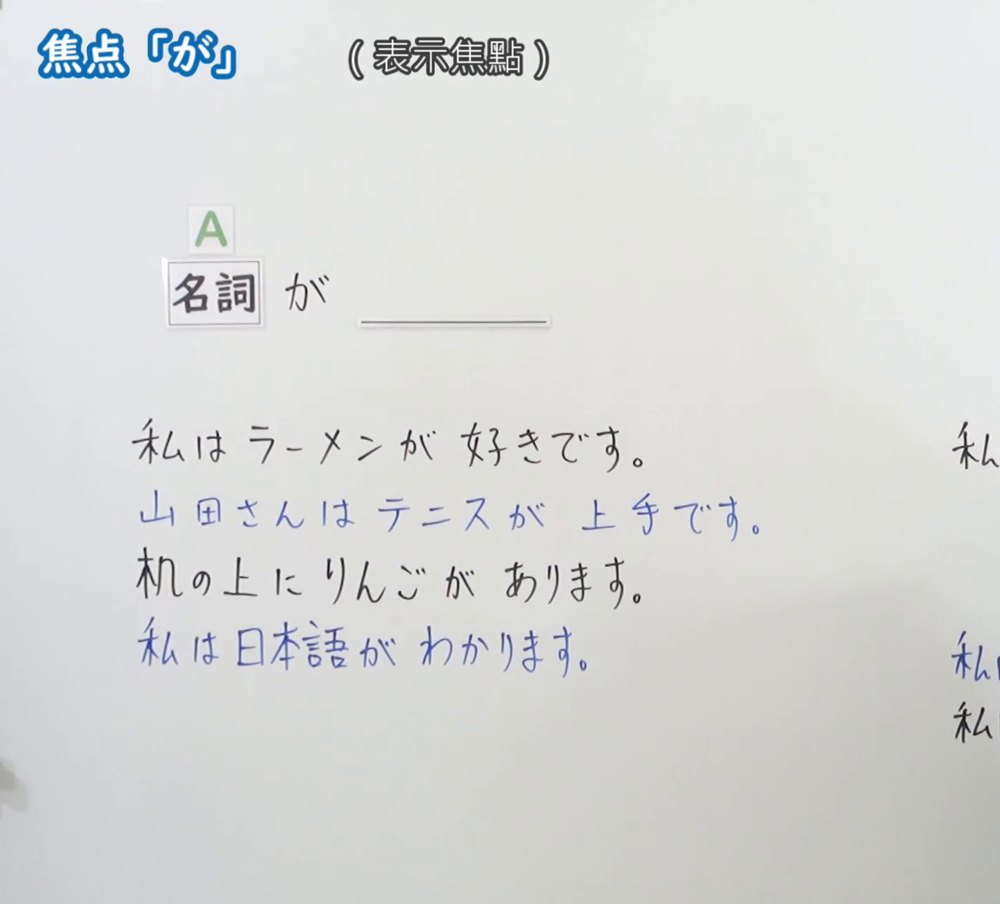
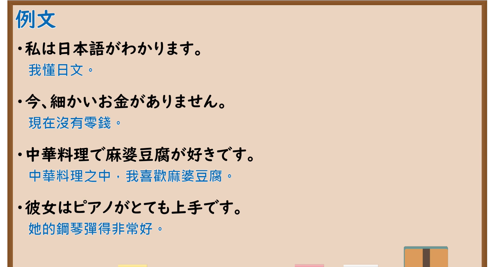

---
{
  "id": "N5-G-0040",
  "kind": "grammar",
  "level": "N5",
  "title": "助词：焦点「が」",
  "card_revision": 2,
  "schema_version": 1,
  "source": {
    "lesson": "N5 第40个语法",
    "material": "出口日語原视频板书（学习者截取的接续图与例句图）与毎日のんびり日本語教師「格助詞「が」の用法一覧」正文",
    "video": "https://www.youtube.com/watch?v=FUn1gokaYoo",
    "screenshot": "assets/grammar/n5/N5-G-0040-connection.png",
    "screenshot_crop": {
      "x": 0,
      "y": 0,
      "width": 1150,
      "height": 1040
    }
  },
  "tags": [
    "が",
    "助词",
    "焦点",
    "N5"
  ],
  "confusions": [
    "が／を",
    "焦点／格标记",
    "は／が",
    "喜欢／能力／理解"
  ]
}
---

# N5 第40个语法：助词「が」（焦点）

# 视频学习资料整理

- 课程：[出口日語「助詞：焦点「が」」](https://www.youtube.com/watch?v=FUn1gokaYoo)
- 视频 ID：`FUn1gokaYoo`
- 视频时长：6分39秒

## 接续图

- 实际时间：未记录（图片由学习者从原视频截取并提供）
- 成品图尺寸：1150×1040，固定左上角 `(0, 0)`，右下角 `(1150, 1040)`
- 板书内容：标题「焦点「が」」，右侧标注“（表示焦點）”；「名詞（A） が ＿＿」；四行例句：「私はラーメンが好きです」「山田さんはテニスが上手です」（蓝字）「机の上にりんごがあります」「私は日本語がわかります」（蓝字）；右侧另有「私…」等多行被画面右缘截断，未补写。

## 例句图

- 实际时间：未记录（图片由学习者从原视频截取并提供）
- 成品图尺寸：1900×1040，固定左上角 `(0, 0)`，右下角 `(1900, 1040)`
- 板书内容：课程「例文」页，含四条例句及中文翻译（私は日本語がわかります／今、細かいお金がありません／中華料理で麻婆豆腐が好きです／彼女はピアノがとても上手です）。四条例句均完整可见。

# 核心

## 功能一：表示焦点

**くわしい意味記述：**

- **主体：** 述語が動作、作用、変化などを表すとき、その主体を「が」で表します。述語が状態性の語のとき、その状態の主体を表します。（谓语表示动作、作用、变化等时，用「が」表示其主体。谓语是状态性词语时，表示该状态的主体。）
- **対象：** 感情や知覚を表す述語においては、その感情や知覚が向けられる対象を「が」で表します。述語が主体の能力を表す場合、その能力が向けられる対象を「が」で表します。（在表示感情或知觉的谓语中，用「が」表示该感情或知觉所指向的对象。谓语表示主体能力时，用「が」表示该能力所指向的对象。）

### 例句

1. 猫が１匹いる。

   （有一只猫。）

2. 私はロックが好きです。

   （我喜欢摇滚音乐。）

3. 新しいスマホが欲しい。

   （我想要一部新手机。）

4. 私は英語が話せる。

   （我会说英语。）

5. 話が全然分かりません。

   （我完全听不懂。）

# 来源

- [出口日語原视频](https://www.youtube.com/watch?v=FUn1gokaYoo)
- [毎日のんびり日本語教師「格助詞「が」の用法一覧」「主体」「対象」](https://mainichi-nonbiri.com/jltct/ga-case-particle/)（查询日期：2026-10-16；Hagoromo 未收录，按流程采用优先级最高的备选网站该页，中文译文取自该页；该站把「が」按“主体”“対象”分类，课程的“焦点”标注与站点分类不同，卡内沿用站点原文）
