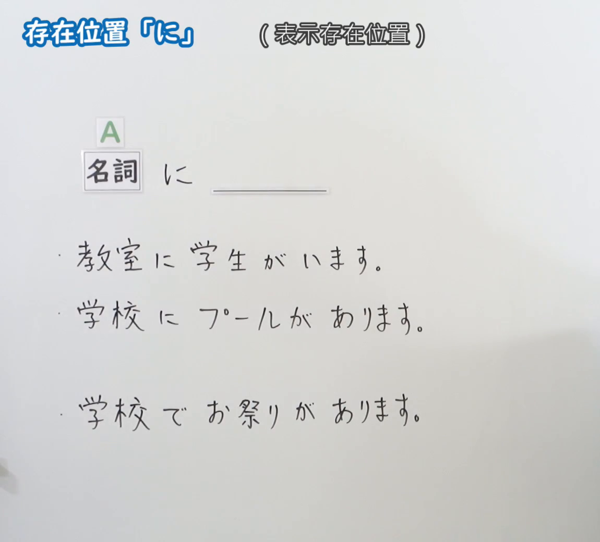
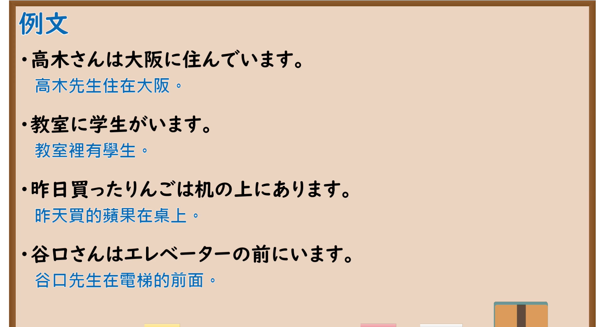

---
{
  "id": "N5-G-0041",
  "kind": "grammar",
  "level": "N5",
  "title": "助词：存在位置「に」",
  "card_revision": 2,
  "schema_version": 1,
  "source": {
    "lesson": "N5 第41个语法",
    "material": "出口日語原视频板书（学习者截取的接续图与例句图）与毎日のんびり日本語教師「格助詞「に」の用法一覧」正文",
    "video": "https://www.youtube.com/watch?v=XWowIHdB3ZQ",
    "screenshot": "assets/grammar/n5/N5-G-0041-connection.png",
    "screenshot_crop": {
      "x": 0,
      "y": 0,
      "width": 1150,
      "height": 1040
    }
  },
  "tags": [
    "に",
    "助词",
    "存在位置",
    "N5"
  ],
  "confusions": [
    "に／で",
    "存在／活动举行",
    "あります",
    "活动性名词"
  ]
}
---

# N5 第41个语法：助词「に」（存在位置）

# 视频学习资料整理

- 课程：[出口日語「助詞：存在位置「に」」](https://www.youtube.com/watch?v=XWowIHdB3ZQ)
- 视频 ID：`XWowIHdB3ZQ`
- 视频时长：4分25秒

## 接续图

- 实际时间：未记录（图片由学习者从原视频截取并提供）
- 成品图尺寸：1150×1040，固定左上角 `(0, 0)`，右下角 `(1150, 1040)`
- 板书内容：标题「存在位置「に」」，右侧标注“（表示存在位置）”；「名詞（A） に ＿＿」；三行例句：「教室に学生がいます」「学校にプールがあります」，间隔后另起「学校でお祭りがあります」（对比「で」）。板书完整，无遮挡。

## 例句图

- 实际时间：未记录（图片由学习者从原视频截取并提供）
- 成品图尺寸：1900×1040，固定左上角 `(0, 0)`，右下角 `(1900, 1040)`
- 板书内容：课程「例文」页，含四条例句及中文翻译（高木さんは大阪に住んでいます／教室に学生がいます／昨日買ったりんごは机の上にあります／谷口さんはエレベーターの前にいます）。四条例句均完整可见。

# 核心

## 功能一：表示存在的位置

**くわしい意味記述：**

- **存在場所：** 述語が存在を表す存在動詞のとき、存在主体の存在場所は「に」で表します。通常は〔～に～が〕型の文型をとります。（谓语是表示存在的存在动词时，存在主体的存在场所用「に」表示。通常采用〔～に～が〕句型。）

### 例句

1. 空に飛行機雲があります。

   （天空中有飞机云。）

2. 奥歯に何か物が詰まってるみたいだ。

   （感觉好像有东西卡在后牙里。）

3. 喉に骨が刺さってる。

   （喉咙里卡了一根骨头。）

4. あのときのことは今でも記憶に残っている。

   （那时的事情我至今还记得。）

# 来源

- [出口日語原视频](https://www.youtube.com/watch?v=XWowIHdB3ZQ)
- [毎日のんびり日本語教師「格助詞「に」の用法一覧」「存在場所」](https://mainichi-nonbiri.com/jltct/ni-case-particle/)（查询日期：2026-10-16；Hagoromo 未收录，按流程采用优先级最高的备选网站该页，中文译文取自该页；该小节有 4 条例句，但都不是板书中「教室に学生がいます」这类“场所に人／物がいる／ある”的典型句，板书对比的「で（活动举行地点）」该页没有解说）
