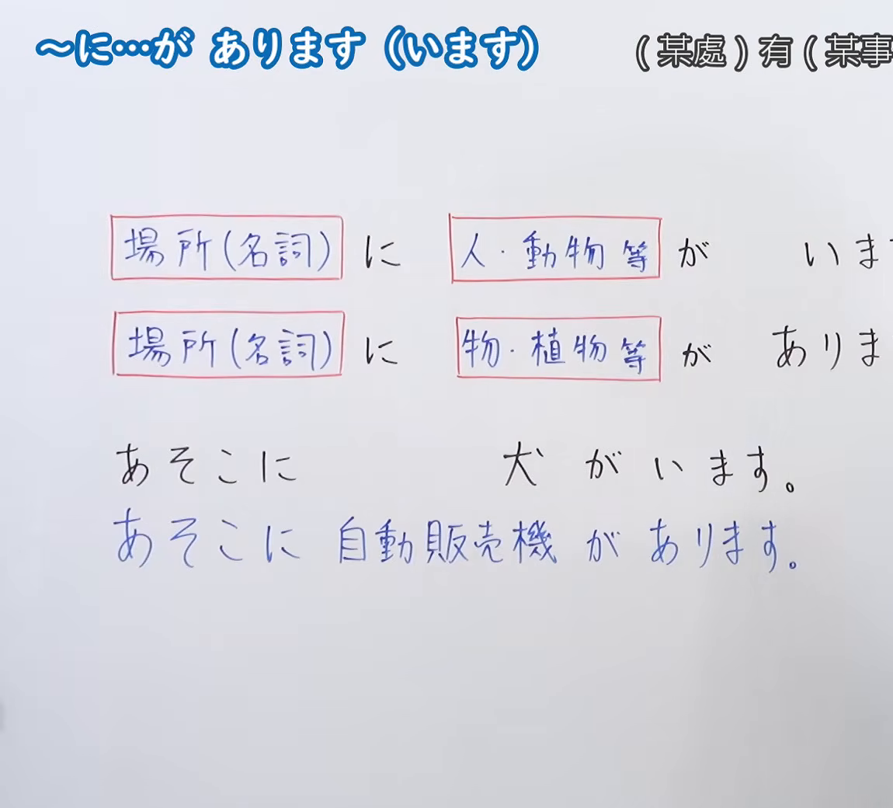
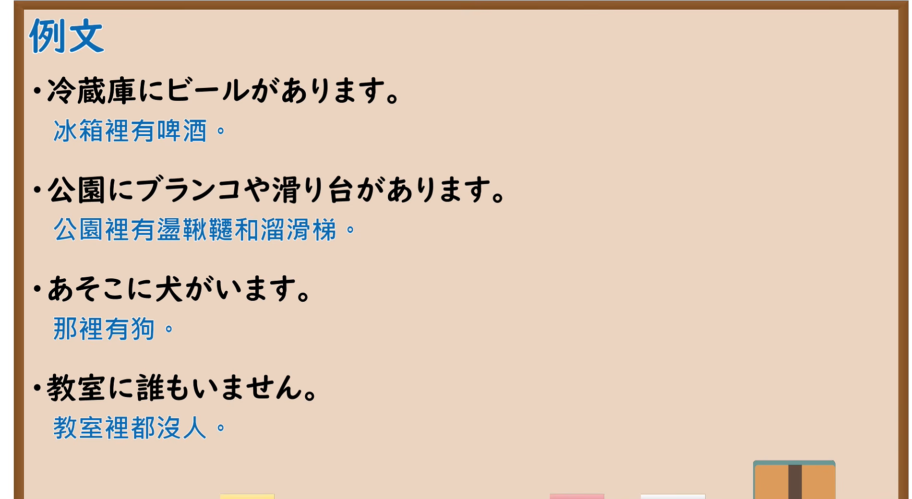

---
{
  "id": "N5-G-0042",
  "kind": "grammar",
  "level": "N5",
  "title": "～に…があります（います）",
  "card_revision": 2,
  "schema_version": 1,
  "source": {
    "lesson": "N5 第42个语法",
    "material": "出口日語原视频板书（学习者截取的接续图与例句图）与东京外国语大学「Nがあります／います」「NにNがあります／います」解说正文",
    "video": "https://www.youtube.com/watch?v=Whuzgn3l-oo",
    "screenshot": "assets/grammar/n5/N5-G-0042-connection.png",
    "screenshot_crop": {
      "x": 0,
      "y": 0,
      "width": 1150,
      "height": 1040
    }
  },
  "tags": [
    "があります",
    "います",
    "存在句",
    "N5"
  ],
  "confusions": [
    "あります／います",
    "に／で",
    "有生命／无生命",
    "存在／活动举行"
  ]
}
---

# N5 第42个语法：～に…があります（います）

# 视频学习资料整理

- 课程：[出口日語「～に…が あります（います）」](https://www.youtube.com/watch?v=Whuzgn3l-oo)
- 视频 ID：`Whuzgn3l-oo`
- 视频时长：4分46秒

## 接续图

- 实际时间：未记录（图片由学习者从原视频截取并提供）
- 成品图尺寸：1150×1040，固定左上角 `(0, 0)`，右下角 `(1150, 1040)`
- 板书内容：标题「～に…が あります（います）」，右侧标注“（某處）有（某事…”（右端被画面右缘截断）；两行公式：「場所（名詞） に 人・動物等 が いま(す)」「場所（名詞） に 物・植物等 が ありま(す)」（句末被截断）；例句「あそこに犬がいます」「あそこに自動販売機があります」（蓝字）。

## 例句图

- 实际时间：未记录（图片由学习者从原视频截取并提供）
- 成品图尺寸：1900×1040，固定左上角 `(0, 0)`，右下角 `(1900, 1040)`
- 板书内容：课程「例文」页，含四条例句及中文翻译（冷蔵庫にビールがあります／公園にブランコや滑り台があります／あそこに犬がいます／教室に誰もいません）。四条例句均完整可见。

# 核心

## 功能一：（某处）有（某事物／某人）

**くわしい意味記述：**

- **あります／います：** 「あります」は、ものの存在を表わします。「います」は、生きものの存在を表わします。「N」は存在するもの、生きものを表わし、「が」をつけます。（「あります」表示物品的存在，「います」表示生物的存在。「N」表示存在的东西、生物，后接「が」。）
- **NにNがあります／います：** ある場所について、そこに存在する人やものを述べる場合には、N1［場所］にN2［もの］があります／N1［場所］にN2［生きもの］がいます、の構文を使います。（叙述某场所存在的人或物时，使用N1［场所］に N2［物］が あります／N1［场所］に N2［生物］が います 的句型。）
- **できごと・行事：** できごとや行事があることを表わす「Nがあります」は、その場所を示すのに助詞「で」を取ります。（表示事件或活动举行的「Nがあります」，其场所用助词「で」表示。）

### 例句

1. 木があります。

   （有树。）

2. 犬がいます。

   （有狗。）

3. 部屋にパソコンがあります。

   （房间里有电脑。）

4. 公園に木があります。

   （公园里有树。）

5. 家に犬がいます。

   （家里有狗。）

# 来源

- [出口日語原视频](https://www.youtube.com/watch?v=Whuzgn3l-oo)
- 东京外国语大学「日本語 文法」解说：[「Nがあります／います」](https://www.coelang.tufs.ac.jp/mt/ja/gmod/contents/explanation/005.html)、[「NにNがあります／います」](https://www.coelang.tufs.ac.jp/mt/ja/gmod/contents/explanation/006.html)（查询日期：2026-10-16；Hagoromo、毎日のんびり日本語教師、日本語NET 均未找到直接对应条目，按流程采用互联网检索所得的两页；例句译文为整理者所译）
