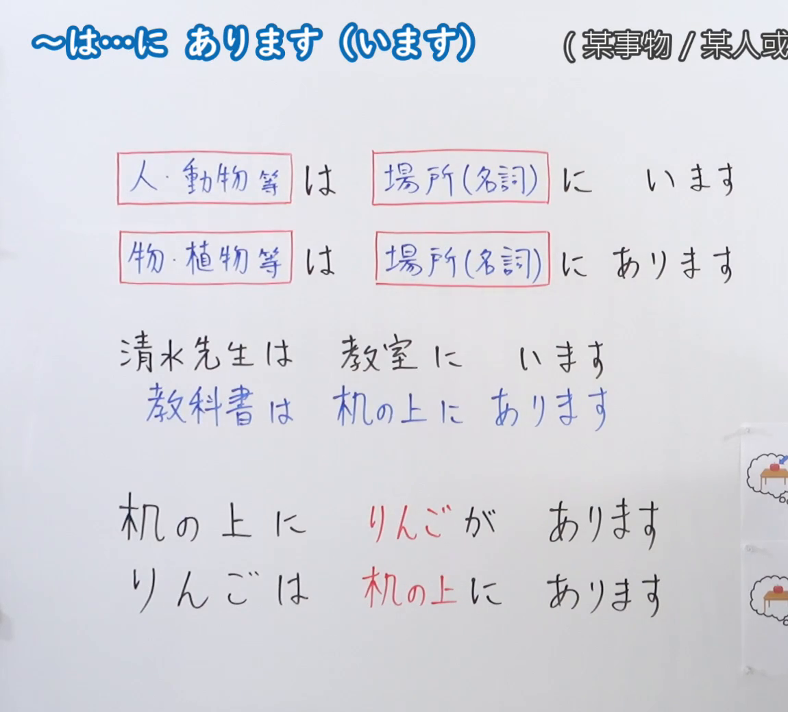
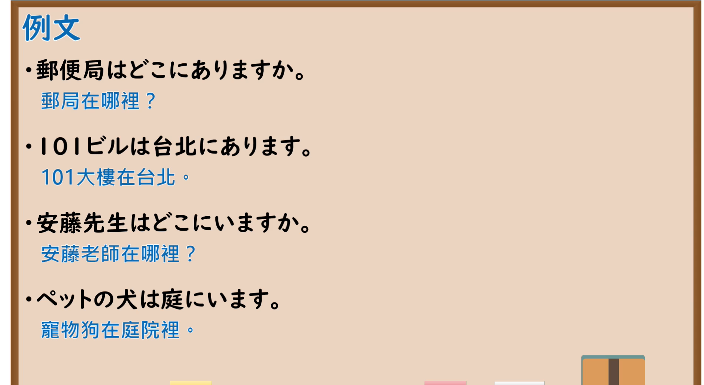

---
{
  "id": "N5-G-0043",
  "kind": "grammar",
  "level": "N5",
  "title": "～は…にあります（います）",
  "card_revision": 2,
  "schema_version": 1,
  "source": {
    "lesson": "N5 第43个语法",
    "material": "出口日語原视频板书（学习者截取的接续图与例句图）与东京外国语大学「NにNがあります／います」「Nの上／下／中／前／後」解说正文",
    "video": "https://www.youtube.com/watch?v=_huhMhP9DgY",
    "screenshot": "assets/grammar/n5/N5-G-0043-connection.png",
    "screenshot_crop": {
      "x": 0,
      "y": 0,
      "width": 1150,
      "height": 1040
    }
  },
  "tags": [
    "は",
    "にあります",
    "います",
    "存在位置",
    "N5"
  ],
  "confusions": [
    "～に～がある／いる",
    "は／が",
    "あります／います",
    "に／で"
  ]
}
---

# N5 第43个语法：～は…にあります（います）

# 视频学习资料整理

- 课程：[出口日語「～は…に あります（います）」](https://www.youtube.com/watch?v=_huhMhP9DgY)
- 视频 ID：`_huhMhP9DgY`
- 视频时长：6分59秒

## 接续图

- 实际时间：未记录（图片由学习者从原视频截取并提供）
- 成品图尺寸：1150×1040，固定左上角 `(0, 0)`，右下角 `(1150, 1040)`
- 板书内容：标题「～は…に あります（います）」，右侧标注“（某事物／某人或…”（右端被画面右缘截断）；两行公式：「人・動物等 は 場所（名詞） に います」「物・植物等 は 場所（名詞） に あります」；例句「清水先生は教室にいます」「教科書は机の上にあります」（蓝字）；对比两行：「机の上にりんごがあります」「りんごは机の上にあります」（红字标出「りんご」「机の上」）；右下角贴有两幅小图，被画面右缘截断。

## 例句图

- 实际时间：未记录（图片由学习者从原视频截取并提供）
- 成品图尺寸：1900×1040，固定左上角 `(0, 0)`，右下角 `(1900, 1040)`
- 板书内容：课程「例文」页，含四条例句及中文翻译（郵便局はどこにありますか／101ビルは台北にあります／安藤先生はどこにいますか／ペットの犬は庭にいます）。四条例句均完整可见。

# 核心

## 功能一：（某事物／某人）在（某处）

**くわしい意味記述：**

- **NはNにあります／います：** N2［もの］はN1［場所］にあります、N2［生きもの］はN1［場所］にいます、の構文で、物や人の存在する場所を述べます。（用N2［物］は N1［场所］に あります、N2［生物］は N1［场所］に います 的句型，叙述物或人所在的场所。）
- **場所のたずね方：** 存在する場所をたずねるときは「どこ」を使います。（询问存在的场所时使用「どこ」。）

### 例句

1. パソコンは部屋にあります。

   （电脑在房间里。）

2. 田中さんは教室にいます。

   （田中在教室里。）

3. A：パソコンはどこにありますか。　B：部屋にあります。

   （A：电脑在哪里？　B：在房间里。）

4. A：田中さんはどこにいますか。　B：教室にいます。

   （A：田中在哪里？　B：在教室里。）

5. ポストは家の向かいにあります。

   （邮筒在房子的对面。）

# 来源

- [出口日語原视频](https://www.youtube.com/watch?v=_huhMhP9DgY)
- 东京外国语大学「日本語 文法」解说：[「NにNがあります／います」](https://www.coelang.tufs.ac.jp/mt/ja/gmod/contents/explanation/006.html)、[「Nの上／下／中／前／後」](https://www.coelang.tufs.ac.jp/mt/ja/gmod/contents/explanation/007.html)（查询日期：2026-10-16；Hagoromo、毎日のんびり日本語教師、日本語NET 均未找到直接对应条目，按流程采用互联网检索所得的两页；例句译文为整理者所译）
