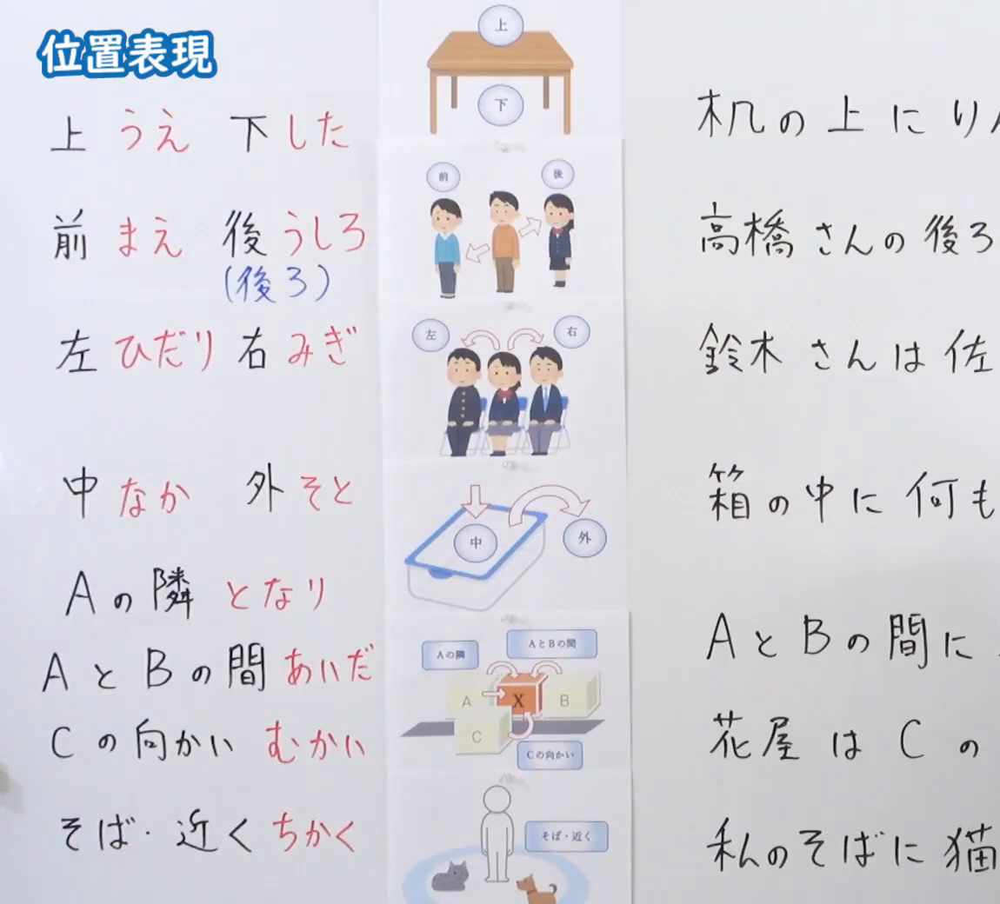
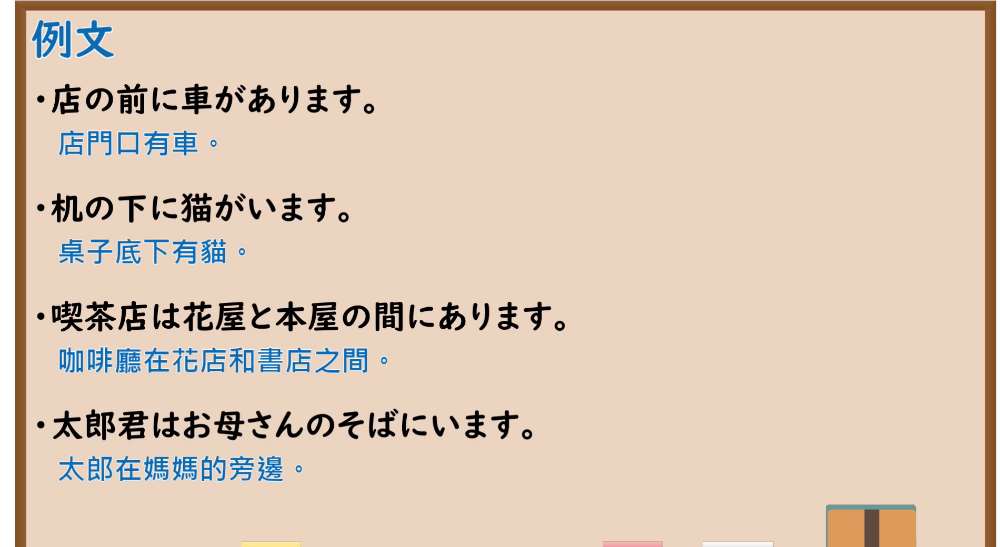

---
{
  "id": "N5-G-0044",
  "kind": "grammar",
  "level": "N5",
  "title": "位置表现",
  "card_revision": 2,
  "schema_version": 1,
  "source": {
    "lesson": "N5 第44个语法",
    "material": "出口日語原视频板书（学习者截取的接续图与例句图）与东京外国语大学「Nの上／下／中／前／後」解说正文",
    "video": "https://www.youtube.com/watch?v=VhGUps4dn3Y",
    "screenshot": "assets/grammar/n5/N5-G-0044-connection.png",
    "screenshot_crop": {
      "x": 0,
      "y": 0,
      "width": 1150,
      "height": 1040
    }
  },
  "tags": [
    "位置",
    "上下前后",
    "N5"
  ],
  "confusions": [
    "隣／そば／近く",
    "前／向かい",
    "の／に",
    "あります／います"
  ]
}
---

# N5 第44个语法：位置表现

# 视频学习资料整理

- 课程：[出口日語「位置表現」](https://www.youtube.com/watch?v=VhGUps4dn3Y)
- 视频 ID：`VhGUps4dn3Y`
- 视频时长：7分10秒

## 接续图

- 实际时间：未记录（图片由学习者从原视频截取并提供）
- 成品图尺寸：1150×1040，固定左上角 `(0, 0)`，右下角 `(1150, 1040)`
- 板书内容：标题「位置表現」，无接续公式；板书左列为词表并配图：上（うえ）／下（した）、前（まえ）／後（うしろ）、左（ひだり）／右（みぎ）、中（なか）／外（そと）、Aの隣（となり）、AとBの間（あいだ）、Cの向かい（むかい）、そば・近く（ちかく）；中间为各词配图，右列为对应例句：「机の上にり…」「高橋さんの後ろ…」「鈴木さんは佐…」「箱の中に何も…」「AとBの間に…」「花屋はCの…」「私のそばに猫…」，右列例句均被画面右缘截断，未补写。

## 例句图

- 实际时间：未记录（图片由学习者从原视频截取并提供）
- 成品图尺寸：1900×1040，固定左上角 `(0, 0)`，右下角 `(1900, 1040)`
- 板书内容：课程「例文」页，含四条例句及中文翻译（店の前に車があります／机の下に猫がいます／喫茶店は花屋と本屋の間にあります／太郎君はお母さんのそばにいます）。四条例句均完整可见。

# 核心

## 功能一：位置的表达（上、下、前、后、左、右、中、外等）

**くわしい意味記述：**

- **N1のN2：** あるものや人の位置をほかのものや人との関係で表わすときには、N1［もの・生きもの］のN2［位置］、という構文を使います。位置を表わす語には、上、下、前、うしろ、右、左、中、内、外、向かい、となり、横、そば、近く、東、西、南、北などがあります。（用N1［物・生物］の N2［位置］ 的句型，以与其他物或人的关系来表示某物或某人的位置。表示位置的词有：上、下、前、うしろ、右、左、中、内、外、向かい、となり、横、そば、近く、東、西、南、北等。）

### 例句

1. 机の上に本があります。

   （桌上有书。）

2. 机の下にかばんがあります。

   （桌子下面有包。）

3. かばんの中にノートがあります。

   （包里有笔记本。）

4. 田中さんの右に山田さんがいます。

   （田中的右边有山田。）

5. 家の前に猫がいます。

   （房子前面有猫。）

# 来源

- [出口日語原视频](https://www.youtube.com/watch?v=VhGUps4dn3Y)
- [东京外国语大学「日本語 文法 Nの上／下／中／前／後：解説」](https://www.coelang.tufs.ac.jp/mt/ja/gmod/contents/explanation/007.html)（查询日期：2026-10-16；Hagoromo、毎日のんびり日本語教師、日本語NET 均未找到直接对应条目，按流程采用互联网检索所得的该页；该页没有各位置词的读音（うえ、した等）和「となり／そば／近く」的区别解说；例句译文为整理者所译）
