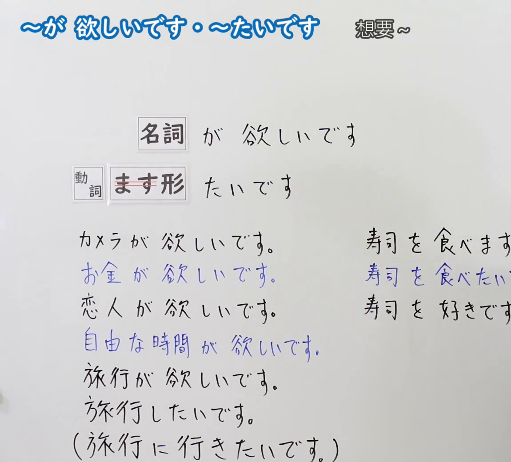
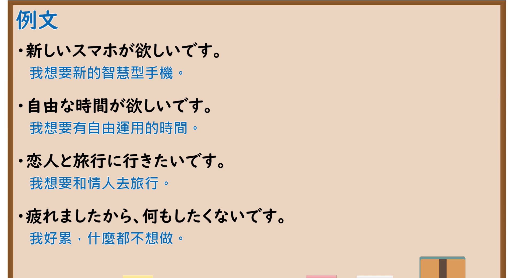

---
{
  "id": "N5-G-0045",
  "kind": "grammar",
  "level": "N5",
  "title": "愿望表达「～が欲しいです／～たいです」",
  "card_revision": 2,
  "schema_version": 1,
  "source": {
    "lesson": "N5 第45个语法",
    "material": "出口日語原视频板书（学习者截取的接续图与例句图）与毎日のんびり日本語教師「【Ｎ５文法】～が欲しい…」「～したい…」正文",
    "video": "https://www.youtube.com/watch?v=IuCqb-0mVC4",
    "screenshot": "assets/grammar/n5/N5-G-0045-connection.png",
    "screenshot_crop": {
      "x": 0,
      "y": 0,
      "width": 1150,
      "height": 1040
    }
  },
  "tags": [
    "が欲しい",
    "たい",
    "愿望",
    "N5"
  ],
  "confusions": [
    "名词／动作",
    "が欲しい／たい",
    "を／が",
    "旅行が欲しい"
  ]
}
---

# N5 第45个语法：～が欲しいです・～たいです

# 视频学习资料整理

- 课程：[出口日語「～が 欲しいです・～たいです」](https://www.youtube.com/watch?v=IuCqb-0mVC4)
- 视频 ID：`IuCqb-0mVC4`
- 视频时长：8分37秒

## 接续图

- 实际时间：未记录（图片由学习者从原视频截取并提供）
- 成品图尺寸：1150×1040，固定左上角 `(0, 0)`，右下角 `(1150, 1040)`
- 板书内容：标题「～が 欲しいです・～たいです」，右侧标注“想要～”；两行公式：「名詞 が 欲しいです」「動詞（ます形，「ます」划去） たいです」；左列例句：「カメラが欲しいです」「お金が欲しいです」「恋人が欲しいです」「自由な時間が欲しいです」「旅行が欲しいです」「旅行したいです」「（旅行に行きたいです）」；右列对比：「寿司を食べます」「寿司を食べたいです」「寿司を好きです」，右列句末被画面右缘截断，未补写。

## 例句图

- 实际时间：未记录（图片由学习者从原视频截取并提供）
- 成品图尺寸：1900×1040，固定左上角 `(0, 0)`，右下角 `(1900, 1040)`
- 板书内容：课程「例文」页，含四条例句及中文翻译（新しいスマホが欲しいです／自由な時間が欲しいです／恋人と旅行に行きたいです／疲れましたから、何もしたくないです）。四条例句均完整可见。

# 核心

## 功能一：想要～

**くわしい意味記述：**

- **～が欲しい：** 物的な欲求、願望を表します。一人称（話者）の願望を表す時は「～が欲しい／は欲しくない」を用います。「～が欲しい」は物的な欲求を表しますので、物を表す名詞にしか接続できません。（表示对物品的欲望、愿望。表达第一人称（说话人）的愿望时使用「～が欲しい／は欲しくない」。「～が欲しい」表示物质性的欲望，只能接表示物品的名词。）
- **～したい：** 動作的な欲求、願望を表します。一人称（話者）の願望を表す時は「～たい／たくない」を用います。「～したい」は動作的な欲求を表しますので、動詞にしか接続できません。（表示对动作的欲望、愿望。表达第一人称（说话人）的愿望时使用「～たい／たくない」。「～したい」表示动作性的欲望，只能接动词。）
- **人称制限：** 二人称、三人称の欲求、願望を表す場合は、「欲しがる」「したがる」を使います。（表达第二、第三人称的欲望、愿望时，使用「欲しがる」「したがる」。）

### 例句

1. 遊ぶお金が欲しい。

   （想要玩的钱。）

2. 子供が欲しい。

   （想要孩子。）

3. 髪を染めたい。

   （想染发。）

4. 肉を食べたい。

   （想吃肉。）

5. 学校は行きたくない。

   （不想去学校。）

# 来源

- [出口日語原视频](https://www.youtube.com/watch?v=IuCqb-0mVC4)
- [毎日のんびり日本語教師「【Ｎ５文法】～が欲しい／は欲しくない／を欲しがる／を欲しがっている」](https://mainichi-nonbiri.com/grammar/n5-gahoshii/)、[「【Ｎ５文法】～したい／したくない／したがる／したがっている」](https://mainichi-nonbiri.com/grammar/n5-shitai/)（查询日期：2026-10-16；Hagoromo 未收录，故按流程采用优先级最高的备选网站条目；中文译文取自这两页）
