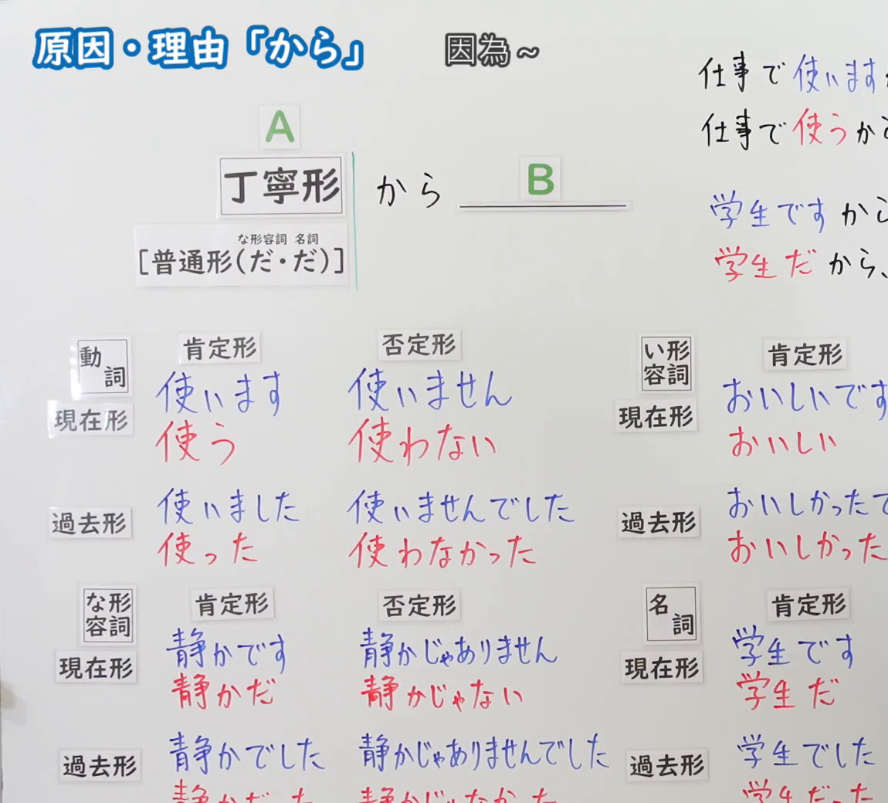
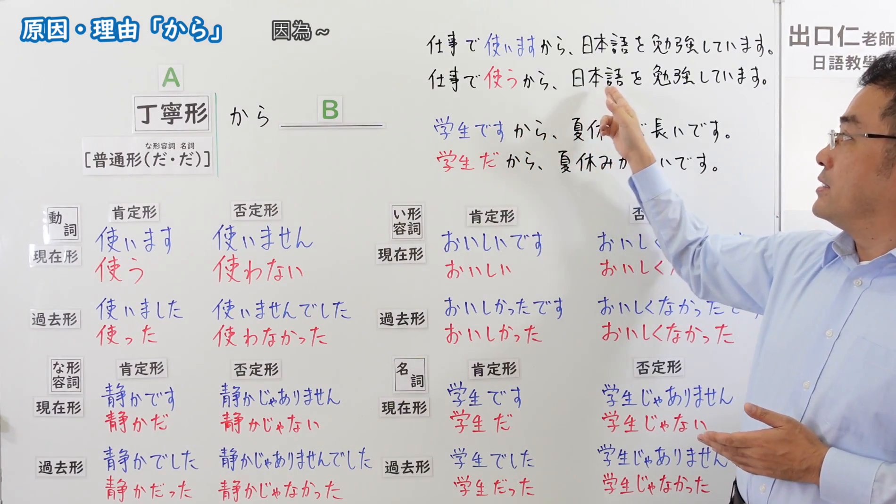

---
{
  "id": "N5-G-0046",
  "kind": "grammar",
  "level": "N5",
  "title": "原因・理由「から」",
  "card_revision": 2,
  "schema_version": 1,
  "source": {
    "lesson": "N5 第46个语法",
    "material": "出口日語原视频板书（学习者截取的接续图与例句图）与日本語NET「【JLPT N5】文法・例文：〜から」正文",
    "video": "https://www.youtube.com/watch?v=VldNpcpljMU",
    "screenshot": "assets/grammar/n5/N5-G-0046-connection.png",
    "screenshot_crop": {
      "x": 0,
      "y": 0,
      "width": 1150,
      "height": 1040
    }
  },
  "tags": [
    "から",
    "原因",
    "理由",
    "N5"
  ],
  "confusions": [
    "から／ので",
    "原因のから／起点のから",
    "だ／だったから",
    "名词・な形容词的接续"
  ]
}
---

# N5 第46个语法：原因・理由「から」

# 视频学习资料整理

- 课程：[出口日語「原因・理由「から」」](https://www.youtube.com/watch?v=VldNpcpljMU)
- 视频 ID：`VldNpcpljMU`
- 视频时长：6分41秒

## 接续图

- 实际时间：未记录（图片由学习者从原视频截取并提供）
- 成品图尺寸：1150×1040，固定左上角 `(0, 0)`，右下角 `(1150, 1040)`
- 板书内容：标题「原因・理由「から」」，右侧标注“因為～”；公式「丁寧形（A） から ＿＿（B）」，下方「［普通形（だ・だ）］」（な形容词、名词用普通形时用「だ」）；右上两行：「仕事で使いますから…」「仕事で使うから…」及「学生ですから…」「学生だから…」，被画面右缘截断；下方为动词、い形容词、な形容词、名词的「肯定形／否定形」「現在形／過去形」的丁宁形（蓝字）与普通形（红字）对照表：使います／使う、使いません／使わない、使いました／使った、使いませんでした／使わなかった；おいしいです／おいしい、おいしかったです／おいしかった；静かです／静かだ、静かじゃありません／静かじゃない、静かでした／静かだった、静かじゃありませんでした／静かじゃなかった；学生です／学生だ、学生じゃありません／学生じゃない、学生でした／学生だった。右侧い形容词、名词栏的否定形被画面右缘截断，表格最下一行也被画面下缘截断，未补写。

## 例句图

- 实际时间：未记录（图片由学习者从原视频截取并提供）
- 成品图尺寸：1900×1070，固定左上角 `(0, 0)`，右下角 `(1900, 1070)`
- 板书内容：（注：第46至48课的例句图是整张板书画面，不是「例文」页。）成品图尺寸含黑板全貌，老师入画并遮挡右侧部分板书。板书内容：右上两组对比例句「仕事で使いますから、日本語を勉強しています。／仕事で使うから、日本語を勉強しています。」「学生ですから、夏休みが長いです。／学生だから、夏休みが長いです。」（被老师手臂遮住中间少量字符），其下为与接续图相同的动词、い形容词、な形容词、名词的丁宁形与普通形对照表，右下角名词否定栏被老师手遮挡部分字符。

# 核心

## 功能一：因为～

**くわしい意味記述：**

- **〜から：** 理由・原因を言う時に使う。接続は 文１＋から＋文２。（用于叙述理由、原因。接续为 句子１＋から＋句子２。）

### 例句

1. 今日は息子の誕生日ですから、早く帰ります。

   （今天是儿子的生日，所以我早点回家。）

2. 日本の会社で働きたいですから、日本語を勉強しています。

   （因为想在日本的公司工作，所以在学日语。）

3. 明日はテストがあるから、遊べません。

   （明天有考试，所以不能玩。）

4. コーヒーを飲んだから、今は全然眠くないです。

   （因为喝了咖啡，所以现在一点也不困。）

5. 牛乳がありませんから、コンビニへ買いに行きます。

   （因为没有牛奶，所以去便利店买。）

# 来源

- [出口日語原视频](https://www.youtube.com/watch?v=VldNpcpljMU)
- [日本語NET「【JLPT N5】文法・例文：〜から」](https://nihongokyoshi-net.com/2020/06/10/jlptn5-grammar-kara/)（查询日期：2026-10-16；Hagoromo 未收录；毎日のんびり日本語教師「格助詞「から」の用法一覧」的「原因・理由」小节例句是“起因”性质（不注意から事故を起こした等），与本课以句子表原因的用法不符，故按优先级采用日本語NET 该条目，该站标注为 N4；该页只有英文翻译，中文译文为整理者所译）
