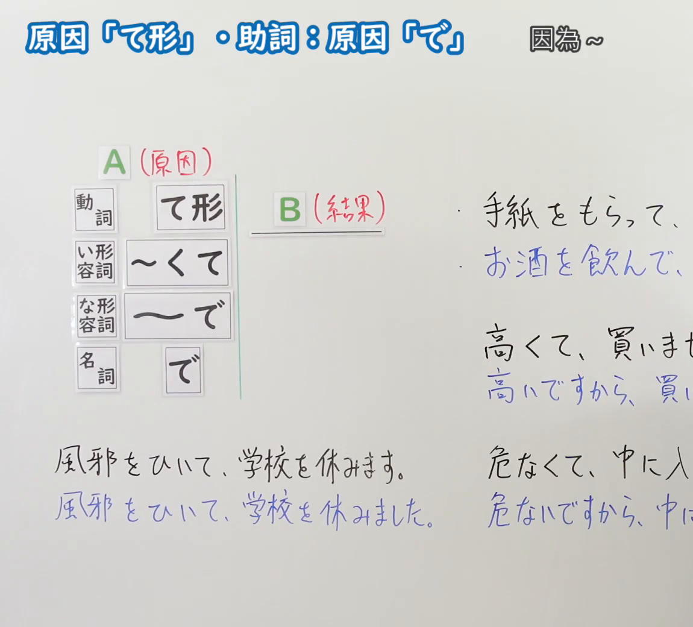
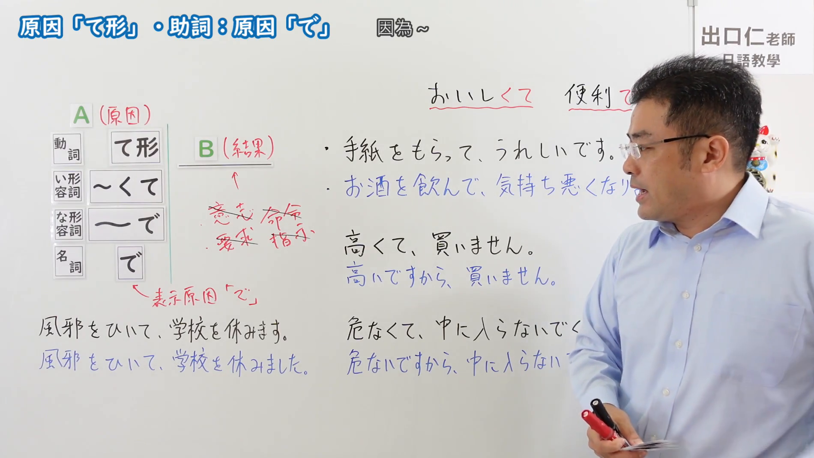

---
{
  "id": "N5-G-0047",
  "kind": "grammar",
  "level": "N5",
  "title": "原因・理由「て」",
  "card_revision": 2,
  "schema_version": 1,
  "source": {
    "lesson": "N5 第47个语法",
    "material": "出口日語原视频板书（学习者截取的接续图与例句图）与东京外国语大学「AくてA・NAでNA・NでN：解説」与毎日のんびり日本語教師「格助詞「で」の用法一覧」正文",
    "video": "https://www.youtube.com/watch?v=LmG8v1mL5dI",
    "screenshot": "assets/grammar/n5/N5-G-0047-connection.png",
    "screenshot_crop": {
      "x": 0,
      "y": 0,
      "width": 1150,
      "height": 1040
    }
  },
  "tags": [
    "て形",
    "で",
    "原因",
    "N5"
  ],
  "confusions": [
    "て／から",
    "て／ので",
    "て形变化",
    "意志表达",
    "に／で"
  ]
}
---

# N5 第47个语法：原因「て形」・助词原因「で」

# 视频学习资料整理

- 课程：[出口日語「原因「て形」・助詞：原因「で」」](https://www.youtube.com/watch?v=LmG8v1mL5dI)
- 视频 ID：`LmG8v1mL5dI`
- 视频时长：8分2秒

## 接续图

- 实际时间：未记录（图片由学习者从原视频截取并提供）
- 成品图尺寸：1150×1040，固定左上角 `(0, 0)`，右下角 `(1150, 1040)`
- 板书内容：标题「原因「て形」・助詞：原因「で」」，右侧标注“因為～”；左侧公式：「A（原因）」列「動詞：て形」「い形容詞：～くて」「な形容詞：～で」「名詞：で」，右接「B（結果）」；右侧例句：「手紙をもらって、…」「お酒を飲んで、…」「高くて、買いま(せん)」「高いですから、買い…」「危なくて、中に入…」「危ないですから、中に…」，句末被画面右缘截断；下方「風邪をひいて、学校を休みます。」「風邪をひいて、学校を休みました。」。

## 例句图

- 实际时间：未记录（图片由学习者从原视频截取并提供）
- 成品图尺寸：1900×1070，固定左上角 `(0, 0)`，右下角 `(1900, 1070)`
- 板书内容：（注：第46至48课的例句图是整张板书画面，不是「例文」页。）成品图尺寸含黑板全貌，老师入画并遮挡右侧部分板书。板书内容：在接续图内容之外，补充右上「おいしくて」「便利で」（红线标出）；「手紙をもらって、うれしいです。」「お酒を飲んで、気持ち悪くなり(ました)」；「高くて、買いません。／高いですから、買いません。」「危なくて、中に入らないでく(ださい)。／危ないですから、中に入らない(で…)」；B（結果）下方红字划去「意志・命令・要求・指示」，标注“表示原因「で」”指向名词栏。老师头部、右臂遮挡右侧「便利で」及多句句末，未补写。

# 核心

## 功能一：因为～（表示原因的「て形」与「で」）

**くわしい意味記述：**

- **Aくて／NAで／Nで（原因）：** 「Aくて／NAで／Nで」が、後に続く「Aい／NA／N／V」で表わされることの原因または理由を表わす場合もあります。（「Aくて／NAで／Nで」也有表示后续「Aい／NA／N／V」所表达内容的原因或理由的用法。）
- **で（原因・理由）：** 述語の事態が成立した原因・理由を表します。（表示谓语事态成立的原因、理由。）

### 例句

1. この本は漢字が多くて難しいです。

   （这本书汉字多，很难。）

2. 熱が高くて、学校へ行くことができませんでした。

   （发烧很厉害，没能去学校。）

3. 雨で道が滑りやすくなった。

   （雨使道路变得更加湿滑。）

4. 疲労で頭が痛くなった。

   （疲劳导致头痛。）

5. 風で髪が乱れた。

   （风使头发乱了。）

# 来源

- [出口日語原视频](https://www.youtube.com/watch?v=LmG8v1mL5dI)
- [东京外国语大学「日本語 文法 AくてA・NAでNA・NでN：解説」](https://www.coelang.tufs.ac.jp/mt/ja/gmod/contents/explanation/049.html)（例句1–2，查询日期：2026-10-16）
- [毎日のんびり日本語教師「格助詞「で」の用法一覧」「原因・理由」](https://mainichi-nonbiri.com/jltct/de-case-particle/)（例句3–5，查询日期：2026-10-16；中文译文取自该页）
- Hagoromo、日本語NET 均未找到直接对应条目，按流程采用以上两页；两页都没有动词「て形」表原因的例句（板书中的「手紙をもらって、うれしいです」类），也没有「て形」后项不能用意志・命令・要求・指示的限制解说，卡内未写这两点；东京外国语大学页的译文为整理者所译
