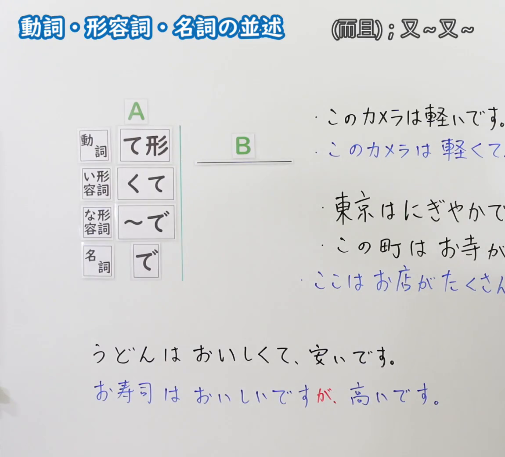
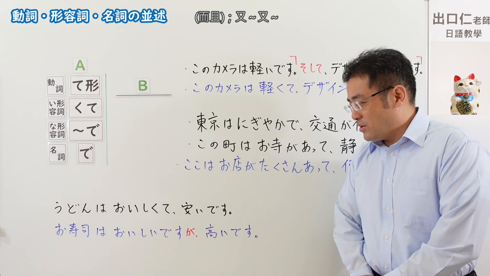

---
{
  "id": "N5-G-0048",
  "kind": "grammar",
  "level": "N5",
  "title": "动词・形容词・名词的并述",
  "card_revision": 2,
  "schema_version": 1,
  "source": {
    "lesson": "N5 第48个语法",
    "material": "出口日語原视频板书（学习者截取的接续图与例句图）与东京外国语大学「AくてA・NAでNA・NでN：解説」正文",
    "video": "https://www.youtube.com/watch?v=J80cLZHYUuc",
    "screenshot": "assets/grammar/n5/N5-G-0048-connection.png",
    "screenshot_crop": {
      "x": 0,
      "y": 0,
      "width": 1150,
      "height": 1040
    }
  },
  "tags": [
    "て形",
    "くて",
    "并列",
    "N5"
  ],
  "confusions": [
    "并列／原因",
    "て／が",
    "くて／けれど",
    "な形容词／名词＋で"
  ]
}
---

# N5 第48个语法：动词・形容词・名词的并述

# 视频学习资料整理

- 课程：[出口日語「動詞・形容詞・名詞の並述」](https://www.youtube.com/watch?v=J80cLZHYUuc)
- 视频 ID：`J80cLZHYUuc`
- 视频时长：6分9秒

## 接续图

- 实际时间：未记录（图片由学习者从原视频截取并提供）
- 成品图尺寸：1150×1040，固定左上角 `(0, 0)`，右下角 `(1150, 1040)`
- 板书内容：标题「動詞・形容詞・名詞の並述」，右侧标注“(而且)；又～又～”；左侧公式：「A」列「動詞：て形」「い形容詞：くて」「な形容詞：～で」「名詞：で」，右接「B」；右侧例句：「このカメラは軽いです。」「このカメラは軽くて、…」（蓝字）；「東京はにぎやかで、…」「この町はお寺があって、…」「ここはお店がたくさんあって、…」（蓝字）；下方对比：「うどんはおいしくて、安いです。」「お寿司はおいしいですが、高いです。」（「が」红字）。右侧多行句末被画面右缘截断，未补写。

## 例句图

- 实际时间：未记录（图片由学习者从原视频截取并提供）
- 成品图尺寸：1900×1070，固定左上角 `(0, 0)`，右下角 `(1900, 1070)`
- 板书内容：（注：第46至48课的例句图是整张板书画面，不是「例文」页。）成品图尺寸含黑板全貌，老师入画并遮挡右侧部分板书。板书内容：右上「このカメラは軽いです。そして、デザ…」（「そして」红字，前后有红色括号）「このカメラは軽くて、デザイン…」；「東京はにぎやかで、交通が…」「この町はお寺があって、静…」「ここはお店がたくさんあって、何…」；下方「うどんはおいしくて、安いです。」「お寿司はおいしいですが、高いです。」。老师头部与身体遮挡右侧多句句末，未补写。

# 核心

## 功能一：（而且）；又～又～（并列叙述）

**くわしい意味記述：**

- **Aくて／NAで／Nで（並列）：** 「Aくて／NAで／Nで」は、２つ以上の名詞・形容詞をつないで、Nを修飾することができます。また、２つ以上の文をつなぐことができます。（「Aくて／NAで／Nで」可以连接两个以上的名词、形容词来修饰N，也可以连接两个以上的句子。）
- **作り方：** １番目の「A1です」「NA1です」「N1です」をそれぞれ「A1くて」「NA1で」「N1で」にします。（把第一个「A1です」「NA1です」「N1です」分别改为「A1くて」「NA1で」「N1で」。）
- **評価の組み合わせ：** マイナス評価のことばとプラス評価のことばはつなげられません。つなげるときは「が」を使います。（负面评价的词和正面评价的词不能连接，连接时使用「が」。）

### 例句

1. この花は小さくて赤いです。

   （这朵花又小又红。）

2. 木村さんはテニスがじょうずで、小林さんはサッカーがじょうずです。

   （木村擅长网球，小林擅长足球。）

3. 田中さんは３年生で、中村さんは４年生です。

   （田中是三年级，中村是四年级。）

4. この靴下は、じょうぶで安いです。

   （这双袜子又结实又便宜。）

5. この靴下はじょうぶですが、高いです。

   （这双袜子很结实，但是很贵。）

# 来源

- [出口日語原视频](https://www.youtube.com/watch?v=J80cLZHYUuc)
- [东京外国语大学「日本語 文法 AくてA・NAでNA・NでN：解説」](https://www.coelang.tufs.ac.jp/mt/ja/gmod/contents/explanation/049.html)（查询日期：2026-10-16；Hagoromo、毎日のんびり日本語教師、日本語NET 均未找到直接对应条目，按流程采用互联网检索所得的该页；该页没有动词「て形」并列的解说（板书的「お寺があって」类），例句译文为整理者所译）
