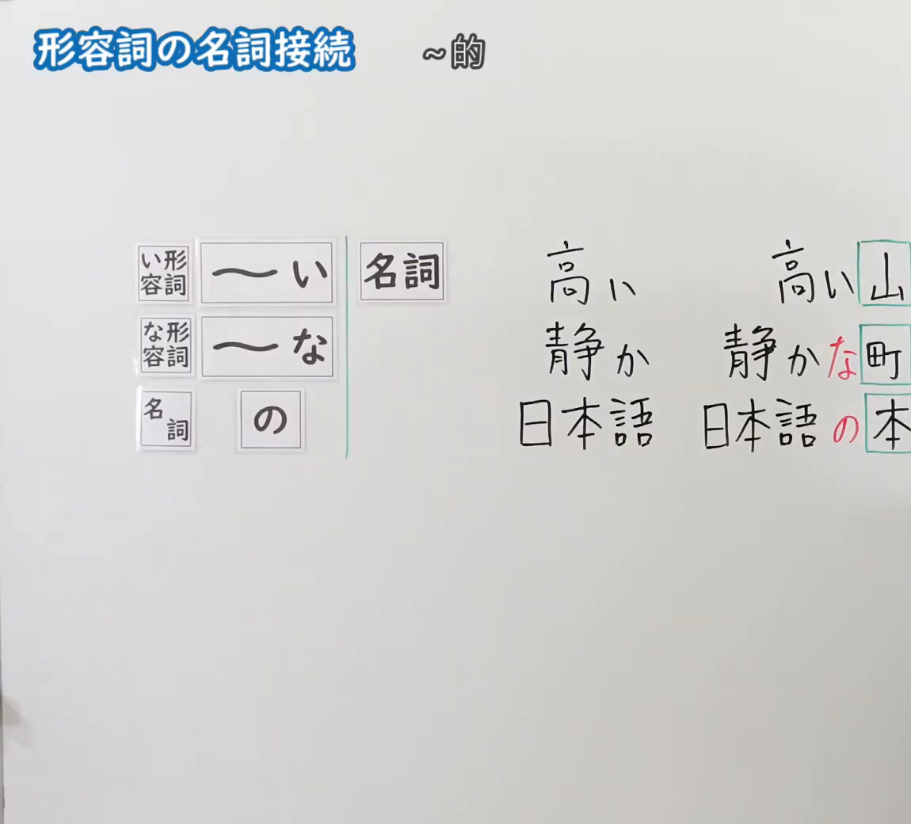
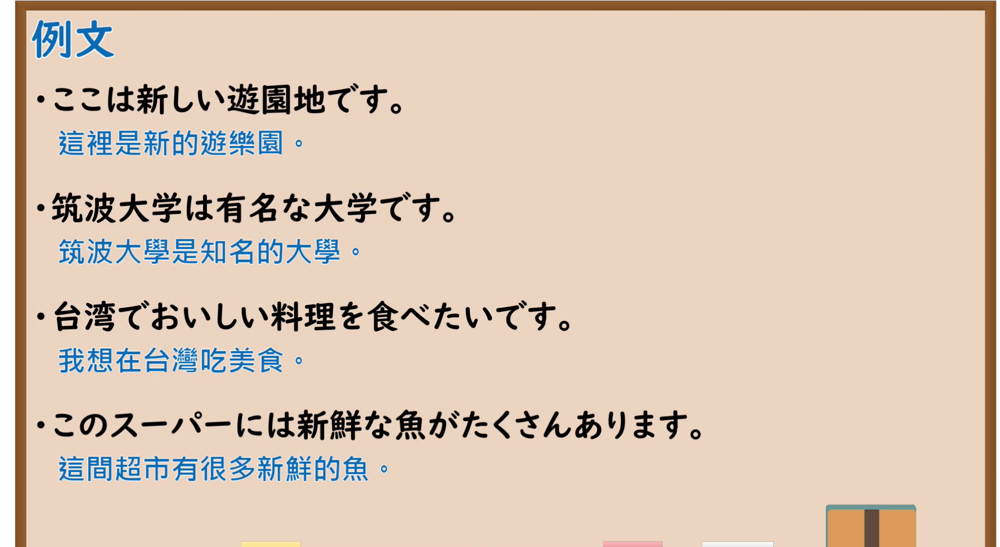

---
{
  "id": "N5-G-0049",
  "kind": "grammar",
  "level": "N5",
  "title": "形容词的名词接续",
  "card_revision": 2,
  "schema_version": 1,
  "source": {
    "lesson": "N5 第49个语法",
    "material": "出口日語原视频板书（学习者截取的接续图与例句图）与东京外国语大学「AいN」「NAなN」解说正文",
    "video": "https://www.youtube.com/watch?v=G-WeQQwGgyo",
    "screenshot": "assets/grammar/n5/N5-G-0049-connection.png",
    "screenshot_crop": {
      "x": 0,
      "y": 0,
      "width": 1150,
      "height": 1040
    }
  },
  "tags": [
    "い形容词",
    "な形容词",
    "名词修饰",
    "N5"
  ],
  "confusions": [
    "な形容词＋な／で",
    "名词＋の／で",
    "い形容词去い",
    "形容词作谓语／修饰名词"
  ]
}
---

# N5 第49个语法：形容词的名词接续

# 视频学习资料整理

- 课程：[出口日語「形容詞の名詞接続」](https://www.youtube.com/watch?v=G-WeQQwGgyo)
- 视频 ID：`G-WeQQwGgyo`
- 视频时长：4分26秒

## 接续图

- 实际时间：未记录（图片由学习者从原视频截取并提供）
- 成品图尺寸：1150×1040，固定左上角 `(0, 0)`，右下角 `(1150, 1040)`
- 板书内容：标题「形容詞の名詞接続」，右侧标注“～的”；左侧公式：「い形容詞：～い」「な形容詞：～な」「名詞：の」，后接「名詞」；右侧对照例：「高い／高い山」「静か／静かな町（「な」红字）」「日本語／日本語の本（「の」红字）」，被修饰的名词用绿框标出，右端被画面右缘截断。

## 例句图

- 实际时间：未记录（图片由学习者从原视频截取并提供）
- 成品图尺寸：1900×1040，固定左上角 `(0, 0)`，右下角 `(1900, 1040)`
- 板书内容：课程「例文」页，含四条例句及中文翻译（ここは新しい遊園地です／筑波大学は有名な大学です／台湾でおいしい料理を食べたいです／このスーパーには新鮮な魚がたくさんあります）。四条例句均完整可见。

# 核心

## 功能一：～的（形容词修饰名词）

**くわしい意味記述：**

- **AいN：** 「Aい」は、Nの性質や特徴（色・形・大きさなど）などを示すことで、Nを修飾します。名詞を修飾するとき「い」で終わるものをイ形容詞（Aい）と言います。（「Aい」通过表示N的性质、特征（颜色、形状、大小等）来修饰N。修饰名词时以「い」结尾的称为い形容词（Aい）。）
- **NAなN：** 形容詞のうち、名詞を修飾するとき「な」をつけるものをナ形容詞（NA）と言います。「NAな」も「Aい」と同様に、Nの性質や特徴などを示すことで、Nを修飾します。（形容词中，修饰名词时加「な」的称为な形容词（NA）。「NAな」与「Aい」一样，通过表示N的性质、特征来修饰N。）
- **どんなN：** Nの性質や特徴などを質問するときは、「どんなN」でたずねます。（询问N的性质、特征时，用「どんなN」。）

### 例句

1. 教室に新しいコンピューターがあります。

   （教室里有新电脑。）

2. 箱の中に小さい犬がいます。

   （箱子里有一只小狗。）

3. 田中さんは元気な人です。

   （田中是精神很好的人。）

4. すてきな絵ですね。

   （画得真好啊。）

5. 静かな音楽のCDがあります。

   （有安静的音乐的CD。）

# 来源

- [出口日語原视频](https://www.youtube.com/watch?v=G-WeQQwGgyo)
- 东京外国语大学「日本語 文法」解说：[「AいN」](https://www.coelang.tufs.ac.jp/mt/ja/gmod/contents/explanation/009.html)、[「NAなN」](https://www.coelang.tufs.ac.jp/mt/ja/gmod/contents/explanation/010.html)（查询日期：2026-10-16；Hagoromo、毎日のんびり日本語教師、日本語NET 均未找到直接对应条目，按流程采用互联网检索所得的两页；这两页没有「名词＋の＋名词」的解说，板书的「日本語の本」一行本卡未补充来源；例句译文为整理者所译）
