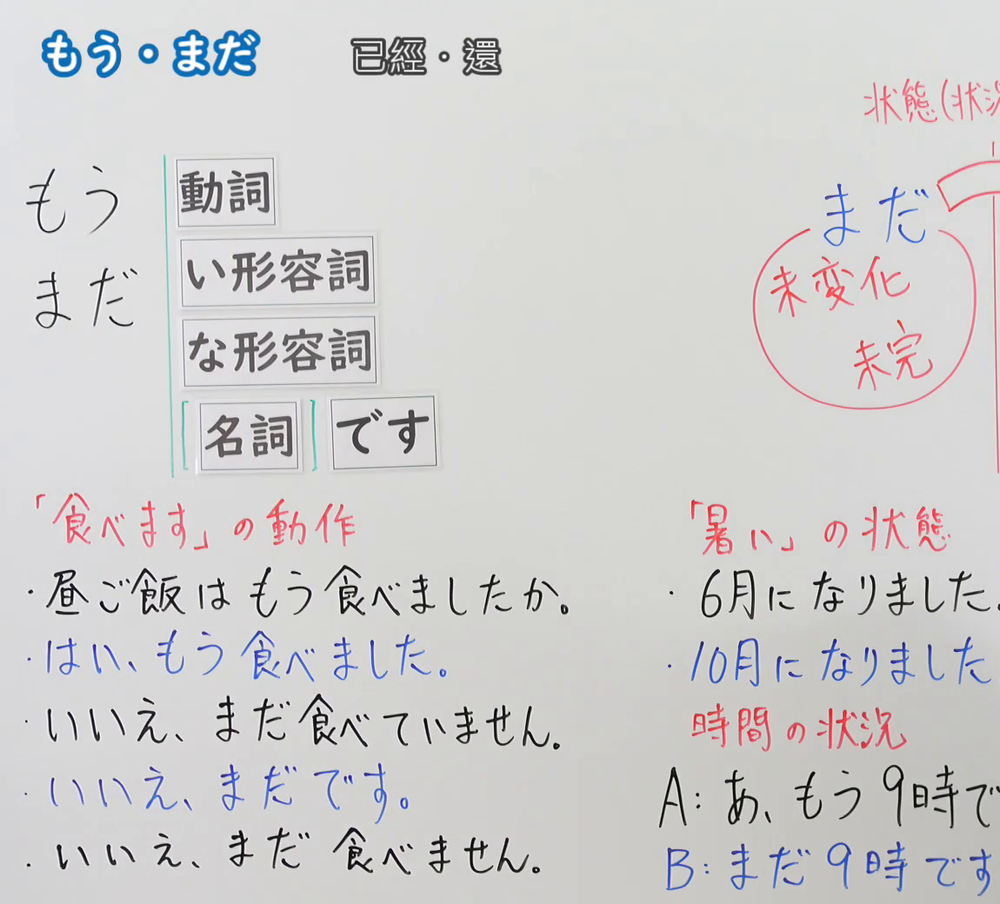
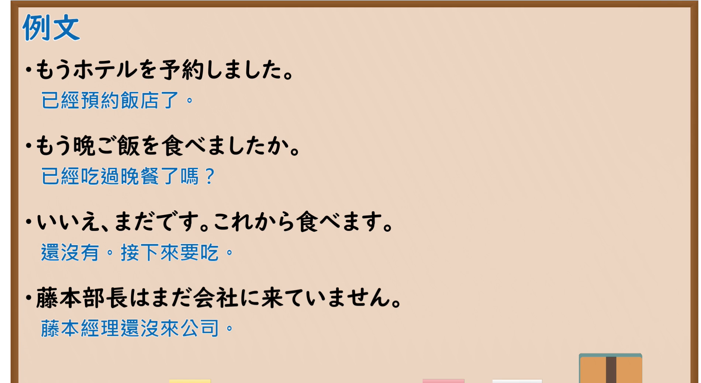

---
{
  "id": "N5-G-0050",
  "kind": "grammar",
  "level": "N5",
  "title": "时间副词「もう・まだ」",
  "card_revision": 2,
  "schema_version": 1,
  "source": {
    "lesson": "N5 第50个语法",
    "material": "出口日語原视频板书（学习者截取的接续图与例句图）与日本語NET「【JLPT N5】文法・例文：もう〜した」正文",
    "video": "https://www.youtube.com/watch?v=6l7ZIcleKoE",
    "screenshot": "assets/grammar/n5/N5-G-0050-connection.png",
    "screenshot_crop": {
      "x": 0,
      "y": 0,
      "width": 1150,
      "height": 1040
    }
  },
  "tags": [
    "もう",
    "まだ",
    "副词",
    "N5"
  ],
  "confusions": [
    "もう／まだ",
    "もう～ました／まだ～ていません",
    "まだです／まだ～ません",
    "完成／状态持续"
  ]
}
---

# N5 第50个语法：もう・まだ

# 视频学习资料整理

- 课程：[出口日語「もう・まだ」](https://www.youtube.com/watch?v=6l7ZIcleKoE)
- 视频 ID：`6l7ZIcleKoE`
- 视频时长：6分55秒

## 接续图

- 实际时间：未记录（图片由学习者从原视频截取并提供）
- 成品图尺寸：1150×1040，固定左上角 `(0, 0)`，右下角 `(1150, 1040)`
- 板书内容：标题「もう・まだ」，右侧标注“已經・還”；左侧公式：「もう／まだ」后接「動詞」「い形容詞」「な形容詞」「名詞 です」；左下红字「「食べます」の動作」下列对话：「昼ご飯はもう食べましたか。」「はい、もう食べました。」（蓝字）「いいえ、まだ食べていません。」「いいえ、まだです。」（蓝字）「いいえ、まだ食べません。」；右上红字「状態（状況…」，圈出「まだ」并标「未変化」「未完」；右下红字「「暑い」の状態」下「6月になりました。」「10月になりました。」，「時間の状況」下「A：あ、もう9時で(す)」「B：まだ9時です」，右侧多处被画面右缘截断，未补写。

## 例句图

- 实际时间：未记录（图片由学习者从原视频截取并提供）
- 成品图尺寸：1900×1040，固定左上角 `(0, 0)`，右下角 `(1900, 1040)`
- 板书内容：课程「例文」页，含四条例句及中文翻译（もうホテルを予約しました／もう晩ご飯を食べましたか／いいえ、まだです。これから食べます／藤本部長はまだ会社に来ていません）。四条例句均完整可见。

# 核心

## 功能一：已经～；还～

**くわしい意味記述：**

- **もう〜した：** 「もう〜した」は、動作や出来事の完了を示します。（表示动作或事件的完成。）接続は V（肯定形＋過去形）。（接续为 动词（肯定形＋过去形）。）
- **「まだ」の答え方：** 「もう〜ましたか？」の質問にまだ完了していないことを述べる場合は、「いいえ、まだです」や「いいえ、まだ〜ていません」の形で答えます。（对「もう〜ましたか？」的提问，叙述尚未完成时，用「いいえ、まだです」或「いいえ、まだ〜ていません」的形式回答。）

### 例句

1. A：もう昼ごはんを食べましたか。　B：はい、食べました。

   （A：已经吃过午饭了吗？　B：是的，吃了。）

2. A：もう宿題をしましたか。　B：いいえ、まだです。

   （A：已经做了作业吗？　B：不，还没有。）

3. A：みなさん、もう京都には行きましたか？　B：はい、行きました。

   （A：大家已经去过京都了吗？　B：是的，去过了。）

4. A：もうレポートを出しましたか。　B：はい、さっき出しました。

   （A：已经交了报告吗？　B：是的，刚才交了。）

5. A：もう映画始まった？　B：ううん、まだだよ。

   （A：电影已经开始了吗？　B：不，还没有。）

# 来源

- [出口日語原视频](https://www.youtube.com/watch?v=6l7ZIcleKoE)
- [日本語NET「【JLPT N5】文法・例文：もう〜した」](https://nihongokyoshi-net.com/2020/02/21/jlptn5-grammar-mou-mashita/)（查询日期：2026-10-16；Hagoromo 未收录，毎日のんびり日本語教師没有 N5 的「もう」「まだ」条目，按流程采用优先级第二的日本語NET 条目；该页只解说「もう〜した」，板书里「まだ」表示未变化的状态（まだ9時です）、「もう」表示变化（もう9時です、6月になりました）的用法，该页没有解说；该页只有英文翻译，中文译文为整理者所译）
