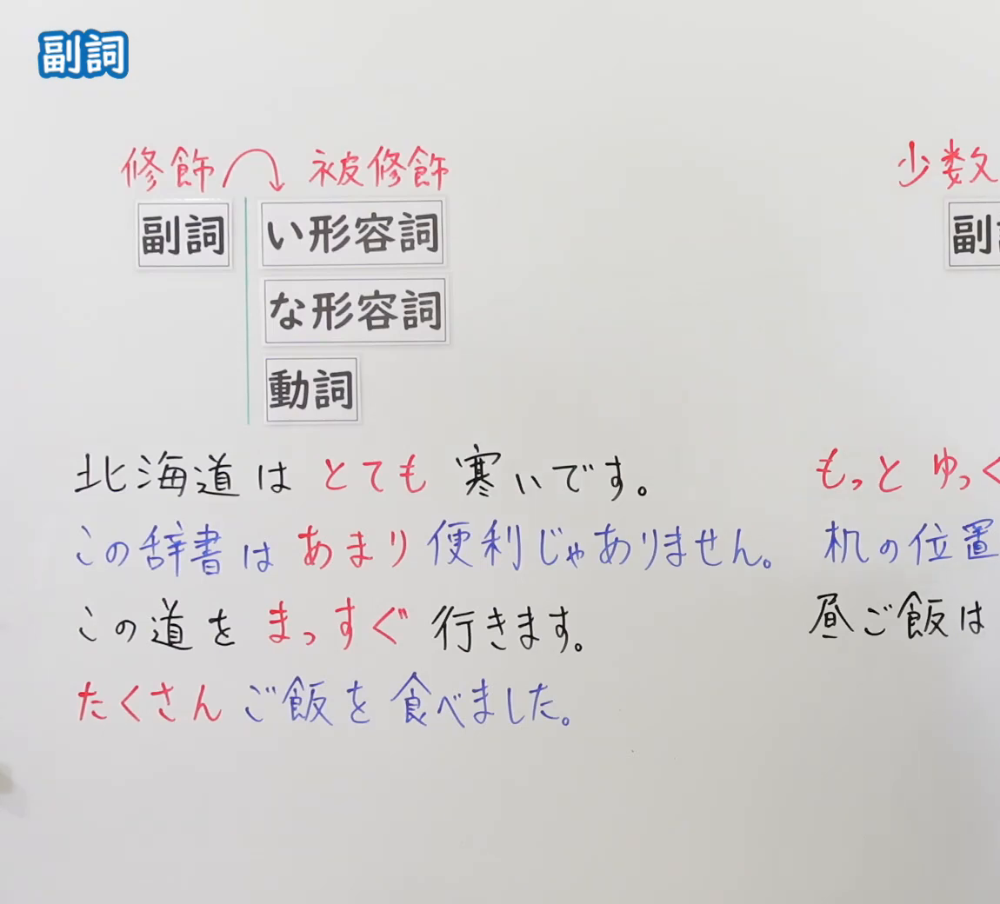
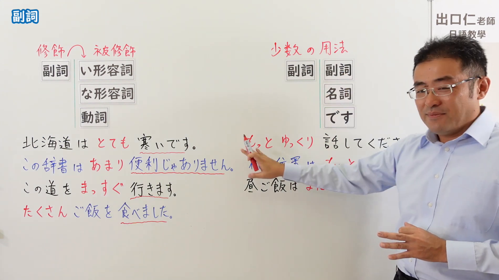

---
{
  "id": "N5-G-0051",
  "kind": "grammar",
  "level": "N5",
  "title": "副词",
  "card_revision": 2,
  "schema_version": 1,
  "source": {
    "lesson": "N5 第51个语法",
    "material": "出口日語原视频板书（学习者截取的接续图与例句图）与东京外国语大学「とても・あまり」解说正文",
    "video": "https://www.youtube.com/watch?v=4uuRpPKbxYM",
    "screenshot": "assets/grammar/n5/N5-G-0051-connection.png",
    "screenshot_crop": {
      "x": 0,
      "y": 0,
      "width": 1150,
      "height": 1040
    }
  },
  "tags": [
    "副词",
    "とても",
    "あまり",
    "N5"
  ],
  "confusions": [
    "副词／形容词",
    "あまり＋否定",
    "もっと／ゆっくり",
    "まだです",
    "副词修饰名词"
  ]
}
---

# N5 第51个语法：副词

# 视频学习资料整理

- 课程：[出口日語「副詞」](https://www.youtube.com/watch?v=4uuRpPKbxYM)
- 视频 ID：`4uuRpPKbxYM`
- 视频时长：6分16秒

## 接续图

- 实际时间：未记录（图片由学习者从原视频截取并提供）
- 成品图尺寸：1150×1040，固定左上角 `(0, 0)`，右下角 `(1150, 1040)`
- 板书内容：标题「副詞」，无接续公式；左侧公式：红字「修飾→被修飾」，「副詞」后接「い形容詞」「な形容詞」「動詞」；例句：「北海道はとても寒いです。」「この辞書はあまり便利じゃありません。」（蓝字）「この道をまっすぐ行きます。」「たくさんご飯を食べました。」（副词红字）；右侧红字「少数の用法」，公式「副詞」后接「副詞」「名詞」「です」，例句「もっとゆっく(り話してください)」「机の位置は…」「昼ご飯は…」，右侧句末被画面右缘截断，未补写。

## 例句图

- 实际时间：未记录（图片由学习者从原视频截取并提供）
- 成品图尺寸：1900×1070，固定左上角 `(0, 0)`，右下角 `(1900, 1070)`
- 板书内容：（注：本课例句图是整张板书画面，不是「例文」页。）成品图尺寸含黑板全貌，老师入画并遮挡右侧部分板书。板书内容：在接续图内容之外，各例句的被修饰语加了红色波浪下划线（寒いです、便利じゃありません、行きます、食べました）；右侧「少数の用法」下的「もっとゆっくり話してください」后半被老师手臂遮挡，其下「机の位置は…」「昼ご飯は…」被手部与手臂遮挡大半，未补写。

# 核心

## 功能一：副词修饰形容词、动词（程度、方式、数量）

**くわしい意味記述：**

- **とても／あまり：** 「とてもAいです」で、程度が高いことを示します。「あまりAくありません」で程度が高くないことを示します。「とても」「あまり」は、「Vます」「Vません」を修飾することもあります。その場合も、程度や頻度が高いこと（高くないこと）を示します。（「とてもAいです」表示程度高，「あまりAくありません」表示程度不高。「とても」「あまり」也可以修饰「Vます」「Vません」，此时也表示程度或频率高（不高）。）
- **ナ形容詞との組み合わせ：** ナ形容詞も「とても」「あまり」の修飾を受けることがあります。（な形容词也可以被「とても」「あまり」修饰。）

### 例句

1. 太郎君の犬はとても大きいです。

   （太郎的狗很大。）

2. わたしの部屋はあまり広くありません。

   （我的房间不太宽敞。）

3. とてもつかれました。

   （非常累。）

4. あまり勉強しません。

   （不太学习。）

5. このあたりには、あまり高い建物がありません。

   （这一带没有什么高大的建筑。）

# 来源

- [出口日語原视频](https://www.youtube.com/watch?v=4uuRpPKbxYM)
- [东京外国语大学「日本語 文法 とても・あまり：解説」](https://www.coelang.tufs.ac.jp/mt/ja/gmod/contents/explanation/034.html)（查询日期：2026-10-16；Hagoromo、毎日のんびり日本語教師、日本語NET 均未找到直接对应课程“副词”的条目，按流程采用互联网检索所得的该页；该页只解说「とても」「あまり」，板书中的「まっすぐ」「たくさん」「もっと」「ゆっくり」及“副词修饰副词／名词／です”的少数用法本页没有解说，卡内未写；例句译文为整理者所译）
