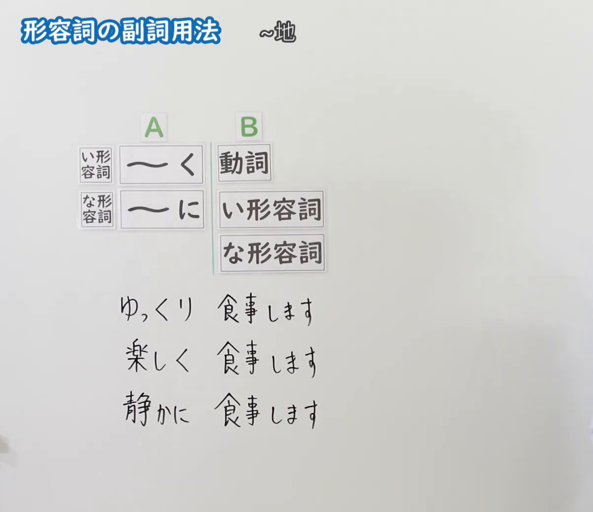
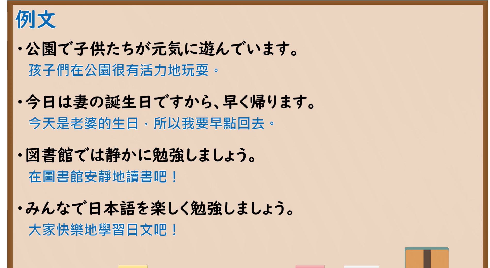

---
{
  "id": "N5-G-0052",
  "kind": "grammar",
  "level": "N5",
  "title": "形容词的副词用法",
  "card_revision": 2,
  "schema_version": 1,
  "source": {
    "lesson": "N5 第52个语法",
    "material": "出口日語原视频板书（学习者截取的接续图与例句图）与J-nihongo「い形容詞の副詞用法（〜く）の意味・使い方」正文",
    "video": "https://www.youtube.com/watch?v=neY8weBna98",
    "screenshot": "assets/grammar/n5/N5-G-0052-connection.png",
    "screenshot_crop": {
      "x": 0,
      "y": 0,
      "width": 1203,
      "height": 1040
    }
  },
  "tags": [
    "い形容词",
    "な形容词",
    "副词用法",
    "N5"
  ],
  "confusions": [
    "くなります／くします",
    "く／に",
    "い形容词去い",
    "形容词作谓语／修饰动词"
  ]
}
---

# N5 第52个语法：形容词的副词用法

# 视频学习资料整理

- 课程：[出口日語「形容詞の副詞用法」](https://www.youtube.com/watch?v=neY8weBna98)
- 视频 ID：`neY8weBna98`
- 视频时长：4分19秒

## 接续图

- 实际时间：未记录（图片由学习者从原视频截取并提供）
- 成品图尺寸：1203×1040，固定左上角 `(0, 0)`，右下角 `(1203, 1040)`
- 板书内容：标题「形容詞の副詞用法」，右侧标注“～地”；左侧公式：「A」列「い形容詞：～く」「な形容詞：～に」，右接「B」列「動詞」「い形容詞」「な形容詞」；例句：「ゆっくり食事します」「楽しく食事します」「静かに食事します」。板书完整，无遮挡。

## 例句图

- 实际时间：未记录（图片由学习者从原视频截取并提供）
- 成品图尺寸：1900×1040，固定左上角 `(0, 0)`，右下角 `(1900, 1040)`
- 板书内容：课程「例文」页，含四条例句及中文翻译（公園で子供たちが元気に遊んでいます／今日は妻の誕生日ですから、早く帰ります／図書館では静かに勉強しましょう／みんなで日本語を楽しく勉強しましょう）。四条例句均完整可见。

# 核心

## 功能一：～地（形容词作副词修饰动词）

**くわしい意味記述：**

- **〜く／〜に：** イ形容詞を「〜く」、ナ形容詞を「〜に」の形にして、動作の様子や程度を説明します。（把い形容词变成「〜く」、な形容词变成「〜に」，来说明动作的样子或程度。）
- **作り方：** イ形容詞：語幹（いを取る）＋く＋V。ナ形容詞：語幹＋に＋V。（い形容词：词干（去掉い）＋く＋动词。な形容词：词干＋に＋动词。）

### 例句

1. 毎朝、早く起きます。

   （每天早上早起。）

2. 名前を大きく書いてください。

   （请把名字写大一点。）

3. 質問には短く答えてください。

   （请简短地回答问题。）

4. もう少しゆっくり話してください。

   （请再说慢一点。）

5. 漢字を正しく書きましょう。

   （让我们正确地书写汉字吧。）

# 来源

- [出口日語原视频](https://www.youtube.com/watch?v=neY8weBna98)
- [J-nihongo「い形容詞の副詞用法（〜く）の意味・使い方」](https://j-nihongo.com/adjective-ku-verb/)（查询日期：2026-10-16；Hagoromo、毎日のんびり日本語教師、日本語NET、东京外国语大学均未找到直接对应条目，按流程采用互联网检索所得的该页；该页只有英文翻译，中文译文为整理者所译；板书中“修饰い形容词、な形容词”的用法该页未解说）
