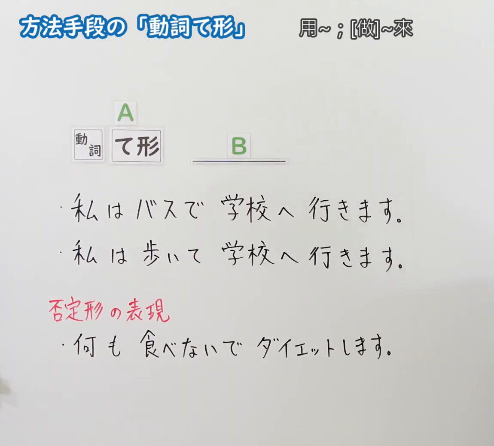
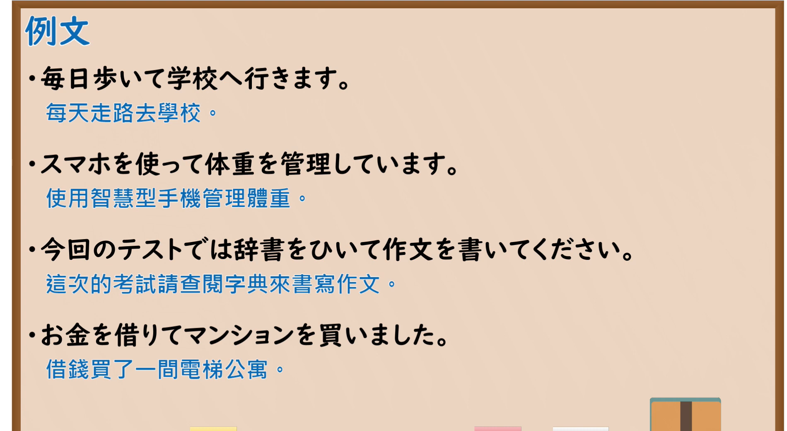

---
{
  "id": "N5-G-0053",
  "kind": "grammar",
  "level": "N5",
  "title": "方法手段的「动词て形」",
  "card_revision": 2,
  "schema_version": 1,
  "source": {
    "lesson": "N5 第53个语法",
    "material": "出口日語原视频板书（学习者截取的接续图与例句图）与东京外国语大学「VてVます：解説」正文",
    "video": "https://www.youtube.com/watch?v=uq4tZjiFRS4",
    "screenshot": "assets/grammar/n5/N5-G-0053-connection.png",
    "screenshot_crop": {
      "x": 0,
      "y": 0,
      "width": 1150,
      "height": 1040
    }
  },
  "tags": [
    "て形",
    "方法",
    "手段",
    "N5"
  ],
  "confusions": [
    "て形的用法",
    "ないで",
    "で（手段）／て形",
    "动作顺序／方法"
  ]
}
---

# N5 第53个语法：方法手段的「动词て形」

# 视频学习资料整理

- 课程：[出口日語「方法手段の「動詞て形」」](https://www.youtube.com/watch?v=uq4tZjiFRS4)
- 视频 ID：`uq4tZjiFRS4`
- 视频时长：4分12秒

## 接续图

- 实际时间：未记录（图片由学习者从原视频截取并提供）
- 成品图尺寸：1150×1040，固定左上角 `(0, 0)`，右下角 `(1150, 1040)`
- 板书内容：标题「方法手段の「動詞て形」」，右侧标注“用～；[做]～來”；公式「A：動詞 て形」「B：＿＿」；例句：「私はバスで学校へ行きます。」「私は歩いて学校へ行きます。」；红字「否定形の表現」下「何も食べないでダイエットします。」。板书完整，无遮挡。

## 例句图

- 实际时间：未记录（图片由学习者从原视频截取并提供）
- 成品图尺寸：1900×1040，固定左上角 `(0, 0)`，右下角 `(1900, 1040)`
- 板书内容：课程「例文」页，含四条例句及中文翻译（毎日歩いて学校へ行きます／スマホを使って体重を管理しています／今回のテストでは辞書をひいて作文を書いてください／お金を借りてマンションを買いました）。四条例句均完整可见。

# 核心

## 功能一：用～；[做]～来（表示方法、手段的动词て形）

**くわしい意味記述：**

- **方法・手段：** 「VてVます」は動作が行なわれるときの方法や手段を表わす場合にも使います。このとき、V1とV2の「Nは／が」は同一です。（「VてVます」也用于表示进行动作时的方法或手段。此时V1和V2的「Nは／が」相同。）
- **他の用法：** 「VてVます」は、順に起こる動作を述べるとき、動作が行なわれる状態を述べるときにも使います。（「VてVます」也用于叙述依次发生的动作，以及叙述动作进行时的状态。）

### 例句

1. わたしは毎日歩いて学校へ行きます。

   （我每天走路去学校。）

2. テープを聞いて、日本語を勉強します。

   （听录音学习日语。）

3. あそこに座って、お弁当を食べましょう。

   （我们坐在那里吃便当吧。）

4. あしたわたしは駅で友だちに会って、いっしょにコンサートに行きます。

   （明天我在车站见朋友，然后一起去听音乐会。）

5. 朝７時に起きて、食堂で朝ごはんを食べて、８時から練習します。

   （早上7点起床，在食堂吃早饭，8点开始练习。）

# 来源

- [出口日語原视频](https://www.youtube.com/watch?v=uq4tZjiFRS4)
- [东京外国语大学「日本語 文法 VてVます：解説」](https://www.coelang.tufs.ac.jp/mt/ja/gmod/contents/explanation/051.html)（查询日期：2026-10-16；Hagoromo、毎日のんびり日本語教師、日本語NET 均未找到直接对应条目，按流程采用互联网检索所得的该页；该页解说含顺序、状态、方法等多种用法，卡内只有前两例属方法・手段，其余为顺序・状态用法，已在上方注明；板书中否定形「～ないで」的用法该页未解说；例句译文为整理者所译）
