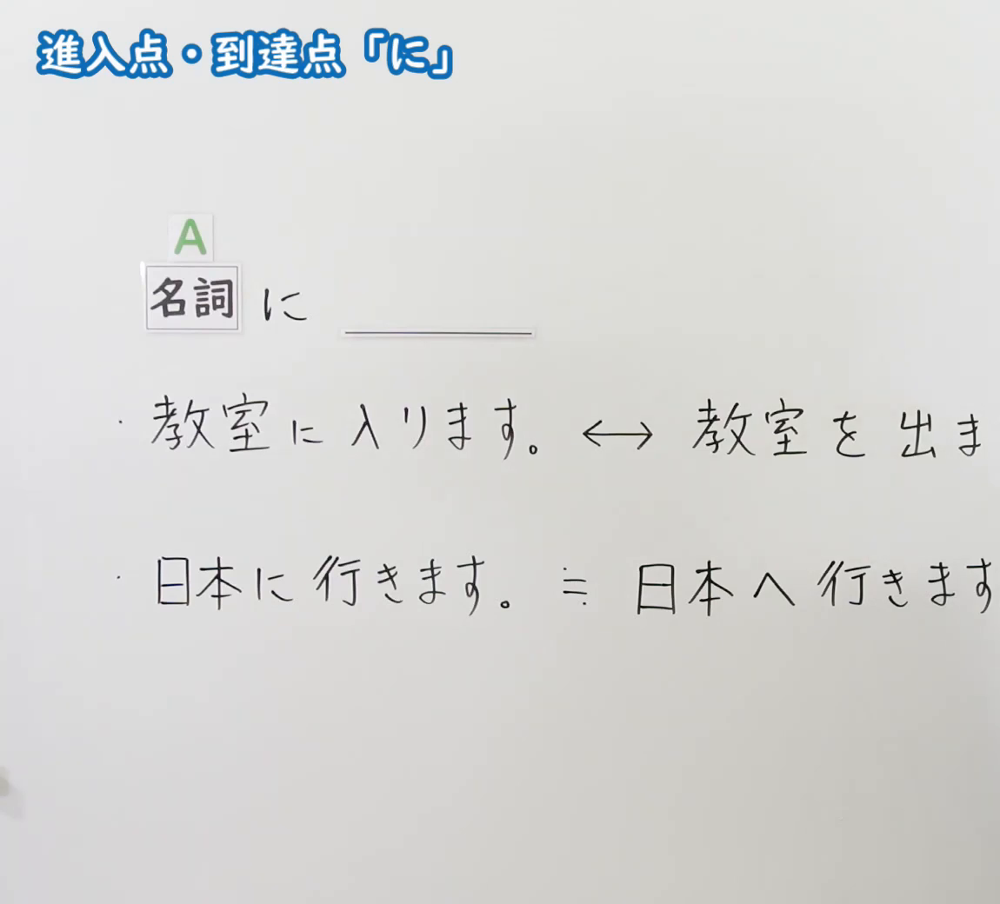
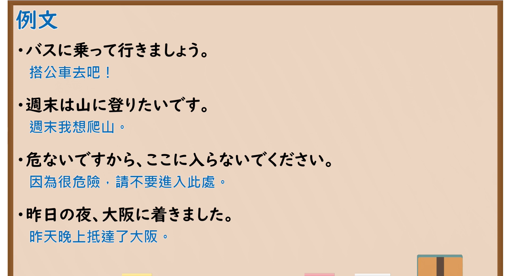

---
{
  "id": "N5-G-0054",
  "kind": "grammar",
  "level": "N5",
  "title": "助词：进入点・到达点「に」",
  "card_revision": 2,
  "schema_version": 1,
  "source": {
    "lesson": "N5 第54个语法",
    "material": "出口日語原视频板书（学习者截取的接续图与例句图）与毎日のんびり日本語教師「格助詞「に」の用法一覧」正文",
    "video": "https://www.youtube.com/watch?v=9YpeZr6Tby4",
    "screenshot": "assets/grammar/n5/N5-G-0054-connection.png",
    "screenshot_crop": {
      "x": 0,
      "y": 0,
      "width": 1150,
      "height": 1040
    }
  },
  "tags": [
    "に",
    "助词",
    "到达点",
    "N5"
  ],
  "confusions": [
    "に／へ",
    "入る／出る",
    "に／を",
    "到达点"
  ]
}
---

# N5 第54个语法：助词「に」（进入点・到达点）

# 视频学习资料整理

- 课程：[出口日語「助詞：進入点・到達点「に」」](https://www.youtube.com/watch?v=9YpeZr6Tby4)
- 视频 ID：`9YpeZr6Tby4`
- 视频时长：4分11秒

## 接续图

- 实际时间：未记录（图片由学习者从原视频截取并提供）
- 成品图尺寸：1150×1040，固定左上角 `(0, 0)`，右下角 `(1150, 1040)`
- 板书内容：标题「進入点・到達点「に」」，无中文标注；「名詞（A） に ＿＿」；两行例句：「教室に入ります。↔ 教室を出ま(す)」「日本に行きます。≒ 日本へ行きます」，右端被画面右缘截断，未补写。

## 例句图

- 实际时间：未记录（图片由学习者从原视频截取并提供）
- 成品图尺寸：1900×1040，固定左上角 `(0, 0)`，右下角 `(1900, 1040)`
- 板书内容：课程「例文」页，含四条例句及中文翻译（バスに乗って行きましょう／週末は山に登りたいです／危ないですから、ここに入らないでください／昨日の夜、大阪に着きました）。四条例句均完整可见。

# 核心

## 功能一：表示进入点、到达点

**くわしい意味記述：**

- **移動の着点：** 主体の移動を表す動詞が述語にくるとき、その移動の着点を表します。（谓语是表示主体移动的动词时，表示该移动的到达点。）

### 例句

1. 実家に帰る。

   （回老家。）

2. 学校に行く。

   （去上学。）

3. ステージにあがる。

   （登上舞台。）

4. 席に座る。

   （坐到座位上。）

5. タクシーに乗る。

   （乘坐出租车。）

# 来源

- [出口日語原视频](https://www.youtube.com/watch?v=9YpeZr6Tby4)
- [毎日のんびり日本語教師「格助詞「に」の用法一覧」「移動の着点」](https://mainichi-nonbiri.com/jltct/ni-case-particle/)（查询日期：2026-10-16；Hagoromo 未收录，按流程采用优先级最高的备选网站该页，中文译文取自该页；该页的例句没有板书中的「入る」，也没有「に／へ」对换的说明，卡内未补写）
