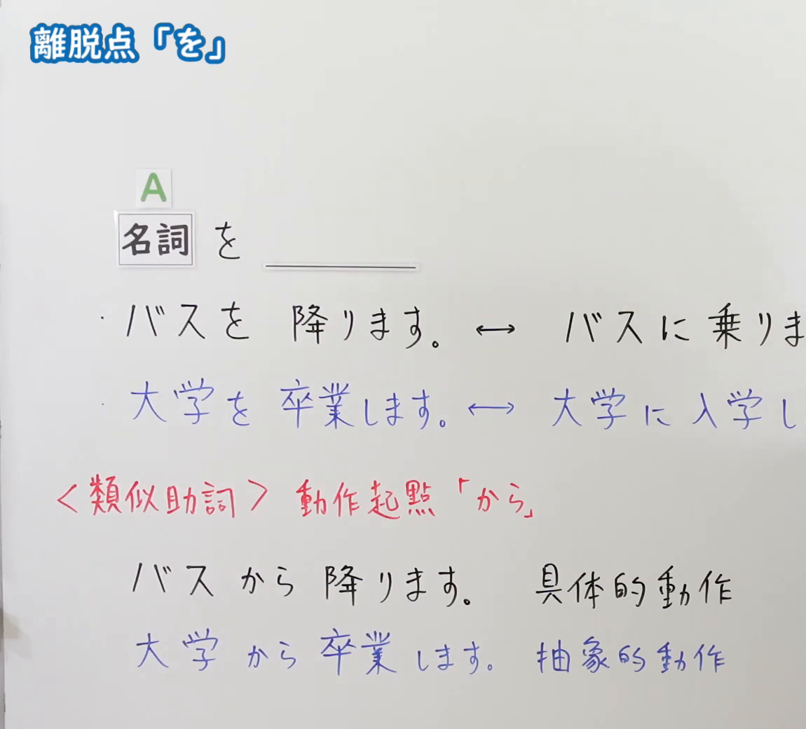
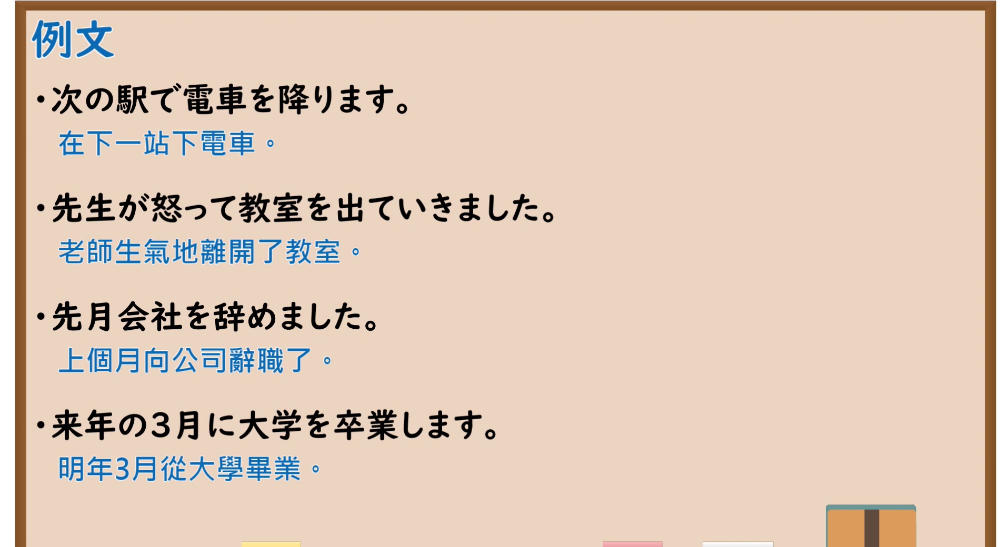

---
{
  "id": "N5-G-0055",
  "kind": "grammar",
  "level": "N5",
  "title": "助词：离脱点「を」",
  "card_revision": 2,
  "schema_version": 1,
  "source": {
    "lesson": "N5 第55个语法",
    "material": "出口日語原视频板书（学习者截取的接续图与例句图）与毎日のんびり日本語教師「格助詞「を」の用法一覧」正文",
    "video": "https://www.youtube.com/watch?v=IsA4G9aBPUw",
    "screenshot": "assets/grammar/n5/N5-G-0055-connection.png",
    "screenshot_crop": {
      "x": 0,
      "y": 0,
      "width": 1150,
      "height": 1040
    }
  },
  "tags": [
    "を",
    "助词",
    "离脱点",
    "N5"
  ],
  "confusions": [
    "を／から",
    "出る／降りる",
    "具体动作／抽象动作",
    "に／を"
  ]
}
---

# N5 第55个语法：助词「を」（离脱点）

# 视频学习资料整理

- 课程：[出口日語「助詞：離脱点「を」」](https://www.youtube.com/watch?v=IsA4G9aBPUw)
- 视频 ID：`IsA4G9aBPUw`
- 视频时长：4分18秒

## 接续图

- 实际时间：未记录（图片由学习者从原视频截取并提供）
- 成品图尺寸：1150×1040，固定左上角 `(0, 0)`，右下角 `(1150, 1040)`
- 板书内容：标题「離脱点「を」」，无中文标注；「名詞（A） を ＿＿」；两行对比：「バスを降ります。↔ バスに乗りま(す)」「大学を卒業します。↔ 大学に入学し(ます)」（蓝字，右端被画面右缘截断）；红字「＜類似助詞＞動作起點「から」」下：「バスから降ります。具体的動作」「大学から卒業します。抽象的動作」（蓝字）。

## 例句图

- 实际时间：未记录（图片由学习者从原视频截取并提供）
- 成品图尺寸：1900×1040，固定左上角 `(0, 0)`，右下角 `(1900, 1040)`
- 板书内容：课程「例文」页，含四条例句及中文翻译（次の駅で電車を降ります／先生が怒って教室を出ていきました／先月会社を辞めました／来年の3月に大学を卒業します）。四条例句均完整可见。

# 核心

## 功能一：表示离开点（离开某处）

**くわしい意味記述：**

- **起点：** 主体の移動を表す移動動詞が述語に置かれているとき、移動動詞が表す移動の起点（出発点）を表します。（谓语是表示主体移动的移动动词时，表示该移动的起点（出发点）。）

### 例句

1. もうすぐ家を出ます。

   （我们马上要离开家了。）

2. 刑務所を出る。

   （出狱。）

3. アパートを退去する。

   （退租公寓。）

4. 家を出発する。

   （出发离开家。）

# 来源

- [出口日語原视频](https://www.youtube.com/watch?v=IsA4G9aBPUw)
- [毎日のんびり日本語教師「格助詞「を」の用法一覧」「起点」](https://mainichi-nonbiri.com/jltct/wo-case-particle/)（查询日期：2026-10-16；Hagoromo 未收录，按流程采用优先级最高的备选网站该页，中文译文取自该页；该小节只有 4 条例句，且没有板书中「降りる」「卒業する」的例句，也没有「を／から」差异的解说，卡内未补写）
