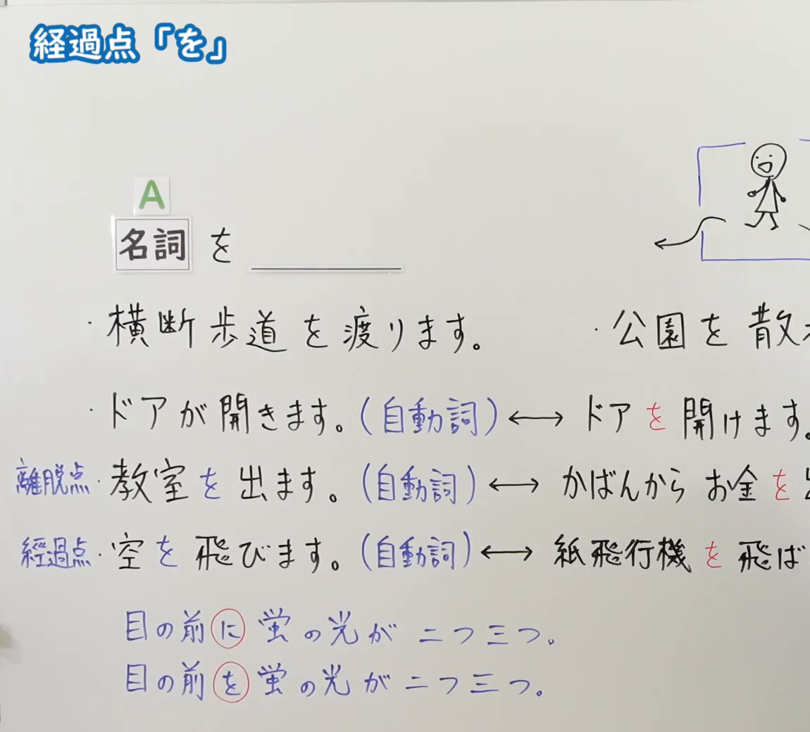
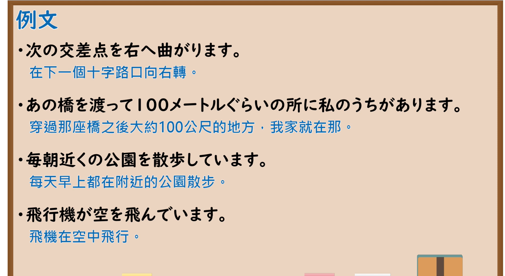

---
{
  "id": "N5-G-0056",
  "kind": "grammar",
  "level": "N5",
  "title": "助词：经过点「を」",
  "card_revision": 2,
  "schema_version": 1,
  "source": {
    "lesson": "N5 第56个语法",
    "material": "出口日語原视频板书（学习者截取的接续图与例句图）与毎日のんびり日本語教師「格助詞「を」の用法一覧」正文",
    "video": "https://www.youtube.com/watch?v=77mWHFbY6TU",
    "screenshot": "assets/grammar/n5/N5-G-0056-connection.png",
    "screenshot_crop": {
      "x": 0,
      "y": 0,
      "width": 1150,
      "height": 1040
    }
  },
  "tags": [
    "を",
    "助词",
    "经过点",
    "N5"
  ],
  "confusions": [
    "自动词／他动词",
    "を／に",
    "离脱点／经过点",
    "通过／移动"
  ]
}
---

# N5 第56个语法：助词「を」（经过点）

# 视频学习资料整理

- 课程：[出口日語「助詞：経過点「を」」](https://www.youtube.com/watch?v=77mWHFbY6TU)
- 视频 ID：`77mWHFbY6TU`
- 视频时长：9分51秒

## 接续图

- 实际时间：未记录（图片由学习者从原视频截取并提供）
- 成品图尺寸：1150×1040，固定左上角 `(0, 0)`，右下角 `(1150, 1040)`
- 板书内容：标题「経過点「を」」，无中文标注；「名詞（A） を ＿＿」；例句：「横断歩道を渡ります。」「公園を散(歩…)」（右端被截断）；对比自动词与他动词：「ドアが開きます。（自動詞）↔ ドアを開けます」「教室を出ます。（自動詞）↔ かばんからお金を出…」（「離脱点」标注在左侧）「空を飛びます。（自動詞）↔ 紙飛行機を飛ば…」（「経過点」标注在左侧）；下方「目の前に蛍の光が二つ三つ。」「目の前を蛍の光が二つ三つ。」（「に」「を」圈红）；右上角有手绘小人穿过门的插图，右端被画面右缘截断。

## 例句图

- 实际时间：未记录（图片由学习者从原视频截取并提供）
- 成品图尺寸：1900×1040，固定左上角 `(0, 0)`，右下角 `(1900, 1040)`
- 板书内容：课程「例文」页，含四条例句及中文翻译（次の交差点を右へ曲がります／あの橋を渡って100メートルぐらいの所に私のうちがあります／毎朝近くの公園を散歩しています／飛行機が空を飛んでいます）。四条例句均完整可见。

# 核心

## 功能一：表示经过点

**くわしい意味記述：**

- **経過域：** 主体の移動を表す移動動詞が述語に置かれているとき、移動動詞が表す移動の経過域（経路、通過点）を表します。（谓语是表示主体移动的移动动词时，表示该移动的经过区域（路径、通过点）。）

### 例句

1. あの丁字路を左に曲がる。

   （在那个丁字路口左转。）

2. スーパーは、銀行を過ぎてすぐです。

   （过了银行就是超市。）

3. ここから３つの交差点を直進して、突き当りを右です。

   （从这里开始过三个十字路口，在尽头右转。）

4. いつもこの道を通って出勤する。

   （总是经过这条路去上班。）

5. この道を歩いて行く。

   （沿着这条路走过去。）

# 来源

- [出口日語原视频](https://www.youtube.com/watch?v=77mWHFbY6TU)
- [毎日のんびり日本語教師「格助詞「を」の用法一覧」「経過域」](https://mainichi-nonbiri.com/jltct/wo-case-particle/)（查询日期：2026-10-16；Hagoromo 未收录，按流程采用优先级最高的备选网站该页，中文译文取自该页；板书中的自动词／他动词对比及「目の前を」的用法该页未解说，卡内未写）
