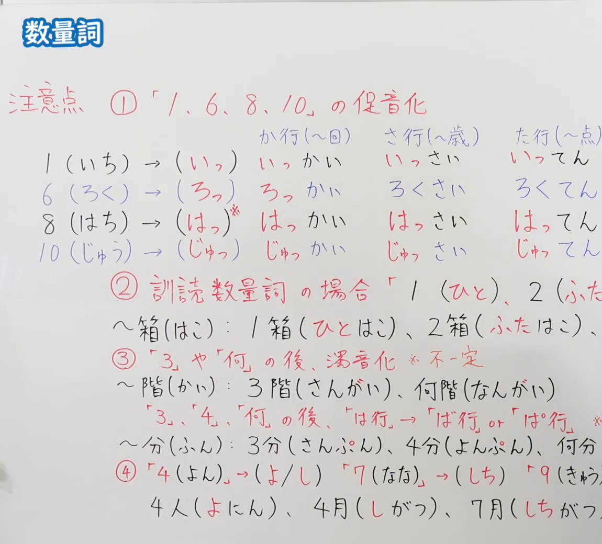
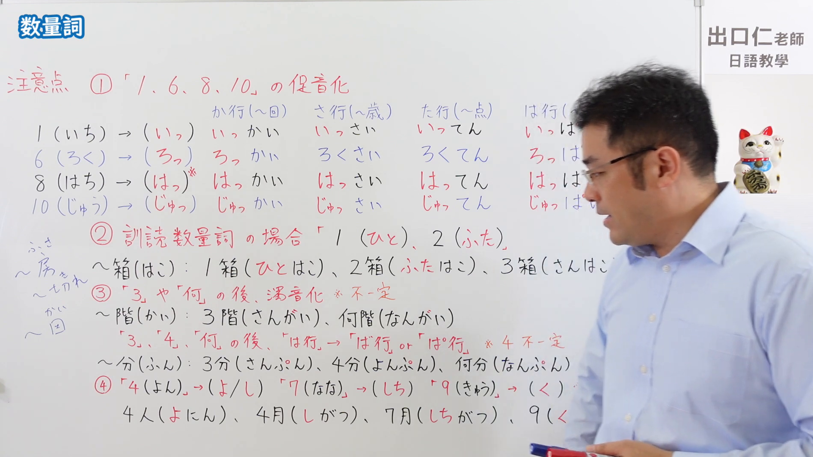

---
{
  "id": "N5-G-0057",
  "kind": "grammar",
  "level": "N5",
  "title": "数量词",
  "card_revision": 2,
  "schema_version": 1,
  "source": {
    "lesson": "N5 第57个语法",
    "material": "出口日語原视频板书（学习者截取的接续图与例句图）与东京外国语大学「助数詞：解説」正文",
    "video": "https://www.youtube.com/watch?v=_CBGGYQ-M40",
    "screenshot": "assets/grammar/n5/N5-G-0057-connection.png",
    "screenshot_crop": {
      "x": 0,
      "y": 0,
      "width": 1150,
      "height": 1040
    }
  },
  "tags": [
    "数量词",
    "助数词",
    "促音化",
    "N5"
  ],
  "confusions": [
    "数字／助数词",
    "促音化／一般读法",
    "训读数量词",
    "浊音化／半浊音化",
    "よん／し・なな／しち・きゅう／く"
  ]
}
---

# N5 第57个语法：数量词

# 视频学习资料整理

- 课程：[出口日語「数量詞」](https://www.youtube.com/watch?v=_CBGGYQ-M40)
- 视频 ID：`_CBGGYQ-M40`
- 视频时长：11分49秒

## 接续图

- 实际时间：未记录（图片由学习者从原视频截取并提供）
- 成品图尺寸：1150×1040，固定左上角 `(0, 0)`，右下角 `(1150, 1040)`
- 板书内容：标题「数量詞」，无接续公式；板书为“注意点”四条：「①「1、6、8、10」の促音化」：1（いち）→（いっ）、6（ろく）→（ろっ）、8（はち）→（はっ）※、10（じゅう）→（じゅっ），列表按か行（～回）、さ行（～歳）、た行（～点）、は行（～…）对照：いっかい／いっさい／いってん、ろっかい／ろくさい／ろくてん、はっかい／はっさい／はってん、じゅっかい／じゅっさい／じゅってん；「②訓読数量詞の場合「1（ひと）、2（ふた）…」」：「～箱（はこ）：1箱（ひとはこ）、2箱（ふたはこ）、…」；「③「3」や「何」の後、濁音化 ※不一定」：「～階（かい）：3階（さんがい）、何階（なんがい）」，「「3」「4」「何」の後、「は行」→「ば行」or「ぱ行」」，「～分（ふん）：3分（さんぷん）、4分（よんぷん）、何分（なんぷん）」；「④「4（よん）」→（よ／し）「7（なな）」→（しち）「9（きゅう）」→（く）」：「4人（よにん）、4月（しがつ）、7月（しちがつ）、9（く…」。各表右端与第④条末行被画面右缘截断，未补写。

## 例句图

- 实际时间：未记录（图片由学习者从原视频截取并提供）
- 成品图尺寸：1900×1070，固定左上角 `(0, 0)`，右下角 `(1900, 1070)`
- 板书内容：（注：本课例句图是整张板书画面，不是「例文」页。）成品图尺寸含黑板全貌，老师入画并遮挡右侧部分板书。板书内容：在接续图内容之外，可见か行至は行的第四列（は行：いっぱ…、ろっぱ…、はっぱ…、じゅっぱ…，被老师头部遮挡）；「②」下「～箱」行右端「3箱（さんはこ…」可见；左下角有小字手写补充「～房（ふさ）」「～切れ」「～回（かい）」，字迹较小；右下角「9（く…」被老师身体遮挡。

# 核心

## 功能一：数量词（数字＋助数词）的读法与音变

**くわしい意味記述：**

- **数＋助数詞：** 日本語では、数量を表わすときに、数に助数詞をつけます。数えるものが何であるかによって、どの助数詞を使うかが決まっています。助数詞は、数えるものの形や性質をある程度反映しています。（日语表示数量时，在数字后加助数词。根据所数事物是什么，决定使用哪个助数词。助数词在一定程度上反映了所数事物的形状和性质。）
- **助数詞の例：** 個数「～個」（小さいもの）、枚数「～枚」（薄いもの）、本数「～本」（細長いもの）、冊数「～冊」（本、ノート）、台数「～台」（乗りもの）、器に入ったものの数「～杯」、人数「～人」、動物の数「～匹」、階数「～階」、回数「～回」、金額「～円」、年齢「～歳」、番号「～番」。（个数「～個」（小东西）、张数「～枚」（薄的东西）、根数「～本」（细长的东西）、册数「～冊」（书、笔记本）、台数「～台」（交通工具）、容器所盛之物「～杯」、人数「～人」、动物「～匹」、楼层「～階」、次数「～回」、金额「～円」、年龄「～歳」、号码「～番」。）
- **語順：** 数えるものとその数は、N［数えるもの］を／が＋数＋助数詞、の語順で示されます。（所数事物与其数量的语序是：N［所数事物］を／が＋数＋助数词。）
- **「～つ」：** 「～つ」の数え方は、ほかの助数詞と違うので、注意しましょう。11以上は「じゅういち、じゅうに、じゅうさん、……」のように数えます。（「～つ」的数法与其他助数词不同，需要注意。11以上按「じゅういち、じゅうに、じゅうさん……」数。）

### 例句

1. あそこにかさが５本あります。

   （那边有5把伞。）

2. ケーキが７つあります。

   （有7个蛋糕。）

3. 切手を10枚とはがきを３枚買います。

   （买10张邮票和3张明信片。）

4. 先生の机の上に辞書が２冊と雑誌が１冊あります。

   （老师的桌上有2本词典和1本杂志。）

5. A：ボールがいくつありますか。　B：15あります。

   （A：有几个球？　B：有15个。）

# 来源

- [出口日語原视频](https://www.youtube.com/watch?v=_CBGGYQ-M40)
- [东京外国语大学「日本語 文法 助数詞：解説」](https://www.coelang.tufs.ac.jp/mt/ja/gmod/contents/explanation/017.html)（查询日期：2026-10-16；Hagoromo、毎日のんびり日本語教師、日本語NET 均未找到直接对应条目，按流程采用互联网检索所得的该页；该页的助数词读法表含各数字对应的读音，印证了板书的促音化（いっぽん、ろっぽん、はっぽん、じゅっぽん等）、浊音化（さんぼん、なんぼん）和「4→よ」等读音，但该页没有板书中的「訓読数量詞」（ひとはこ、ふたはこ）说明和「～房」「～切れ」，卡内未写；例句译文为整理者所译）
