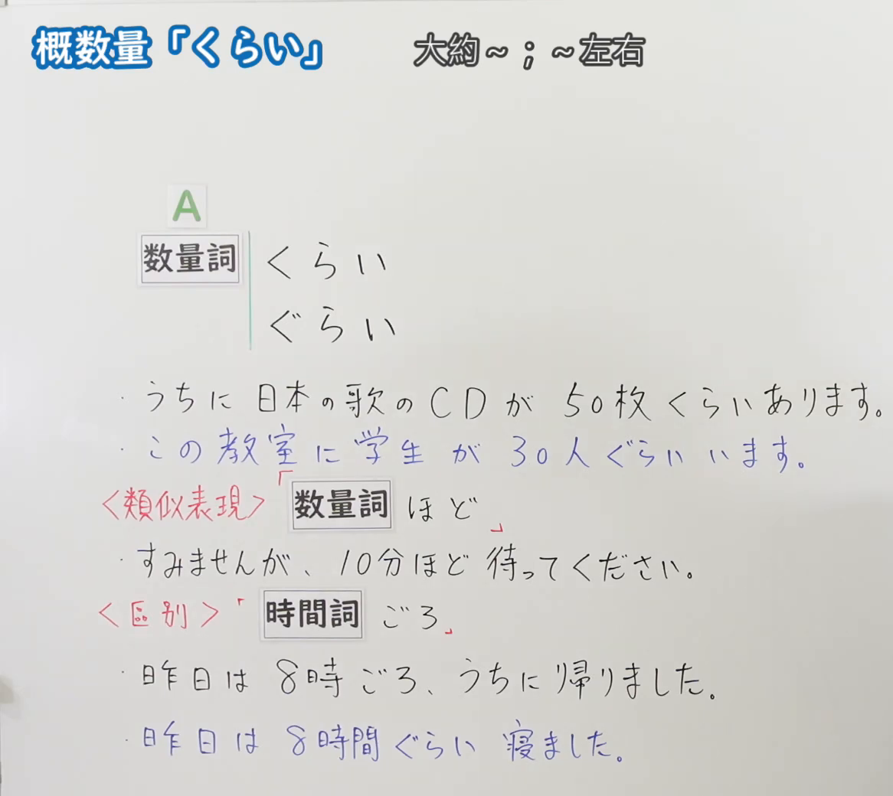
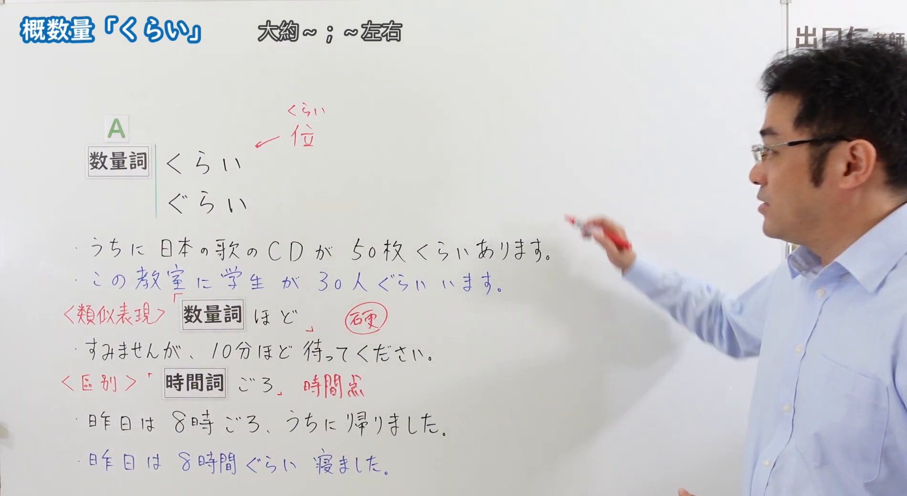

---
{
  "id": "N5-G-0058",
  "kind": "grammar",
  "level": "N5",
  "title": "助词：概数量「くらい」",
  "card_revision": 2,
  "schema_version": 1,
  "source": {
    "lesson": "N5 第58个语法",
    "material": "出口日語原视频板书（学习者截取的接续图与例句图）与毎日のんびり日本語教師「【Ｎ４文法】～くらい／ぐらい」正文",
    "video": "https://www.youtube.com/watch?v=8YDjOEFO7-Q",
    "screenshot": "assets/grammar/n5/N5-G-0058-connection.png",
    "screenshot_crop": {
      "x": 0,
      "y": 0,
      "width": 1166,
      "height": 1040
    }
  },
  "tags": [
    "くらい",
    "ぐらい",
    "概数",
    "N5"
  ],
  "confusions": [
    "ぐらい／ほど／ごろ",
    "时间点／时间量",
    "数量词＋くらい",
    "同じくらい"
  ]
}
---

# N5 第58个语法：助词「くらい」（概数量）

# 视频学习资料整理

- 课程：[出口日語「助詞：概数量「くらい」」](https://www.youtube.com/watch?v=8YDjOEFO7-Q)
- 视频 ID：`8YDjOEFO7-Q`
- 视频时长：7分30秒

## 接续图

- 实际时间：未记录（图片由学习者从原视频截取并提供）
- 成品图尺寸：1166×1040，固定左上角 `(0, 0)`，右下角 `(1166, 1040)`
- 板书内容：标题「概数量「くらい」」，右侧标注“大約～；～左右”；公式「A：数量詞 くらい／ぐらい」；例句：「うちに日本の歌のCDが50枚くらいあります。」「この教室に学生が30人ぐらいいます。」（蓝字）；红字「＜類似表現＞」「数量詞ほど」，例句「すみませんが、10分ほど待ってください。」；红字「＜区別＞」「時間詞ごろ」，例句「昨日は8時ごろ、うちに帰りました。」「昨日は8時間ぐらい寝ました。」（蓝字）。板书完整，无遮挡。

## 例句图

- 实际时间：未记录（图片由学习者从原视频截取并提供）
- 成品图尺寸：1900×1040，固定左上角 `(0, 0)`，右下角 `(1900, 1040)`
- 板书内容：（注：本课例句图是整张板书画面，不是「例文」页。）成品图尺寸含黑板全貌，老师入画，位于右侧，对板书无遮挡。板书内容：在接续图内容之外，补充「くらい」旁红字标注汉字「位」，「数量詞ほど」旁红圈标注“較硬”（较书面），「時間詞ごろ」旁红字“時間点”。

# 核心

## 功能一：大约～；～左右

**くわしい意味記述：**

- **数量＋くらい／ぐらい：** 多さ、大きさ、時間、範囲等が大体その数値に近いこと、あるいはほとんど同じことを表します。「約～」「大体～」と同じ意味です。（表示多少、大小、时间、范围等大致接近该数值，或几乎相同。与「約～」「大体～」意思相同。）
- **「ほど」との関係：** 「ほど」に言い換えられます。「ほど」を使うとやや硬い表現になります。（可以换成「ほど」。用「ほど」会稍显生硬。）

### 例句

1. 食費は毎月３万円くらいかかる。

   （伙食费每月要3万日元左右。）

2. 彼女は子どもが５人くらいいる。

   （她有五个左右的孩子。）

3. ４時間くらい昼寝した。

   （睡了四个小时左右的午觉。）

4. 二人の身長は同じぐらいだ。

   （两个人的身高差不多。）

5. 今の職場では、自分の息子ぐらいの人と一緒に働いている。

   （在现在的工作单位，和与自己儿子年纪相仿的人一起工作。）

# 来源

- [出口日語原视频](https://www.youtube.com/watch?v=8YDjOEFO7-Q)
- [毎日のんびり日本語教師「【Ｎ４文法】～くらい／ぐらい」](https://mainichi-nonbiri.com/grammar/n4-kurai/)（查询日期：2026-10-16；Hagoromo 未收录，故按流程采用优先级最高的备选网站条目，该站将本语法归入 N4；中文译文取自该页；板书中的「ごろ」（时间点）与「くらい」（时间量）的区别该页未解说，卡内未写）
