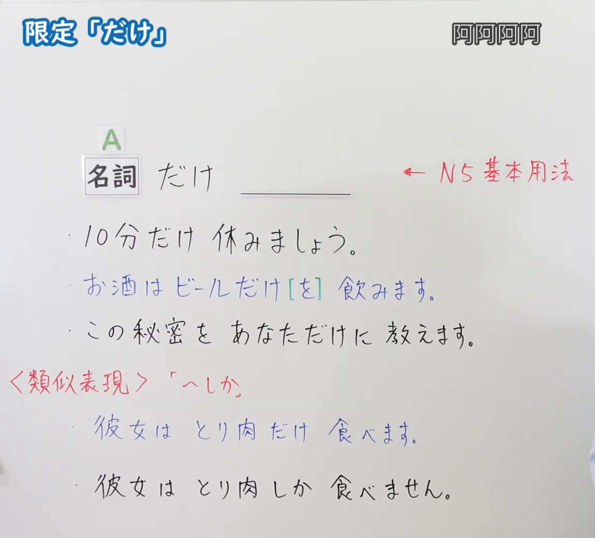
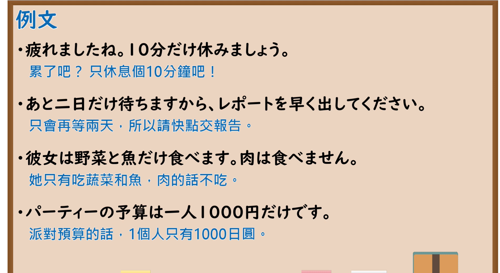

---
{
  "id": "N5-G-0059",
  "kind": "grammar",
  "level": "N5",
  "title": "助词：限定「だけ」",
  "card_revision": 2,
  "schema_version": 1,
  "source": {
    "lesson": "N5 第59个语法",
    "material": "出口日語原视频板书（学习者截取的接续图与例句图）与毎日のんびり日本語教師「【Ｎ５文法】～だけ」正文",
    "video": "https://www.youtube.com/watch?v=3-3ei75IbbA",
    "screenshot": "assets/grammar/n5/N5-G-0059-connection.png",
    "screenshot_crop": {
      "x": 0,
      "y": 0,
      "width": 1150,
      "height": 1040
    }
  },
  "tags": [
    "だけ",
    "助词",
    "限定",
    "N5"
  ],
  "confusions": [
    "だけ／しか",
    "だけ／のみ",
    "だけ＋を／に",
    "数量词＋だけ"
  ]
}
---

# N5 第59个语法：助词「だけ」（限定）

# 视频学习资料整理

- 课程：[出口日語「助詞：限定「だけ」」](https://www.youtube.com/watch?v=3-3ei75IbbA)
- 视频 ID：`3-3ei75IbbA`
- 视频时长：8分13秒

## 接续图

- 实际时间：未记录（图片由学习者从原视频截取并提供）
- 成品图尺寸：1150×1040，固定左上角 `(0, 0)`，右下角 `(1150, 1040)`
- 板书内容：标题「限定「だけ」」，右上标注被截为“阿阿阿阿”（疑为画面中字幕残留），不作转录；「名詞（A） だけ ＿＿」，右侧红字「N5基本用法」；例句：「10分だけ休みましょう。」「お酒はビールだけ[を]飲みます。」（蓝字，「を」绿框）「この秘密をあなただけに教えます。」；红字「＜類似表現＞「へしか」」，对比：「彼女はとり肉だけ食べます。」「彼女はとり肉しか食べません。」。板书完整，无遮挡。

## 例句图

- 实际时间：未记录（图片由学习者从原视频截取并提供）
- 成品图尺寸：1900×1040，固定左上角 `(0, 0)`，右下角 `(1900, 1040)`
- 板书内容：课程「例文」页，含四条例句及中文翻译（疲れましたね。10分だけ休みましょう／あと二日だけ待ちますから、レポートを早く出してください／彼女は野菜と魚だけ食べます。肉は食べません／パーティーの予算は一人1000円だけです）。四条例句均完整可见。

# 核心

## 功能一：只～；仅～（表示限定）

**くわしい意味記述：**

- **限定：** 限定を表します。主に客観的な表現に用いられます。そのため、時間や程度、範囲などの数量が少ないことに対する話者の不満のニュアンスはほとんどありません。（表示限定。主要用于客观表达，因此几乎没有说话人对时间、程度、范围等数量之少的不满的语气。）
- **「しか〜ない」との違い：** 主観的かつ数量が少ないことに対する不満を表すには「～しか～ない」を用いた方がいいです。（要表达主观的、对数量少的不满，用「～しか～ない」更合适。）

### 例句

1. 参加したい人だけ当日来てください。

   （想参加的人请当天来。）

2. 一つだけ質問してもいいですか。

   （我可以只问一个问题吗？）

3. 今日だけ全品半額です。

   （仅今天全部商品半价。）

4. 寝る前に１時間だけゲームしたい。

   （睡觉前只想玩一个小时的游戏。）

5. クラスの中で彼一人だけが異彩を放っていた。

   （班里只有他一个人格外出众。）

# 来源

- [出口日語原视频](https://www.youtube.com/watch?v=3-3ei75IbbA)
- [毎日のんびり日本語教師「【Ｎ５文法】～だけ」](https://mainichi-nonbiri.com/grammar/n5-dake/)（查询日期：2026-10-16；Hagoromo 未收录，故按流程采用优先级最高的备选网站条目；中文译文取自该页，第5例译文有改动）
