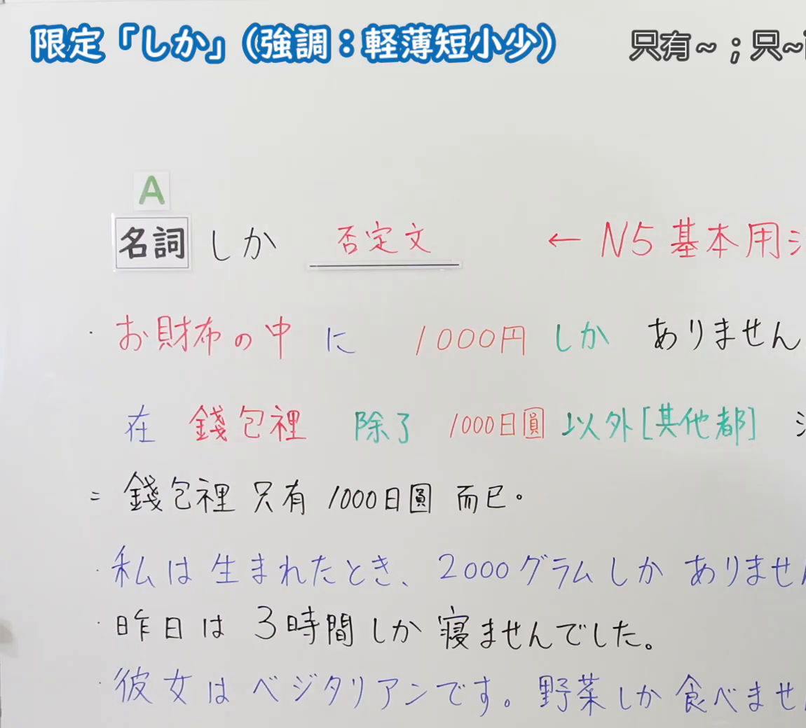
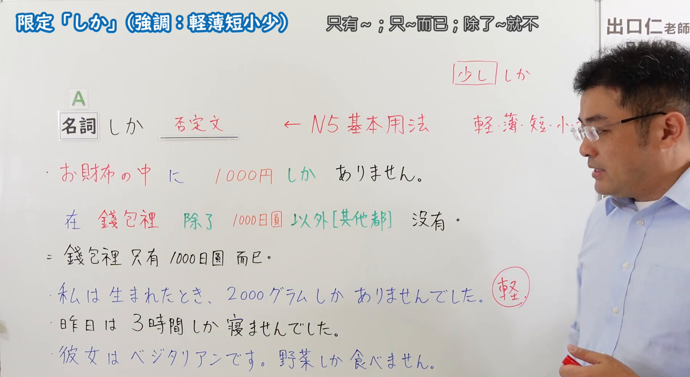

---
{
  "id": "N5-G-0060",
  "kind": "grammar",
  "level": "N5",
  "title": "助词：限定「しか」",
  "card_revision": 2,
  "schema_version": 1,
  "source": {
    "lesson": "N5 第60个语法",
    "material": "出口日語原视频板书（学习者截取的接续图与例句图）与日本語NET「【JLPT N4】文法・例文：〜しか〜ない」正文",
    "video": "https://www.youtube.com/watch?v=iphWzxJwPxE",
    "screenshot": "assets/grammar/n5/N5-G-0060-connection.png",
    "screenshot_crop": {
      "x": 0,
      "y": 0,
      "width": 1150,
      "height": 1040
    }
  },
  "tags": [
    "しか",
    "助词",
    "限定",
    "N5"
  ],
  "confusions": [
    "しか／だけ",
    "しか＋否定",
    "少しだけ／少ししか",
    "轻薄短小少"
  ]
}
---

# N5 第60个语法：助词「しか」（限定）

# 视频学习资料整理

- 课程：[出口日語「助詞：限定「しか」（強調：軽薄短小少）」](https://www.youtube.com/watch?v=iphWzxJwPxE)
- 视频 ID：`iphWzxJwPxE`
- 视频时长：6分30秒

## 接续图

- 实际时间：未记录（图片由学习者从原视频截取并提供）
- 成品图尺寸：1150×1040，固定左上角 `(0, 0)`，右下角 `(1150, 1040)`
- 板书内容：标题「限定「しか」（強調：軽薄短小少）」，右侧标注“只有～；只～而已；除了～就不…”（右端被画面右缘截断）；公式「名詞（A） しか ＿＿（否定文）」，红字「←N5基本用法」；红字例句「お財布の中に1000円しかありません。」，其下中文说明“在錢包裡 除了 1000日圓 以外[其他都] 沒有”（红、绿字）及“＝ 錢包裡 只有 1000日圓 而已。”；蓝字：「私は生まれたとき、2000グラムしかありませんでした。」「昨日は3時間しか寝ませんでした。」「彼女はベジタリアンです。野菜しか食べませ(ん)」，句末被画面右缘截断，未补写。

## 例句图

- 实际时间：未记录（图片由学习者从原视频截取并提供）
- 成品图尺寸：1900×1040，固定左上角 `(0, 0)`，右下角 `(1900, 1040)`
- 板书内容：（注：本课例句图是整张板书画面，不是「例文」页。）成品图尺寸含黑板全貌，老师入画，位于右侧，遮挡右上角部分标注。板书内容：在接续图内容之外，补充右上角框出的「少ししか」，右侧红字「軽・薄・短・小…」（被老师头部遮挡），以及「2000グラムしかありませんでした。」旁红圈标注“軽”；完整可见「彼女はベジタリアンです。野菜しか食べません。」。

# 核心

## 功能一：只有～；只～而已；除了～就不…

**くわしい意味記述：**

- **〜しか〜ない：** 期待していたよりも程度が低いと感じた時や、量が少ないと感じた時に使う表現。備考：動詞は常に否定の形をとる。（在感到程度比期待的低、或感到数量少时使用的表达。备注：动词始终采用否定形。）

### 例句

1. マークさんは日本に３年も留学したのに、ひらがなしか書けません。

   （马克明明在日本留学了三年，却只会写平假名。）

2. 昨日、忙しすぎて４時間しか寝られませんでした。

   （昨天太忙了，只睡了四个小时。）

3. 今、財布の中には５００円しかありません。

   （现在钱包里只有500日元。）

4. 昨日、３０分しか勉強できませんでした。

   （昨天只学习了30分钟。）

5. 夜は野菜しか食べないんです。

   （晚上只吃蔬菜。）

# 来源

- [出口日語原视频](https://www.youtube.com/watch?v=iphWzxJwPxE)
- [日本語NET「【JLPT N4】文法・例文：〜しか〜ない」](https://nihongokyoshi-net.com/2019/08/15/jlptn4-grammar-shika/)（查询日期：2026-10-16；Hagoromo 未收录，毎日のんびり日本語教師的 N5 条目中没有「しか」，按优先级采用日本語NET 该条目，该站将本语法归入 N4；该页只有英文翻译，中文译文为整理者所译；板书中的「軽薄短小少」强调用法该页未解说）
