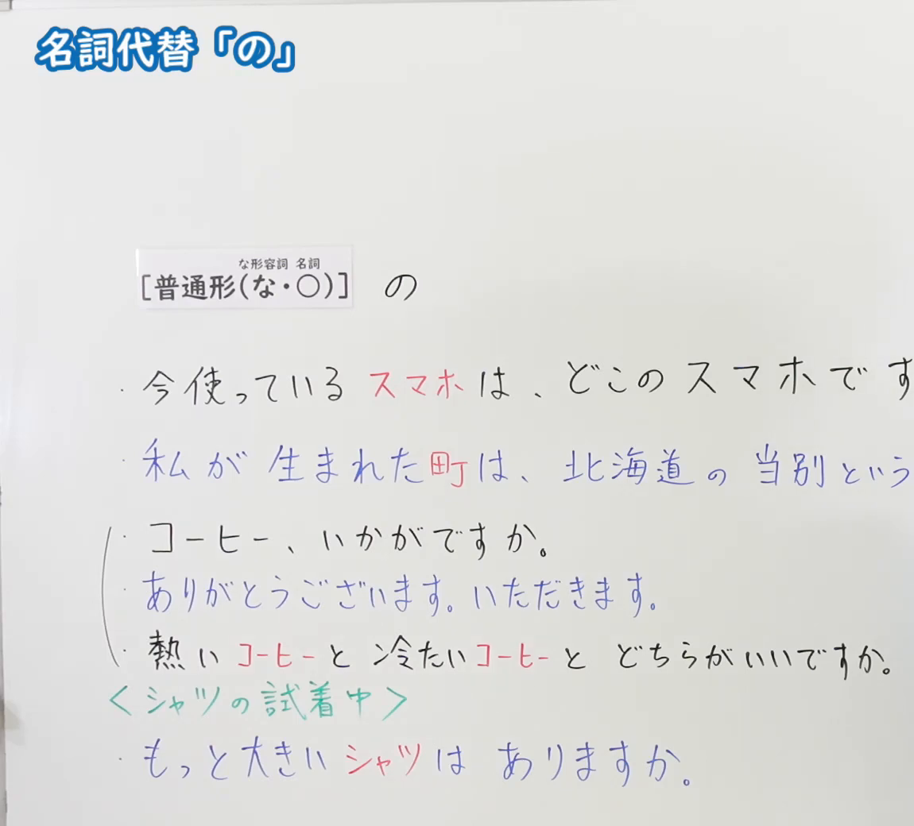
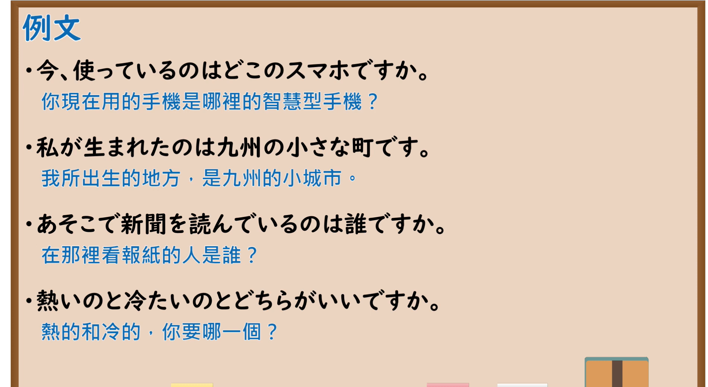

---
{
  "id": "N5-G-0061",
  "kind": "grammar",
  "level": "N5",
  "title": "名词代替「の」",
  "card_revision": 2,
  "schema_version": 1,
  "source": {
    "lesson": "N5 第61个语法",
    "material": "出口日語原视频板书（学习者截取的接续图与例句图）与东京外国语大学「NのN」「NAなN」解说正文",
    "video": "https://www.youtube.com/watch?v=y5cmsp1XBks",
    "screenshot": "assets/grammar/n5/N5-G-0061-connection.png",
    "screenshot_crop": {
      "x": 0,
      "y": 0,
      "width": 1150,
      "height": 1040
    }
  },
  "tags": [
    "の",
    "形式名词",
    "名词代替",
    "N5"
  ],
  "confusions": [
    "形式名词の／所有格の",
    "の／こと",
    "普通形＋の",
    "名词省略"
  ]
}
---

# N5 第61个语法：名词代替「の」

# 视频学习资料整理

- 课程：[出口日語「名詞代替「の」」](https://www.youtube.com/watch?v=y5cmsp1XBks)
- 视频 ID：`y5cmsp1XBks`
- 视频时长：6分22秒

## 接续图

- 实际时间：未记录（图片由学习者从原视频截取并提供）
- 成品图尺寸：1150×1040，固定左上角 `(0, 0)`，右下角 `(1150, 1040)`
- 板书内容：标题「名詞代替「の」」；公式「［普通形（な・○）］の」（な形容词接「な」、名词接「○」即不变，字小标注在方括号上方）；例句：「今使っているスマホは、どこのスマホです(か)」（「スマホ」红字）「私が生まれた町は、北海道の当別という(町です)」（「町」红字）「コーヒー、いかがですか。」「ありがとうございます。いただきます。」「熱いコーヒーと冷たいコーヒーとどちらがいいですか。」（「コーヒー」红字）；绿字「＜シャツの試着中＞」下「もっと大きいシャツはありますか。」（「シャツ」红字）。右侧部分例句句末被画面右缘截断，未补写。

## 例句图

- 实际时间：未记录（图片由学习者从原视频截取并提供）
- 成品图尺寸：1900×1040，固定左上角 `(0, 0)`，右下角 `(1900, 1040)`
- 板书内容：课程「例文」页，含四条例句及中文翻译（今、使っているのはどこのスマホですか／私が生まれたのは九州の小さな町です／あそこで新聞を読んでいるのは誰ですか／熱いのと冷たいのとどちらがいいですか）。四条例句均完整可见。

# 核心

## 功能一：用「の」代替前面已出现的名词

**くわしい意味記述：**

- **N1のN2のN2の省略：** N1がN2の所有者、種類を表わし、状況からN2が何であるかわかっているとき、N2は省略できます。（N1表示N2的所有者或种类，且根据情境能知道N2是什么时，可以省略N2。）
- **「Aい」「NAな」＋の：** 「Aい」「NAな」が修飾するNが何であるかわかっている場合は、Nの代わりに「の」を使うことができます。（「Aい」「NAな」所修饰的N是什么已经明确时，可以用「の」代替N。）

### 例句

1. A：これは誰のかばんですか。　B：わたしのです。

   （A：这是谁的包？　B：是我的。）

2. A：それはいつの新聞ですか。　B：きのうのです。

   （A：那是什么时候的报纸？　B：是昨天的。）

3. わたしのはどこにありますか。

   （我的在哪里？）

4. A：どの靴を買いますか。　B：黒いのを買います。

   （A：买哪双鞋？　B：买黑色的。）

5. A：どんな音楽がすきですか。　B：静かなのがすきです。

   （A：喜欢什么样的音乐？　B：喜欢安静的。）

# 来源

- [出口日語原视频](https://www.youtube.com/watch?v=y5cmsp1XBks)
- 东京外国语大学「日本語 文法」解说：[「NのN」](https://www.coelang.tufs.ac.jp/mt/ja/gmod/contents/explanation/008.html)、[「NAなN」](https://www.coelang.tufs.ac.jp/mt/ja/gmod/contents/explanation/010.html)（查询日期：2026-10-16；Hagoromo、毎日のんびり日本語教師、日本語NET 均未找到直接对应条目，按流程采用互联网检索所得的两页；这两页没有板书里“动词普通形＋の”把动作名词化（「使っているのは～」「生まれたのは～」）的解说，卡内未写；例句译文为整理者所译）
